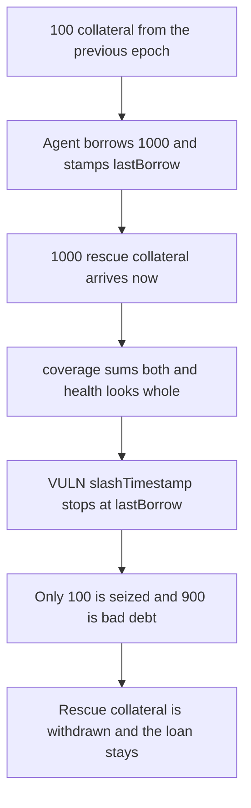

# CAP Labs: coverage counts collateral that slashTimestamp will not seize

> **Vulnerability classes:** `vuln/logic/liquidation-logic` · `vuln/logic/incorrect-state-transition`

<!-- non-defihacklabs -->
<!-- source-auditvault: https://github.com/Auditware/AuditVault/blob/main/findings/61537-discrepancy-between-health-calculation-and-slashable-collate.md -->
<!-- date: 2025-05 -->

## Key info

| Field | Value |
|---|---|
| **Loss** | Agent keeps 1000 borrowed USD. Liquidation seizes 100 collateral and books 900 of bad debt |
| **Vulnerable contract** | `NetworkMiddleware.slashTimestamp` |
| **Attacker EOA** | `0x1111111111111111111111111111111111111111` |
| **Attack contract** | `Exploit` |
| **Attack tx** | `Exploit.run()` |
| **Chain / block / date** | Ethereum model · block 0 · 2025-05 |
| **Compiler** | solc 0.8.27, cancun |
| **Bug class** | Health and slash use different timestamps |

## TL;DR

`coverage` sums every delegation at `block.timestamp`. `slashTimestamp` is `max(previous epoch, lastBorrow)`, and only strictly older deposits can be slashed. An agent with 100 of older collateral borrows 1000, then a friendly delegator posts 1000 in the same timestamp. Health reads 1100. Slashable collateral is still 100. Liquidation books 900 of bad debt, the fresh 1000 is withdrawn, and the borrower keeps the 1000 USD.

## Background

Trail of Bits' May 2025 review of the CAP Labs Covered Agent Protocol, by Benjamin Samuels. Figure 14.1 is `slashTimestamp` in `Delegation.sol`. Figure 14.2 is `coverage` in the Symbiotic `NetworkMiddleware`, which passes `block.timestamp` into every vault. The epoch length in this reduction is one second so a previous-epoch deposit and a same-timestamp rescue deposit can both be created in one transaction. The cutoff formula is the audited one.

## The vulnerable code

```solidity
function slashTimestamp(address _agent) public view returns (uint48 _slashTimestamp) {
    DelegationStorage storage $ = _storage;
    _slashTimestamp = uint48(Math.max((epoch() - 1) * $.epochDuration, $.agentData[_agent].lastBorrow)); // @> VULN: cutoff ignores collateral that coverage() still counts
}
```

`coverage` sets `_timestamp` to `block.timestamp` and adds every delegation at or before that time. `slashableCollateral` adds only delegations with `timestamp < slashTimestamp`.

## Root cause

The number that makes the position look healthy is not the number liquidation can take. A deposit at `lastBorrow` improves `coverage` and is excluded from slashing. After the risk passes, that depositor withdraws.

## Preconditions

- Epoch length is one second. One delegation of 100 is timestamped at `block.timestamp - 1`.
- The agent borrows 1000, which sets `lastBorrow` to `block.timestamp`.
- A second delegation of 1000 is timestamped at `block.timestamp`.

## Attack walkthrough

1. Delegate 100 from the previous epoch.
2. Borrow 1000 USD. `lastBorrow` becomes now.
3. Delegate 1000 at the current timestamp.
4. `coverage` returns 1100, which covers the debt.
5. `slashableCollateral` returns 100.
6. `liquidate` seizes 100, stores bad debt of 900, and `withdrawUnslashable` returns the 1000. The agent still holds the borrowed 1000 USD.

## Diagrams



## Impact

Lenders are short 900 USD. The rescue delegator gets the 1000 collateral back. The borrowing agent keeps the 1000 USD that the fresh collateral appeared to secure. If every delegation were from the current epoch, the slash amount would be zero and the protocol would absorb the whole debt, which is the extreme case in the report.

## Remediation

Slash every delegation that `coverage` counts, regardless of epoch. A bonding delay should also stop collateral from being withdrawn while it is supporting a borrow.

## How to reproduce

```bash
cd 61537-discrepancy-between-health-calculation-and-slashable-collate_exp
forge test -vv
```

`test_rescue_deposit_is_not_slashable` asserts coverage 1100, slashable 100, bad debt 900, a 1000 USD loan balance, and 1000 collateral returned. Captured output is `output.txt`.

## Sources

- AuditVault finding: https://github.com/Auditware/AuditVault/blob/main/findings/61537-discrepancy-between-health-calculation-and-slashable-collate.md
- Report: https://github.com/trailofbits/publications/blob/master/reviews/2025-05-caplabs-coveredagentprotocol-securityreview.pdf
- Blamed lines: `contracts/delegation/Delegation.sol` `slashTimestamp`, and `contracts/delegation/providers/symbiotic/NetworkMiddleware.sol` `coverage`, as cited in the review.
