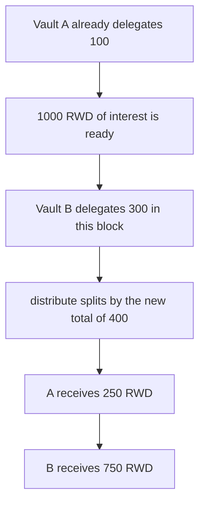

# CAP Labs — a same-block delegation takes 750 of 1000 RWD

> **Vulnerability classes:** vuln/logic/reward-calculation · vuln/logic/missing-check

> **Reproduction:** a self-contained Foundry PoC that compiles and runs offline
> with only `forge-std` — no fork and no RPC. Trace: [output.txt](output.txt).
> PoC: [test/61538-reward-distribution-enables-front-running-attacks-and-reward_exp.sol](test/61538-reward-distribution-enables-front-running-attacks-and-reward_exp.sol).

<!-- non-defihacklabs -->
<!-- source-auditvault: https://github.com/Auditware/AuditVault/blob/main/findings/61538-reward-distribution-enables-front-running-attacks-and-reward.md -->
<!-- date: 2025-05 -->

---

## Key info

| | |
|---|---|
| **Impact** | **HIGH** — vault B delegates in the repayment block and takes **750 of 1000 RWD** from vault A |
| **Protocol** | CAP Labs `Delegation` |
| **Vulnerable code** | `distribute` pays `pot * delegated[vault] / total` with no time weight |
| **Bug class** | Reward share ignores how long the stake has been delegated |
| **Finding** | Trail of Bits (Benjamin Samuels) — CAP Labs, May 2025 · id 61538 |
| **Report** | [Trail of Bits CAP Labs review](https://github.com/trailofbits/publications/blob/master/reviews/2025-05-caplabs-coveredagentprotocol-securityreview.pdf) |
| **Source** | [AuditVault finding](https://github.com/Auditware/AuditVault/blob/main/findings/61538-reward-distribution-enables-front-running-attacks-and-reward.md) |
| **Status** | Reproduced as a local delegation pot. |
| **Compiler** | solc 0.8.27, cancun, via IR |

---

## TL;DR

Vault A already delegates **100** behind an agent. The repayment interest, **1000 RWD**, sits on the delegation contract.

Vault B delegates **300** and calls `distribute` in the same transaction. The pot is split by current delegation: A receives **250 RWD** and B receives **750 RWD**. B provided none of the backing before this block.

The control locks eligibility after A's deposit. B's later delegation is ignored. A receives the full **1000 RWD** and B receives **0**.

## The vulnerable code

```solidity
// @> VULN: the share uses delegation at distribute time, including this block
uint256 pay = pot * delegated[vault] / base;
if (pay != 0) reward.transfer(vault, pay);
```

## Preconditions

- Vault A is already delegated for **100**.
- **1000 RWD** of interest is ready to distribute.
- Vault B can delegate before `distribute` in the same block. No warp is required.

## Attack walkthrough

1. Vault B delegates **300**. Total delegation becomes **400**.
2. `distribute` reads the **1000 RWD** balance.
3. A is paid `1000 * 100 / 400 = 250`.
4. B is paid `1000 * 300 / 400 = 750`.

Control: eligibility is frozen at A's **100** before B delegates. `distributeTo(A)` transfers **1000 RWD**. B's balance stays 0.

## Diagrams



## Impact

Vault A, the existing backer, receives **250 RWD** instead of the **1000 RWD** interest. Vault B takes the other **750 RWD** without having backed the loan before the repayment.

## Remediation

Exclude collateral delegated in the current epoch from the distribution, or pay from a checkpoint of delegation taken before the repayment.

## Sources

- [AuditVault finding 61538](https://github.com/Auditware/AuditVault/blob/main/findings/61538-reward-distribution-enables-front-running-attacks-and-reward.md)
- [Trail of Bits CAP Labs review, May 2025](https://github.com/trailofbits/publications/blob/master/reviews/2025-05-caplabs-coveredagentprotocol-securityreview.pdf)

### Taxonomy

- `severity/high`
- `vuln/logic/reward-calculation` · `vuln/logic/missing-check`
