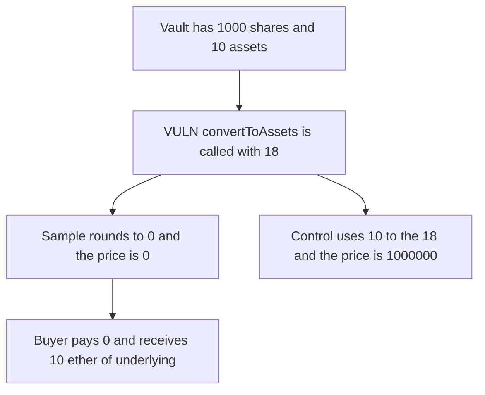

# StakedCapAdapter prices a 10 ether vault at zero and the assets are taken for free

> **Vulnerability classes:** `vuln/arithmetic/decimal-mismatch` · `vuln/logic/price-calculation`

<!-- non-defihacklabs -->
<!-- source-auditvault: https://github.com/Auditware/AuditVault/blob/main/findings/61540-wrong-captokendecimals-value-used-in-stakedcapadapterprice-c.md -->
<!-- date: 2025-05 -->

## Key info

| Field | Value |
|---|---|
| **Loss** | 10 ether of underlying, bought at a reported price of 0 |
| **Vulnerable contract** | `StakedCapAdapter.price` |
| **Attacker EOA** | `0x1111111111111111111111111111111111111111` |
| **Attack contract** | `Exploit` |
| **Attack tx** | `Exploit.run()` |
| **Chain / block / date** | Ethereum model · block 0 · 2025-05 |
| **Compiler** | solc 0.8.27, cancun, via IR |
| **Bug class** | Decimal count used as the share amount |

## TL;DR

The vault has 1000 ether shares and 10 ether of assets, so one full share is worth 0.01 underlying. `price` passes `decimals()` (18) into `convertToAssets` and divides by 18. `convertToAssets(18)` rounds to 0, the adapter returns 0, and the buyer pays 0 for the shares and redeems all 10 ether. `priceFixed` uses `10 ** decimals` and returns 1000000, which is the 8-decimal price of 0.01.

## Background

Trail of Bits' May 2025 review of CAP Labs' Covered Agent Protocol. The quoted `StakedCapAdapter.price` stores `IERC20Metadata(capToken).decimals()` and passes that integer to `convertToAssets`, then divides by it. Current cap-contracts uses `10 ** decimals` in that slot. The two mistakes cancel on a perfectly linear sample and diverge when `convertToAssets(18)` rounds to 0, which is this vault.

## The vulnerable code

```solidity
uint256 capTokenDecimals = ERC20Min(capToken).decimals(); // @> VULN: 18, not 10**18
// FIX: capTokenDecimals = 10 ** ERC20Min(capToken).decimals()
uint256 pricePerFullShare = StakedVault(asset_).convertToAssets(capTokenDecimals);
latestAnswer = latestAnswer * pricePerFullShare / capTokenDecimals;
```

The change that removes the harm:

```diff
- uint256 capTokenDecimals = ERC20Min(capToken).decimals();
+ uint256 capTokenDecimals = 10 ** uint256(ERC20Min(capToken).decimals());
```

## Root cause

`convertToAssets` is `shares * totalAssets / totalSupply`. Eighteen wei of shares against 1000 ether of supply is zero assets. The following division by 18 cannot recover the ratio. Sampling `10 ** 18` shares returns 0.01 ether of assets per share.

## Preconditions

- Underlying price from the oracle is 1e8.
- The vault's own share balance is 1000 ether and it holds 10 ether of underlying.
- The sale charges `shares * price / 1e8`.

## Attack walkthrough

1. `price` loads decimals 18.
2. `convertToAssets(18)` is 0 and the returned price is 0.
3. `priceFixed` returns 1000000.
4. `buy` at price 0 transfers 10 ether of underlying to the buyer and records a payment of 0.

## Diagrams



## Impact

The buyer receives 10 ether of underlying without paying. A price of 1000000 would have charged for the 0.01 underlying per share.

## Remediation

Set `capTokenDecimals` to `10 ** decimals` before both `convertToAssets` and the division, which is the formula in the current `StakedCapAdapter`.

## How to reproduce

```bash
cd 61540-wrong-captokendecimals-value-used-in-stakedcapadapterprice-c_exp
forge test -vv
```

`test_exploit` is the harm. The control test is the guarded path. Captured output is `output.txt`.

## Sources

- AuditVault finding: https://github.com/Auditware/AuditVault/blob/main/findings/61540-wrong-captokendecimals-value-used-in-stakedcapadapterprice-c.md
- Trail of Bits review: https://github.com/trailofbits/publications/blob/master/reviews/2025-05-caplabs-coveredagentprotocol-securityreview.pdf
- Fixed source: https://github.com/cap-labs-dev/cap-contracts/blob/main/contracts/oracle/libraries/StakedCapAdapter.sol
