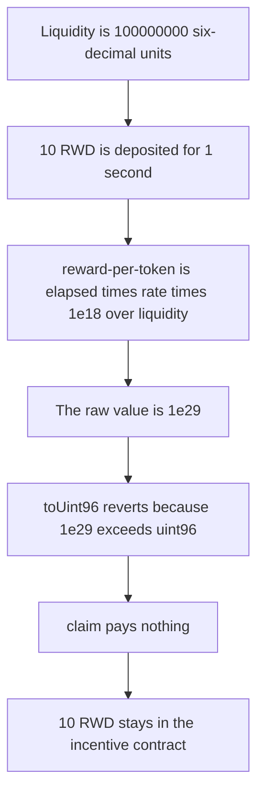

# Paladin Valkyrie — uint96 reward-per-token downcast locks the rewards

> **Vulnerability classes:** vuln/arithmetic/overflow · vuln/dos/frozen-funds

<!-- non-defihacklabs -->
<!-- source-auditvault: https://github.com/Auditware/AuditVault/blob/main/findings/61553-reward-tokens-can-become-inaccessible-due-to-revert-when-rew.md -->
<!-- date: 2025-03 -->

## Key info

| Field | Value |
|---|---|
| **Loss** | 10 ether of reward tokens stay in the incentive contract. The LP receives 0 |
| **Vulnerable contract** | `IncentiveLogic._updateRewardState` |
| **Attacker EOA** | `0x1111111111111111111111111111111111111111` |
| **Attack contract** | `Exploit` |
| **Attack tx** | `Exploit.run()` |
| **Chain / block / date** | Ethereum model · block 0 · 2025-03 |
| **Compiler** | solc 0.8.27, cancun, via IR |
| **Bug class** | Scaled reward-per-token does not fit in uint96 |

## TL;DR

`_newRewardPerToken` returns `elapsed * ratePerSec * 1e18 / totalLiquidity`. With 6-decimal liquidity of 100000000 and an 18-decimal reward, that value is `rewardDecimals + 18 - liquidityDecimals` and does not fit in `uint96`. `_updateRewardState` does `toUint96()` before storing it, so `claim` reverts. 10 ether deposited for a 1-second window (the block timestamp is already 1, and `lastUpdateTime` is 0) produces a raw accumulator of 1e29. The claim reverts and the 10 ether stay in the contract. The same formula stored in `uint256` pays the LP 10 ether.

## Background

Cyfrin reviewed Paladin Valkyrie on 2025-03-12. `BaseIncentiveLogic._updateRewardState` assigns `_newRewardPerToken()` to `rewardPerTokenStored` through a checked cast to `uint96`. The report's case is a Uniswap v4 full-range pool whose liquidity is denominated in a 6-decimal token, paired with an 18-decimal reward. `claim` calls the update, so the overflow locks every reward token.

## The vulnerable code

```solidity
function _newRewardPerToken() public view returns (uint256) {
    uint256 lastUpdateTimeApplicable =
        block.timestamp < _state.endTimestamp ? block.timestamp : _state.endTimestamp;
    return _state.rewardPerTokenStored
        + ((((lastUpdateTimeApplicable - _state.lastUpdateTime) * _state.ratePerSec) * UNIT) / _totalSupply);
}

function _updateRewardState() internal {
    // @> VULN: rewardPerTokenStored is downcast to uint96 and the scaled value overflows
    uint96 newRewardPerToken = _newRewardPerToken().toUint96();
    reward.rewardPerTokenStored = newRewardPerToken;
}
```

```diff
-    uint96 newRewardPerToken = _newRewardPerToken().toUint96();
+    uint256 newRewardPerToken = _newRewardPerToken();
```

## Root cause

`UNIT` is 1e18. Dividing by 6-decimal liquidity (`100 * 10^6`) instead of an 18-decimal supply multiplies the accumulator by `10^12` relative to the reward token. `10 ether * 1e18 / 1e8 = 1e29`. `type(uint96).max` is about `7.92e28`. The checked cast reverts, and because the cast sits on the claim path the tokens cannot be transferred.

## Preconditions

- `totalLiquidity` is 100000000, the 6-decimal figure from the report.
- The reward token has 18 decimals. 10 ether is deposited with `duration = 1`, `lastUpdateTime = 0`, and `endTimestamp = 1`.
- The block timestamp is 1, so the applicable elapsed time is 1 second. No timestamp change is required.
- The sole LP's liquidity equals `totalLiquidity`, so a successful claim would pay the entire deposit.

## Attack walkthrough

1. Liquidity is set to 100000000.
2. 10 ether of RWD is deposited. `ratePerSec` is 10 ether.
3. `_newRewardPerToken` returns 1e29, which is greater than `uint96` max.
4. `claim` calls `toUint96` and reverts.
5. The logic contract still holds 10 ether. The LP holds 0. `updated` is still false.

## Diagrams



## Impact

The LP cannot claim. 10 ether of reward tokens remain in the contract. The control stores the same 1e29 accumulator in `uint256` and transfers 10 ether to the LP.

## PoC

```bash
cd 61553-reward-tokens-can-become-inaccessible-due-to-revert-when-rew_exp
forge test -vv
```

`test_exploit_uint96_downcast_locks_rewards` asserts the claim reverted, the raw value exceeds `uint96`, and the contract balance is 10 ether. `test_control_uint256_pays_the_rewards` asserts the LP receives 10 ether.

## Sources

- AuditVault finding: https://github.com/Auditware/AuditVault/blob/main/findings/61553-reward-tokens-can-become-inaccessible-due-to-revert-when-rew.md
- Cyfrin report: https://github.com/solodit/solodit_content/blob/main/reports/Cyfrin/2025-03-12-cyfrin-paladin-valkyrie-v2.0.md
- Fix commit noted by the report: `6bb56b53e885734b389274b8a8d0419db39de514` on PaladinFinance/Valkyrie
