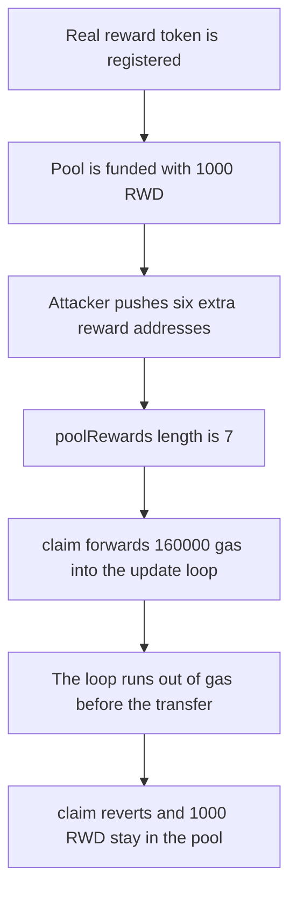

# Paladin Valkyrie — uncapped poolRewards array makes claim run out of gas

> **Vulnerability classes:** vuln/dos/unbounded-loop · vuln/dos/frozen-funds

<!-- non-defihacklabs -->
<!-- source-auditvault: https://github.com/Auditware/AuditVault/blob/main/findings/61554-poolrewards-arrays-can-grow-without-bounds-resulting-in-dos.md -->
<!-- date: 2025-03 -->

## Key info

| Field | Value |
|---|---|
| **Loss** | 1,000 ether of reward tokens stay in the pool. The LP's claim reverts and pays 0 |
| **Vulnerable contract** | `PoolRewards._updateAllUserState` |
| **Attacker EOA** | `0x1111111111111111111111111111111111111111` |
| **Attack contract** | `Exploit` |
| **Attack tx** | `Exploit.run()` |
| **Chain / block / date** | Ethereum model · block 0 · 2025-03 |
| **Compiler** | solc 0.8.27, cancun, via IR |
| **Bug class** | Permissionless push into an array that claim loops |

## TL;DR

`addReward` pushes any address onto `poolRewards`. `claim` loops that array and updates storage for every entry. A balance-change notification forwards 160000 gas, which is enough for the one real reward and not enough for six extra entries. The inner call runs out of gas, `claim` reverts, and 1,000 RWD stay in the pool. Capping the array at one token rejects the second push, and the same 160000 gas stipend pays the LP the 1,000 RWD.

## Background

Cyfrin reviewed Paladin Valkyrie on 2025-03-12. Reward distribution is permissionless, so `poolRewards[id]` can grow without a bound. `_updateAllUserState` walks the whole array and is used by `claim` and by `notifyBalanceChange` / `notifyTransfer`. Those notifications are what Uniswap hooks call. A long array makes the notification run out of gas, which reverts the hook and blocks the claim. This reduction uses six spam entries, not thousands, and a 160000 gas stipend standing in for the gas a notifier forwards. The loop itself is the quoted one.

## The vulnerable code

```solidity
function _updateAllUserState(address account) internal {
    address[] memory _tokens = poolRewards;
    uint256 _length = _tokens.length;
    // @> VULN: poolRewards has no cap, so this loop exhausts the notifier's gas
    for (uint256 i; i < _length; i++) {
        _updateRewardState(_tokens[i], account);
    }
}
```

```diff
 function addReward(address rewardToken) external {
+    if (poolRewards.length >= CAP) revert RewardCap(CAP);
     poolRewards.push(rewardToken);
 }
```

## Root cause

The array is append-only and permissionless. Every claim and every transfer notification iterates it and writes three storage slots per entry. Gas therefore grows with the number of spam tokens. Once that cost exceeds the gas the caller forwards, the call reverts and the reward balance cannot be transferred.

## Preconditions

- One real reward token is registered and the pool holds 1,000 RWD.
- The attacker pushes six further addresses. No token deployment is required, because each iteration only writes storage keyed by the address.
- `claim` forwards `HOOK_GAS = 160000` into the loop. That budget pays a single-token claim and reverts on seven entries.

## Attack walkthrough

1. The real reward token is pushed and 1,000 RWD are transferred to the pool.
2. The attacker pushes addresses `1` through `6`. `rewardCount` is 7.
3. `claim` calls the inner loop with 160000 gas.
4. The loop starts updating every entry and runs out of gas before the transfer.
5. The outer claim reverts. The pool still holds 1,000 RWD. The LP holds 0.

## Diagrams



## Impact

The LP cannot claim. 1,000 RWD remain in the pool after the reverting call. With the array capped at one token, the attacker's second `addReward` reverts and `claim` transfers the 1,000 RWD to the LP.

## PoC

```bash
cd 61554-poolrewards-arrays-can-grow-without-bounds-resulting-in-dos_exp
forge test -vv
```

`test_exploit_six_spam_rewards_revert_claim` asserts seven entries, a reverted claim, and a pool balance of 1,000 ether. `test_control_cap_lets_claim_pay` asserts the second push reverts with `RewardCap(1)` and the LP receives 1,000 ether.

## Sources

- AuditVault finding: https://github.com/Auditware/AuditVault/blob/main/findings/61554-poolrewards-arrays-can-grow-without-bounds-resulting-in-dos.md
- Cyfrin report: https://github.com/solodit/solodit_content/blob/main/reports/Cyfrin/2025-03-12-cyfrin-paladin-valkyrie-v2.0.md
- Fix noted by the report: reward-token allowlist in commit `b95ae97a67eca4e1e33cafc636ae3d3d3c1af088` on PaladinFinance/Valkyrie
