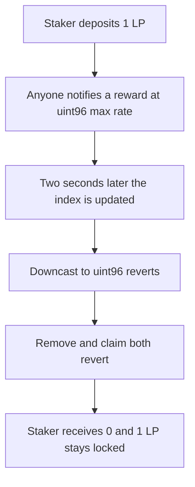

# Valkyrie — a permissionless reward notify locks staked LP

> **Vulnerability classes:** vuln/arithmetic/overflow · vuln/dos/frozen-funds · vuln/access-control/missing-auth

> **Reproduction:** a self-contained Foundry PoC that compiles and runs offline
> with only `forge-std` — no fork and no RPC. Trace: [output.txt](output.txt).
> PoC: [test/61555-permissionless-reward-distribution-can-be-abused-to-cause-fu_exp.sol](test/61555-permissionless-reward-distribution-can-be-abused-to-cause-fu_exp.sol).

<!-- non-defihacklabs -->
<!-- source-auditvault: https://github.com/Auditware/AuditVault/blob/main/findings/61555-permissionless-reward-distribution-can-be-abused-to-cause-fu.md -->
<!-- date: 2025-03 -->

---

## Key info

| | |
|---|---|
| **Impact** | **HIGH** — the staker receives **0 of 1 LP**. Claim and remove both revert, so the 1 LP stays in the incentive logic |
| **Protocol** | Paladin Valkyrie incentive logic |
| **Vulnerable code** | `_updateRewardState` downcasts `_newRewardPerToken()` to `uint96` |
| **Bug class** | Permissionless `depositRewards` sets `ratePerSec` to `uint96` max, then the index update reverts |
| **Finding** | Cyfrin (Draiakoo) — Paladin Valkyrie, 12 March 2025 · id 61555 |
| **Report** | [2025-03-12-cyfrin-paladin-valkyrie-v2.0.md](https://github.com/solodit/solodit_content/blob/main/reports/Cyfrin/2025-03-12-cyfrin-paladin-valkyrie-v2.0.md) |
| **Source** | [AuditVault finding](https://github.com/Auditware/AuditVault/blob/main/findings/61555-permissionless-reward-distribution-can-be-abused-to-cause-fu.md) |
| **Status** | Fixed in Valkyrie commit `b95ae97` (reward-token allowlist). Reproduced here as a local synthetic. |
| **Compiler** | solc 0.8.27, cancun, via IR |

---

## TL;DR

`depositRewards` has no caller check and no reward-token allowlist. A notifier deposits `type(uint96).max * 1 weeks`, which stores `ratePerSec = type(uint96).max`.

The index added on the next update is

```text
((now - lastUpdateTime) * ratePerSec * UNIT) / totalLiquidity
```

With `UNIT` and the stake both equal to 1 LP, two seconds of accrual equal `2 * uint96 max`. The downcast to `uint96` reverts. `removeLiquidity` and `claim` both take that path, so the staker cannot exit and is paid nothing.

`nowTs` replaces `block.timestamp` because the playground keeps one timestamp for the whole replay. The two-second gap is `advance(2)`, the same gap as the report's `skip(2)`.

## The vulnerable code

Pre-fix body of the index update, reduced to one pool and one reward token:

```solidity
function _updateRewardState(address account) internal {
    // @> VULN: permissionless uint96-max rate makes this downcast revert and brick the pool
    uint96 newRewardPerToken = toUint96(_newRewardPerToken());
    rewardData.rewardPerTokenStored = newRewardPerToken;
}

function _newRewardPerToken() internal view returns (uint256) {
    uint256 _totalSupply = totalLiquidity;
    RewardData memory _state = rewardData;
    if (_totalSupply == 0) return _state.rewardPerTokenStored;
    uint256 lastUpdateTimeApplicable = nowTs < _state.endTimestamp ? nowTs : _state.endTimestamp;
    return _state.rewardPerTokenStored
        + ((((lastUpdateTimeApplicable - _state.lastUpdateTime) * _state.ratePerSec) * UNIT) / _totalSupply);
}
```

The fixed logic rejects `depositRewards` unless `msg.sender` is the reward admin, and it caps the duration at 4 weeks.

## Root cause

The stored reward index is a `uint96`, but the per-second rate is chosen by whoever calls `depositRewards`. A rate of `uint96` max overflows that index as soon as the position has accrued for more than one second at 1 LP of liquidity. Every later update reverts, including the update inside remove and claim.

## Preconditions

- A staker has already deposited **1 LP**.
- `depositRewards` is callable by anyone, with any reward token.
- The notified amount is `type(uint96).max * 1 weeks` and the duration is 1 week, so the rate is exactly `type(uint96).max`.
- At least two seconds pass before the staker updates. Here that is `advance(2)`.

## Attack walkthrough

1. Mint **1 LP** to the staker and stake it. The logic contract holds **1 LP**.
2. Mint `type(uint96).max * 1 weeks` of a worthless reward token and call `depositRewards` for 1 week.
3. Read `ratePerSec`. It is `type(uint96).max`.
4. Advance `nowTs` by 2 seconds.
5. `removeLiquidity(1 LP)` updates the index, the `uint96` downcast reverts, and the LP is not transferred.
6. `claim` hits the same downcast and reverts. The staker's LP balance is **0**. The logic contract still holds **1 LP**.

Control: `depositRewards` requires the reward admin and a duration of at most 4 weeks. The same max-rate notify from a non-admin reverts. The staker then withdraws **1 LP** and the logic contract's LP balance is 0.

## Diagrams



## Impact

The staker cannot remove liquidity and cannot claim. They receive **0 of 1 LP**, and that 1 LP remains in the incentive logic. The same revert blocks every later reward update on the pool.

## Remediation

Restrict `depositRewards` to an allowlisted reward token or an allowlisted caller, which is what Valkyrie shipped in commit `b95ae97`. A duration cap alone also stops this particular rate, but the report's fix is the allowlist.

## Sources

- [AuditVault finding 61555](https://github.com/Auditware/AuditVault/blob/main/findings/61555-permissionless-reward-distribution-can-be-abused-to-cause-fu.md)
- [Cyfrin Paladin Valkyrie report, 12 March 2025](https://github.com/solodit/solodit_content/blob/main/reports/Cyfrin/2025-03-12-cyfrin-paladin-valkyrie-v2.0.md)
- Fix: [Valkyrie@b95ae97](https://github.com/PaladinFinance/Valkyrie/pull/5/commits/b95ae97a67eca4e1e33cafc636ae3d3d3c1af088)

### Taxonomy

- `severity/high`
- `vuln/arithmetic/overflow` · `vuln/dos/frozen-funds` · `vuln/access-control/missing-auth`
