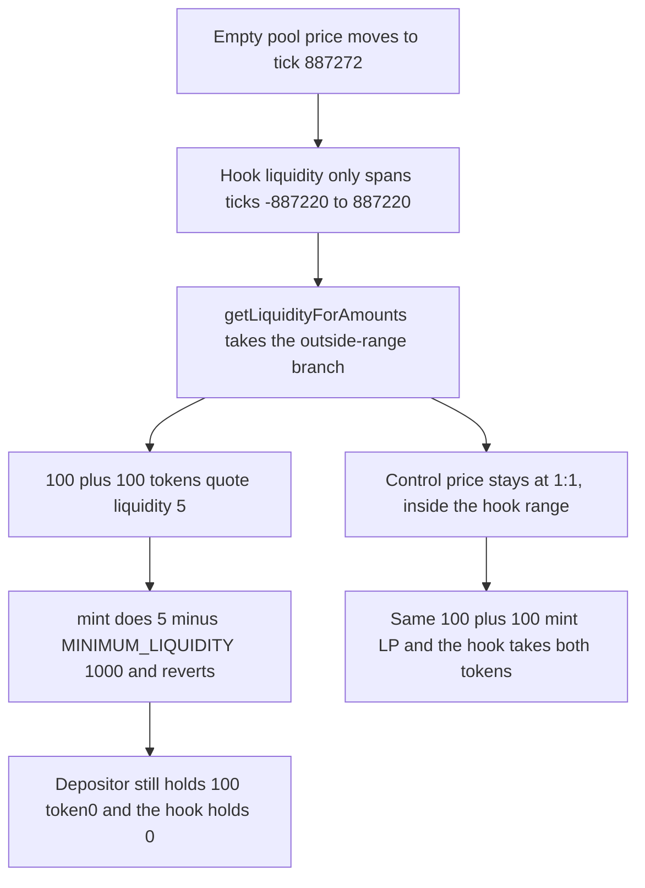

# Paladin Valkyrie: a price outside the FullRangeHook ticks makes the first mint revert

> **Vulnerability classes:** vuln/oracle/price-manipulation · vuln/logic/price-calculation · vuln/dos/init-constraint

<!-- non-defihacklabs -->
<!-- source-auditvault: https://github.com/Auditware/AuditVault/blob/main/findings/61556-manipulation-of-price-outside-of-the-fullrangehook-liquidity.md -->
<!-- date: 2025-03 -->

## Key info

| Field | Value |
|---|---|
| **Loss** | First mint of 100 + 100 tokens reverts. Both balances stay put. In-range control mints LP and the hook takes the 100 |
| **Vulnerable contract** | `FullRangeHook.mint` / `LiquidityAmounts.getLiquidityForAmounts` |
| **Attacker EOA** | `0x1111111111111111111111111111111111111111` |
| **Attack contract** | `Exploit` |
| **Attack tx** | `Exploit.run()` |
| **Chain / block / date** | Ethereum model · block 0 · 2025-03 |
| **Compiler** | solc 0.8.27, cancun, via IR |
| **Bug class** | Hook ticks stop at ±887220 while the pool price can reach tick 887272 |

## TL;DR

`FullRangeHook` treats ticks -887220 and 887220 as the full range. Uniswap V4's `TickMath` goes to ±887272. After the price is moved to tick 887272, `getLiquidityForAmounts` takes the outside-range branch and quotes liquidity 5 for a 100 + 100 deposit. The first mint does `liquidity - MINIMUM_LIQUIDITY` with `MINIMUM_LIQUIDITY = 1000`, underflows, and reverts. The 100 tokens stay with the depositor and the pool never receives its first liquidity. The same deposit at the 1:1 price, inside the hook range, mints LP tokens and the hook takes both amounts.

## Background

Cyfrin reviewed Paladin Valkyrie (report 2025-03-12). Pools that use `FullRangeHook` are supposed to stay inside one full-range position so every swap and every mint hits the in-range arm of `getLiquidityForAmounts`. The hook's tick constants are the multiples of spacing 60 nearest the Uniswap bounds, not the bounds themselves. An empty pool can be swapped to the protocol max tick before any liquidity is added. The report's own log for 100e18 + 100e18 is liquidity `100000000000000000005` in range and `5` at the max tick.

## The vulnerable code

Hook bounds, copied from the report:

```solidity
/// @dev Min tick for full range with tick spacing of 60
int24 internal constant MIN_TICK = -887220;
/// @dev Max tick for full range with tick spacing of 60
int24 internal constant MAX_TICK = -MIN_TICK;
```

`TickMath.MIN_TICK` is -887272 and `TickMath.MAX_TICK` is 887272. The liquidity function the report quotes then leaves the middle branch:

```solidity
if (sqrtRatioX96 <= sqrtRatioAX96) {
    liquidity = getLiquidityForAmount0(sqrtRatioAX96, sqrtRatioBX96, amount0);
} else if (sqrtRatioX96 < sqrtRatioBX96) {
    uint128 liquidity0 = getLiquidityForAmount0(sqrtRatioX96, sqrtRatioBX96, amount0);
    uint128 liquidity1 = getLiquidityForAmount1(sqrtRatioAX96, sqrtRatioX96, amount1);
    liquidity = liquidity0 < liquidity1 ? liquidity0 : liquidity1;
} else {
    liquidity = getLiquidityForAmount1(sqrtRatioAX96, sqrtRatioBX96, amount1);
}
```

The first depositor still subtracts the minimum:

```solidity
uint256 raw = uint256(liquidity);
// @> VULN: outside -887220..887220 the quote is 5, so the first mint cannot subtract MINIMUM_LIQUIDITY
if (raw < MINIMUM_LIQUIDITY) revert MintUnderflow(raw);
liquidityMinted = raw - MINIMUM_LIQUIDITY;
```

## Root cause

The position that is supposed to cover every reachable price does not. Tick 887272 is a legal `slot0` value and it is greater than 887220, so `sqrtPrice` is above `sqrtRatioB` and only `amount1` is converted across the hook's range. That quotient is 5 wei of liquidity for 100 tokens. `1000` cannot be subtracted from 5. For a 6-decimal token the report notes the minimum cannot be reached at all, so the pool stays permanently unseeded. This reduction shows the 18-decimal case from the report's log: the mint reverts and the 100 tokens never move.

## Preconditions

- The pool has no liquidity yet, so a swap can set `slot0` to `getSqrtPriceAtTick(887272)` without crossing a position. The synthetic writes that sqrt price directly; the quote and the mint use the real formulas.
- `MINIMUM_LIQUIDITY` is 1000, as in the report (`1e3`).
- The deposit is 100e18 of each token, the amount in the report's first log.

## Attack walkthrough

1. The depositor receives 100 token0 and 100 token1 and approves the hook.
2. The price is set to `TickMath.getSqrtPriceAtTick(887272)`.
3. `quote` returns 5. That is below 1000.
4. `mint` transfers would pull both amounts, then computes `5 - 1000` and reverts. The transfers roll back.
5. The depositor still has 100 token0. The hook's token0 balance is 0 and no LP was minted.
6. The control leaves `sqrtPrice` at the 1:1 price. The same quote is above 1000, `mint` returns `liquidity - 1000`, and the hook holds 100 of each token.

## Diagrams



## Impact

The first liquidity add reverts, so the pool cannot be seeded while the price sits outside the hook range. The depositor's 100 token0 and 100 token1 stay in their wallet. A depositor who pushes the size high enough to clear liquidity 1000, the report's figure is more than 18000e18 for a quote of 978, would lock that oversized deposit into a position that is not the full range they intended. The in-range control shows the same 100 + 100 deposit is otherwise a normal mint.

## Remediation

Use `TickMath.minUsableTick(tickSpacing)` and `TickMath.maxUsableTick(tickSpacing)` only if those bounds are also the pool's min and max, or reject `slot0` prices outside the position before quoting. The mint must not subtract `MINIMUM_LIQUIDITY` from a quote that the outside-range branch has collapsed.

## How to reproduce

```bash
cd 61556-manipulation-of-price-outside-of-the-fullrangehook-liquidity_exp
forge test -vv
```

`test_exploit_outside_price_mint_reverts` asserts the quote is 5, the mint reverts, 100 token0 stays with the depositor, and the hook's balance is 0. `test_control_in_range_mint_succeeds` asserts the 1:1 quote clears 1000, LP equals `liquidity - 1000`, and the hook holds 100 of each token. Captured output is `output.txt`.

## Sources

- AuditVault finding: https://github.com/Auditware/AuditVault/blob/main/findings/61556-manipulation-of-price-outside-of-the-fullrangehook-liquidity.md
- Cyfrin report (Paladin Valkyrie, 2025-03-12): https://github.com/solodit/solodit_content/blob/main/reports/Cyfrin/2025-03-12-cyfrin-paladin-valkyrie-v2.0.md
