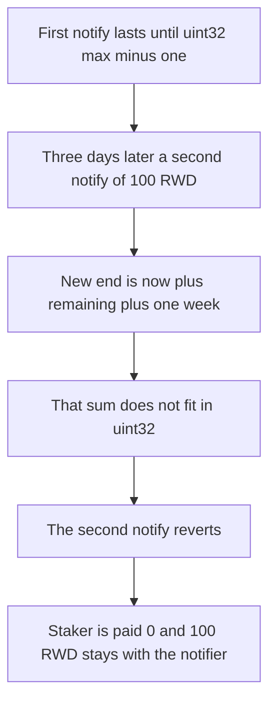

# Valkyrie — a long first distribution blocks the next reward notify

> **Vulnerability classes:** vuln/arithmetic/overflow · vuln/dos/frozen-funds · vuln/logic/reward-calculation

> **Reproduction:** a self-contained Foundry PoC that compiles and runs offline
> with only `forge-std` — no fork and no RPC. Trace: [output.txt](output.txt).
> PoC: [test/61557-reward-distribution-can-be-blocked-by-an-initial-distributio_exp.sol](test/61557-reward-distribution-can-be-blocked-by-an-initial-distributio_exp.sol).

<!-- non-defihacklabs -->
<!-- source-auditvault: https://github.com/Auditware/AuditVault/blob/main/findings/61557-reward-distribution-can-be-blocked-by-an-initial-distributio.md -->
<!-- date: 2025-03 -->

---

## Key info

| | |
|---|---|
| **Impact** | **HIGH** — the second notify reverts, so the staker is paid **0 of 100 RWD** and that 100 RWD never enters the pool |
| **Protocol** | Paladin Valkyrie incentive logic |
| **Vulnerable code** | Extension path casts `now + newDuration` to `uint32` |
| **Bug class** | A first duration near `uint32` max makes every later `depositRewards` revert |
| **Finding** | Cyfrin (Draiakoo) — Paladin Valkyrie, 12 March 2025 · id 61557 |
| **Report** | [2025-03-12-cyfrin-paladin-valkyrie-v2.0.md](https://github.com/solodit/solodit_content/blob/main/reports/Cyfrin/2025-03-12-cyfrin-paladin-valkyrie-v2.0.md) |
| **Source** | [AuditVault finding](https://github.com/Auditware/AuditVault/blob/main/findings/61557-reward-distribution-can-be-blocked-by-an-initial-distributio.md) |
| **Status** | Fixed in Valkyrie commit `c3298fa` (maximum distribution duration). Reproduced here as a local synthetic. |
| **Compiler** | solc 0.8.27, cancun, via IR |

---

## TL;DR

`depositRewards` is permissionless. The first caller can pass a duration of `type(uint32).max - 1 - now`. That stores `endTimestamp = type(uint32).max - 1`.

While that distribution is still active, the next notify does:

```text
newDuration = (endTimestamp - now) + duration
endTimestamp = uint32(now + newDuration)
```

`now + newDuration` is `4295572094`, which is above `type(uint32).max`. The cast reverts. A notifier who tries to stream **100 RWD** for one week is rolled back. The sole staker's claim returns **0**.

`nowTs` replaces `block.timestamp`. The three-day gap is `advance(3 days)`, the same gap as the report's `skip(3 days)`.

## The vulnerable code

Pre-fix extension branch, reduced to one pool and one reward token:

```solidity
uint256 remainingDuration = uint256(endTimestampCache) - nowTs;
uint256 newDuration = remainingDuration + duration;
uint256 leftoverRewards = uint256(rewardData.ratePerSec) * remainingDuration;
uint256 newRate = (amount + leftoverRewards) / newDuration;
require(newRate >= rewardData.ratePerSec, "rate");
rewardData.ratePerSec = uint96(newRate);
uint256 endRaw = nowTs + newDuration;
// @> VULN: the extended end is cast to uint32 and reverts when the first duration filled the type
require(endRaw <= uint256(type(uint32).max), "uint32");
rewardData.endTimestamp = uint32(endRaw);
```

The fixed logic rejects any duration above 4 weeks, so the grief schedule cannot be created and the second notify's end still fits in `uint32`.

## Root cause

The stored end is a `uint32`, and an active distribution extends by adding the new duration to whatever time is left. Nothing stops the first duration from sitting one second below the top of that type. The next extension then cannot be stored.

## Preconditions

- `depositRewards` is callable by anyone, with a duration of at least one week and no maximum.
- The first duration is `type(uint32).max - 1 - nowTs` and the amount is 1 wei. The resulting rate is 0, but the end timestamp is still `type(uint32).max - 1`.
- A second notify of **100 RWD** for 1 week arrives 3 days later, while that end is still in the future.

## Attack walkthrough

1. Stake 1 unit of liquidity. This caller is the only staker.
2. Notify 1 wei with the grief duration. `endTimestamp` becomes `4294967294`.
3. Advance 3 days.
4. Mint **100 RWD** to an honest notifier and call `depositRewards` for 1 week.
5. The extension require reverts. The 100 RWD transfer is rolled back.
6. `claim` returns **0**. The notifier still holds **100 RWD**.

Control: duration must be between 1 week and 4 weeks. The first notify streams 604800 wei for 1 week (rate 1). Three days later a second notify of 100 RWD for 1 week is accepted. After the blended window of 950400 seconds the staker is paid `99999999999999792000` wei, just under 100 RWD, instead of 0.

## Diagrams



## Impact

No later reward token can be scheduled on this pool until the grief end, which is decades away. The honest **100 RWD** distribution does not start. The staker is paid **0 of 100 RWD**.

## Remediation

Cap `duration` at a few weeks, and reject an extension whose new end does not fit in `uint32`. Valkyrie did this in commit `c3298fa`.

## Sources

- [AuditVault finding 61557](https://github.com/Auditware/AuditVault/blob/main/findings/61557-reward-distribution-can-be-blocked-by-an-initial-distributio.md)
- [Cyfrin Paladin Valkyrie report, 12 March 2025](https://github.com/solodit/solodit_content/blob/main/reports/Cyfrin/2025-03-12-cyfrin-paladin-valkyrie-v2.0.md)
- Fix: [Valkyrie@c3298fa](https://github.com/PaladinFinance/Valkyrie/pull/5/commits/c3298fa520787ca07034d055ac9c3f71aefebb67)

### Taxonomy

- `severity/high`
- `vuln/arithmetic/overflow` · `vuln/dos/frozen-funds` · `vuln/logic/reward-calculation`
