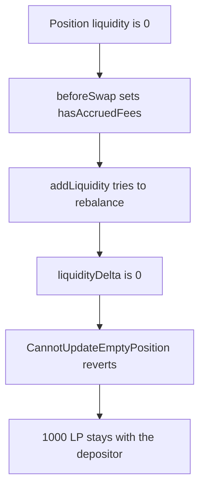

# Valkyrie — a zero-liquidity swap blocks a 1000 LP deposit

> **Vulnerability classes:** vuln/dos/frozen-funds · vuln/logic/missing-check · vuln/logic/incorrect-state-transition

> **Reproduction:** a self-contained Foundry PoC that compiles and runs offline
> with only `forge-std` — no fork and no RPC. Trace: [output.txt](output.txt).
> PoC: [test/61558-swaps-performed-in-pools-with-zero-liquidity-can-cause-a-com_exp.sol](test/61558-swaps-performed-in-pools-with-zero-liquidity-can-cause-a-com_exp.sol).

<!-- non-defihacklabs -->
<!-- source-auditvault: https://github.com/Auditware/AuditVault/blob/main/findings/61558-swaps-performed-in-pools-with-zero-liquidity-can-cause-a-com.md -->
<!-- date: 2025-03 -->

---

## Key info

| | |
|---|---|
| **Impact** | **HIGH** — `addLiquidity` reverts and **1000 LP** stays with the depositor. The hook holds 0 |
| **Protocol** | Paladin Valkyrie `FullRangeHook` |
| **Vulnerable code** | `beforeSwap` sets `hasAccruedFees` with no liquidity check |
| **Bug class** | A zero-liquidity swap corrupts the rebalance flag |
| **Finding** | Cyfrin (Draiakoo) — Paladin Valkyrie, 12 March 2025 · id 61558 |
| **Report** | [2025-03-12-cyfrin-paladin-valkyrie-v2.0.md](https://github.com/solodit/solodit_content/blob/main/reports/Cyfrin/2025-03-12-cyfrin-paladin-valkyrie-v2.0.md) |
| **Source** | [AuditVault finding](https://github.com/Auditware/AuditVault/blob/main/findings/61558-swaps-performed-in-pools-with-zero-liquidity-can-cause-a-com.md) |
| **Status** | Fixed in Valkyrie commit `46fa611`. Reproduced here as a local synthetic. |
| **Compiler** | solc 0.8.27, cancun, via IR |

---

## TL;DR

`FullRangeHook.beforeSwap` marks `hasAccruedFees` on every swap and does not require the position to have liquidity. A swap while `liquidity == 0` sets the flag. The next `addLiquidity` sees the flag, calls `_rebalance`, and removes `liquidity` as a signed delta. That delta is 0. `Position.update` reverts `CannotUpdateEmptyPosition` when both the delta and the stored liquidity are 0.

The depositor still holds **1000 LP**. The hook's balance and `liquidity` stay 0. The deposit cannot land.

The fixed `beforeSwap` reverts `"zero liquidity"` before setting the flag. `hasAccruedFees` stays false, and the same `addLiquidity(1000 ether)` credits the hook with 1000 LP.

## Vulnerable code

```solidity
function beforeSwap() external {
    // @> VULN: liquidity is not checked, so a zero-liquidity swap still sets the flag
    if (!hasAccruedFees) hasAccruedFees = true;
}

function _updatePosition(int256 liquidityDelta) internal view {
    if (liquidityDelta == 0) {
        if (liquidity == 0) revert CannotUpdateEmptyPosition();
    }
}
```

The report's fix:

```diff
 function beforeSwap() external {
+    require(liquidity > 0, "zero liquidity");
     if (!hasAccruedFees) hasAccruedFees = true;
 }
```

`_rebalance` uses `liquidityDelta = -int256(liquidity)`, which is the removal the real hook asks Uniswap for. On an empty position that is a 0 poke, and the position library rejects it.

## Attack walkthrough

1. The depositor is minted **1000 LP** and approves the hook. `liquidity` is 0.
2. `beforeSwap` runs. The flag becomes true. Liquidity is still 0.
3. `addLiquidity(1000 ether)` enters the `hasAccruedFees` branch and calls `_rebalance`.
4. `_updatePosition(0)` hits `liquidity == 0` and reverts `CannotUpdateEmptyPosition`.
5. The call is caught. The depositor still holds **1000 LP**. The hook holds 0. `liquidity` is still 0. The flag is still true, because the reverting add did not clear it.

Control: `beforeSwap` on the fixed hook reverts while liquidity is 0, and the flag stays false. `addLiquidity(1000 ether)` then transfers 1000 LP into the hook and sets `liquidity` to 1000 LP.

## Diagrams



## Impact

A swap on an empty `FullRangeHook` pool makes the following deposit revert. **1000 LP** cannot be added. The hook's position stays at 0. The fixed hook rejects that swap, and the same deposit moves the 1000 LP in.

## Remediation

Require `liquidity > 0` at the start of `beforeSwap`, which is what Valkyrie commit `46fa611` does. Do not set `hasAccruedFees` for a swap that has no position to rebalance.

## Sources

- [AuditVault finding 61558](https://github.com/Auditware/AuditVault/blob/main/findings/61558-swaps-performed-in-pools-with-zero-liquidity-can-cause-a-com.md)
- [Cyfrin Paladin Valkyrie report, 12 March 2025](https://github.com/solodit/solodit_content/blob/main/reports/Cyfrin/2025-03-12-cyfrin-paladin-valkyrie-v2.0.md)
- Fix: [Valkyrie@46fa611](https://github.com/PaladinFinance/Valkyrie/commit/46fa6111e3aee74913a05f2de72120fc70d4f032)

### Taxonomy

- `severity/high`
- `vuln/dos/frozen-funds` · `vuln/logic/missing-check` · `vuln/logic/incorrect-state-transition`
