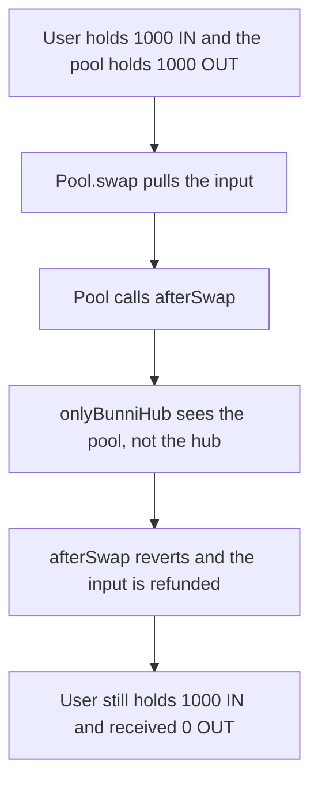

# Valkyrie — a Bunni swap reverts and 1000 IN stays with the user

> **Vulnerability classes:** vuln/access-control/broken-logic · vuln/dos/griefing · vuln/logic/wrong-condition

> **Reproduction:** a self-contained Foundry PoC that compiles and runs offline
> with only `forge-std` — no fork and no RPC. Trace: [output.txt](output.txt).
> PoC: [test/61559-swaps-are-not-possible-on-pools-registered-with-bunni-due-to_exp.sol](test/61559-swaps-are-not-possible-on-pools-registered-with-bunni-due-to_exp.sol).

<!-- non-defihacklabs -->
<!-- source-auditvault: https://github.com/Auditware/AuditVault/blob/main/findings/61559-swaps-are-not-possible-on-pools-registered-with-bunni-due-to.md -->
<!-- date: 2025-03 -->

---

## Key info

| | |
|---|---|
| **Impact** | **HIGH** — the swap reverts. The user keeps **1000 IN** and receives **0 OUT** |
| **Protocol** | Paladin Valkyrie `ValkyrieHooklet` |
| **Vulnerable code** | `afterSwap` gated by `onlyBunniHub` |
| **Bug class** | The hook checks the hub, but Bunni calls it from the hook |
| **Finding** | Cyfrin (Draiakoo) — Paladin Valkyrie, 12 March 2025 · id 61559 |
| **Report** | [2025-03-12-cyfrin-paladin-valkyrie-v2.0.md](https://github.com/solodit/solodit_content/blob/main/reports/Cyfrin/2025-03-12-cyfrin-paladin-valkyrie-v2.0.md) |
| **Source** | [AuditVault finding](https://github.com/Auditware/AuditVault/blob/main/findings/61559-swaps-are-not-possible-on-pools-registered-with-bunni-due-to.md) |
| **Status** | Fixed in Valkyrie commit `333f26b` (`onlyHook`). Reproduced here as a local synthetic. |
| **Compiler** | solc 0.8.27, cancun, via IR |

---

## TL;DR

`ValkyrieHooklet.afterSwap` is `onlyBunniHub`. Bunni invokes that hook from `BunniHook`, not from `BunniHub`. The pool in this reduction is that caller. `require(msg.sender == bunniHub)` reverts. The pool catches the failure, refunds the input, and does not transfer output.

The user swapped **1000 IN**. They still hold 1000 IN. They received 0 OUT. The 1000 OUT inventory stays in the pool.

The fixed hook is `onlyBunniHook` and is bound to the pool. The same swap returns true and pays the user **1000 OUT**.

## Vulnerable code

```solidity
modifier onlyBunniHub() {
    // @> VULN: BunniHook is the caller, so this hub check reverts every swap
    require(msg.sender == bunniHub, "hub");
    _;
}

function afterSwap() external onlyBunniHub returns (bytes4) {
    return ValkyrieHooklet.afterSwap.selector;
}
```

The fix named in the report is `onlyBunniHook` (later `onlyHook`) on `afterSwap`:

```solidity
modifier onlyBunniHook() {
    require(msg.sender == bunniHook, "hook");
    _;
}
```

The pool is the local stand-in for Bunni's hook caller. No live Bunni deployment is required.

## Attack walkthrough

1. The user is minted **1000 IN** and **1000 OUT**. The 1000 OUT is funded into the pool so a successful swap has inventory.
2. `pool.swap(1000 ether)` pulls 1000 IN and calls `hook.afterSwap()`.
3. `msg.sender` inside the hooklet is the pool. `bunniHub` is a different contract. The require reverts.
4. The pool refunds 1000 IN and returns `(false, 0)`.
5. The user holds 1000 IN and 0 OUT. The pool still holds 1000 OUT.

Control: `setBunniHook(pool)` then the same fund and swap. `afterSwap` accepts the pool. The user receives **1000 OUT** and their IN balance is 0.

## Diagrams



## Impact

Swaps on a pool configured with this hooklet cannot complete. A swap of **1000 IN** is refunded. The user receives no output. The fixed check lets the same swap deliver **1000 OUT**.

## Remediation

Gate `afterSwap` on the Bunni hook that actually calls it, not on `BunniHub`. Valkyrie commit `333f26b` adds `onlyHook` for that caller.

## Sources

- [AuditVault finding 61559](https://github.com/Auditware/AuditVault/blob/main/findings/61559-swaps-are-not-possible-on-pools-registered-with-bunni-due-to.md)
- [Cyfrin Paladin Valkyrie report, 12 March 2025](https://github.com/solodit/solodit_content/blob/main/reports/Cyfrin/2025-03-12-cyfrin-paladin-valkyrie-v2.0.md)
- Fix: [Valkyrie@333f26b](https://github.com/PaladinFinance/Valkyrie/commit/333f26bcdad465cae4f7fbdeee8ebfca2ce43659)

### Taxonomy

- `severity/high`
- `vuln/access-control/broken-logic` · `vuln/dos/griefing` · `vuln/logic/wrong-condition`
