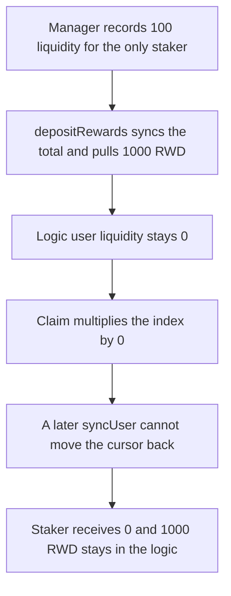

# Valkyrie — a missing user-liquidity sync pays the staker 0

> **Vulnerability classes:** vuln/logic/reward-calculation · vuln/logic/state-update · vuln/dos/frozen-funds

> **Reproduction:** a self-contained Foundry PoC that compiles and runs offline
> with only `forge-std` — no fork and no RPC. Trace: [output.txt](output.txt).
> PoC: [test/61560-missing-user-liquidity-sync-in-timeweightedincentivelogic-up_exp.sol](test/61560-missing-user-liquidity-sync-in-timeweightedincentivelogic-up_exp.sol).

<!-- non-defihacklabs -->
<!-- source-auditvault: https://github.com/Auditware/AuditVault/blob/main/findings/61560-missing-user-liquidity-sync-in-timeweightedincentivelogic-up.md -->
<!-- date: 2025-03 -->

---

## Key info

| | |
|---|---|
| **Impact** | **HIGH** — the sole staker claims **0 of 1000 RWD**. The fair amount stays in the logic, and a later sync does not recover it |
| **Protocol** | Paladin Valkyrie `TimeWeightedIncentiveLogic` |
| **Vulnerable code** | `_updateAllUserState` never calls `_syncUserLiquidity` |
| **Bug class** | Rewards are checkpointed against a zero user balance |
| **Finding** | Cyfrin (Draiakoo) — Paladin Valkyrie, 12 March 2025 · id 61560 |
| **Report** | [2025-03-12-cyfrin-paladin-valkyrie-v2.0.md](https://github.com/solodit/solodit_content/blob/main/reports/Cyfrin/2025-03-12-cyfrin-paladin-valkyrie-v2.0.md) |
| **Source** | [AuditVault finding](https://github.com/Auditware/AuditVault/blob/main/findings/61560-missing-user-liquidity-sync-in-timeweightedincentivelogic-up.md) |
| **Status** | Fixed in Valkyrie commit `10383a1`. Reproduced here as a local synthetic. |
| **Compiler** | solc 0.8.27, cancun, via IR |

---

## TL;DR

`depositRewards` copies the pool's total liquidity from the manager. `TimeWeightedIncentiveLogic._updateAllUserState` does not copy the user's liquidity, unlike the other incentive logics.

The staker already has **100** liquidity on the manager, which is the entire pool, before this logic is attached. The logic's `userLiquidity` stays **0** while `totalLiquidity` becomes **100**. After a **1000 RWD** distribution has fully elapsed, the claim multiplies the index by 0 and pays **0**. `syncUser` afterwards cannot help: the reward cursor has already moved to the end index, so the second claim is also **0**. All **1000 RWD** remains in the logic.

`nowTs` replaces `block.timestamp`. The window is `advance(1000)`, equal to the duration, so the streamed amount is exact.

## The vulnerable code

Pre-fix override. The base logic syncs the user before this loop. This override does not:

```solidity
function _updateRewardState(address account) internal {
    uint256 newRpt = _newRewardPerToken();
    // @> VULN: user liquidity was never synced, so this product pays 0
    uint256 earned = (userLiquidity[account] * (newRpt - userLast[account])) / UNIT;
    pending[account] = earned;
    userLast[account] = newRpt;
}
```

The fixed claim copies `manager.userLiquidity(account)` before it reads that balance into the earned product.

## Root cause

Two balances exist: the manager's live liquidity and the logic's cached copy. The cache is what `_earned` multiplies by. Total liquidity is refreshed when rewards are deposited. User liquidity is not refreshed on claim. A position that was opened before the logic was registered is invisible to the payout, and the first claim freezes the user's cursor at the new index so the missed rewards cannot be claimed later.

## Preconditions

- The staker has **100** liquidity on the manager and is the only liquidity. The logic's user cache is still 0.
- `depositRewards` syncs `totalLiquidity` to 100 and pulls **1000 RWD** for a duration of 1000 seconds. The rate is exactly 1 RWD per second.
- The staker claims only after `nowTs` has reached the distribution end.

## Attack walkthrough

1. `manager.addLiquidity(staker, 100 ether)`.
2. Mint **1000 RWD** and `depositRewards`. Logic `totalLiquidity` becomes 100. Logic `userLiquidity` stays 0.
3. Advance 1000 seconds.
4. `claim` runs `_updateRewardState` with user liquidity 0. Pending payout is 0. `userLast` becomes the end index.
5. `syncUser` copies 100 into the logic. The second `claim` multiplies by a zero index delta and returns 0.
6. The logic contract still holds **1000 RWD**. The staker's reward balance is 0.

Control: the same sequence, but the claim copies the manager's user liquidity first. The staker receives **1000 RWD** and the logic balance is 0.

## Diagrams



## Impact

The staker is paid **0** instead of the fair **1000 RWD**. Those tokens stay in the incentive logic. Calling `syncUser` after the claim does not release them.

## Remediation

At the start of `_updateAllUserState`, if the user has not been synced, copy `manager.userLiquidity(account)` before `_updateRewardState`. Valkyrie added that sync in commit `10383a1`.

## Sources

- [AuditVault finding 61560](https://github.com/Auditware/AuditVault/blob/main/findings/61560-missing-user-liquidity-sync-in-timeweightedincentivelogic-up.md)
- [Cyfrin Paladin Valkyrie report, 12 March 2025](https://github.com/solodit/solodit_content/blob/main/reports/Cyfrin/2025-03-12-cyfrin-paladin-valkyrie-v2.0.md)
- Fix: [Valkyrie@10383a1](https://github.com/PaladinFinance/Valkyrie/pull/5/commits/10383a15bdd21f8ad61676fc3ec4959fcda01574)

### Taxonomy

- `severity/high`
- `vuln/logic/reward-calculation` · `vuln/logic/state-update` · `vuln/loss-of-funds/locked-funds`
