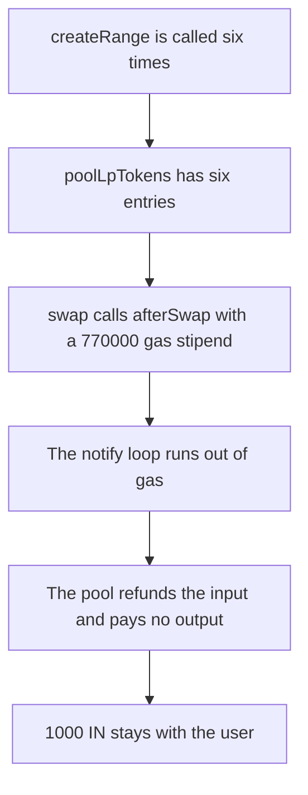

# Valkyrie — six ranges stop a swap of 1000 IN

> **Vulnerability classes:** vuln/dos/griefing · vuln/logic/missing-check · vuln/logic/missing-validation

> **Reproduction:** a self-contained Foundry PoC that compiles and runs offline
> with only `forge-std` — no fork and no RPC. Trace: [output.txt](output.txt).
> PoC: [test/61561-denial-of-service-for-swaps-on-multirangehook-pools-cyfrin-n_exp.sol](test/61561-denial-of-service-for-swaps-on-multirangehook-pools-cyfrin-n_exp.sol).

<!-- non-defihacklabs -->
<!-- source-auditvault: https://github.com/Auditware/AuditVault/blob/main/findings/61561-denial-of-service-for-swaps-on-multirangehook-pools-cyfrin-n.md -->
<!-- date: 2025-03 -->

---

## Key info

| | |
|---|---|
| **Impact** | **HIGH** — with 6 ranges the swap fails and **1000 IN** cannot be swapped. The user receives **0 OUT** |
| **Protocol** | Paladin Valkyrie `MultiRangeHook` |
| **Vulnerable code** | permissionless `poolLpTokens.push` in `createRange` |
| **Bug class** | `afterSwap` walks an uncapped array until it runs out of gas |
| **Finding** | Cyfrin (Draiakoo) — Paladin Valkyrie, 12 March 2025 · id 61561 |
| **Report** | [2025-03-12-cyfrin-paladin-valkyrie-v2.0.md](https://github.com/solodit/solodit_content/blob/main/reports/Cyfrin/2025-03-12-cyfrin-paladin-valkyrie-v2.0.md) |
| **Source** | [AuditVault finding](https://github.com/Auditware/AuditVault/blob/main/findings/61561-denial-of-service-for-swaps-on-multirangehook-pools-cyfrin-n.md) |
| **Status** | Fixed in Valkyrie commit `7af7783` (maximum of five ranges). Reproduced here as a local synthetic. |
| **Compiler** | solc 0.8.27, cancun, via IR |

---

## TL;DR

`createRange` is permissionless and pushes a new LP token onto `poolLpTokens`. `afterSwap` loops that array and notifies every range. Each notification writes six storage slots. A swap gives `afterSwap` a stipend of 770000 gas, which is enough for five ranges and not for six.

With six ranges the stipend runs out, the pool refunds the input, and no output is paid. **1000 IN** stays with the user. They receive 0 OUT.

The fixed hook rejects `createRange` once five ranges exist. A pool with five ranges swaps the same 1000 IN and pays the user **1000 OUT**.

The per-range writes stand in for the incentive-manager loop in the report. The real deployment hits the block gas limit with a much larger array. The cap of five is the fix Paladin shipped. This reduction keeps that cap and shows the gas gap between five and six inside one transaction.

## Vulnerable code

```solidity
function createRange() external returns (address lpToken) {
    // @> VULN: permissionless push, so poolLpTokens grows without a cap
    lpToken = address(uint160(poolLpTokens.length + 1));
    poolLpTokens.push(lpToken);
}

function afterSwap() external {
    uint256 n = poolLpTokens.length;
    for (uint256 i; i < n;) {
        _notifySwap(poolLpTokens[i]);
        unchecked { ++i; }
    }
}
```

```diff
 function createRange() external returns (address lpToken) {
+    require(poolLpTokens.length < 5, "max ranges");
     lpToken = address(uint160(poolLpTokens.length + 1));
     poolLpTokens.push(lpToken);
 }
```

## Attack walkthrough

1. The user is minted **1000 IN** and the pool is funded with **1000 OUT**.
2. `createRange` runs six times. Each call deploys an LP token and pushes it. There is no maximum.
3. `rangeCount` is 6.
4. `swap(1000 ether)` pulls the input and calls `afterSwap` with 770000 gas.
5. The loop writes storage for each range until the stipend is exhausted. The call fails.
6. The pool refunds 1000 IN and returns `(false, 0)`.
7. The user still holds **1000 IN** and holds 0 OUT.

Control: the sixth `createRange` reverts. Five ranges are created. The same swap returns true and the user receives **1000 OUT**. Their IN balance is 0.

## Diagrams



## Impact

Anyone can add ranges until swaps on that pool no longer fit in the gas available to `afterSwap`. Here six ranges are enough. A swap of **1000 IN** is refunded and the user receives nothing. Five ranges, which is the shipped maximum, still deliver **1000 OUT**.

## Remediation

Cap `poolLpTokens` at five, which is what Valkyrie commit `7af7783` enforces. `createRange` past the cap must revert so `afterSwap` cannot be grown until it runs out of gas.

## Sources

- [AuditVault finding 61561](https://github.com/Auditware/AuditVault/blob/main/findings/61561-denial-of-service-for-swaps-on-multirangehook-pools-cyfrin-n.md)
- [Cyfrin Paladin Valkyrie report, 12 March 2025](https://github.com/solodit/solodit_content/blob/main/reports/Cyfrin/2025-03-12-cyfrin-paladin-valkyrie-v2.0.md)
- Fix: [Valkyrie@7af7783](https://github.com/PaladinFinance/Valkyrie/commit/7af7783b2236598193ef0b4fa66032b91e3e4e40)

### Taxonomy

- `severity/high`
- `vuln/dos/griefing` · `vuln/logic/missing-check` · `vuln/logic/missing-validation`
