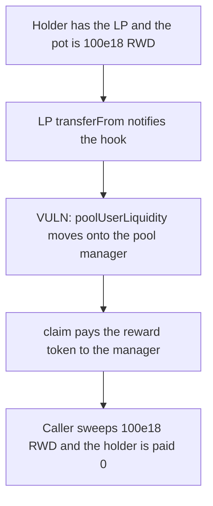

# Paladin Valkyrie — recycled LP liquidity pays the reward token to the caller

> **Vulnerability classes:** vuln/logic/reward-calculation · vuln/logic/missing-check

<!-- non-defihacklabs -->
<!-- source-auditvault: https://github.com/Auditware/AuditVault/blob/main/findings/61562-rewards-can-be-stolen-when-incentivizederc20-tokens-are-recu.md -->
<!-- date: 2025-03 -->

## Key info

| | |
|---|---|
| **Protocol** | Paladin Valkyrie |
| **Finding** | Cyfrin, AuditVault 61562 |
| **Vulnerable code** | `IncentivizedERC20.transferFrom` → `notifyTransfer` |
| **Harm** | The caller claims 100e18 of the reward token. The LP holder is paid 0. |
| **Chain** | local synthetic |

## TL;DR

`transferFrom` on the incentivized LP notifies the hook, which moves `poolUserLiquidity` from the holder to the recipient. Recycling that LP into the pool manager makes the manager the sole liquidity account. `claim` then pays the manager 100e18 of the reward token, a different token from the LP. A sweep takes that balance to the caller. The control reverts when the recycled LP notifies, and the holder claims the 100e18.

## The vulnerable code

```solidity
function transferFrom(address from, address to, uint256 amount) public override returns (bool) {
    ITokenizedHook(hook).notifyTransfer(poolId, from, to, amount);
    return super.transferFrom(from, to, amount);
}

poolUserLiquidity[id][from] -= amount;
// @> VULN: recycled IncentivizedERC20 liquidity is credited to `to`
poolUserLiquidity[id][to] += amount;
```

The fix rejects `notifyTransfer` when the caller is the incentivized LP.

## Root cause

Liquidity accounting follows the ERC20 transfer with no check that the token is an incentivized LP being parked on a contract that will not keep the rewards. Whoever can call `claim` for the new holder receives the reward token.

## Preconditions

The holder has the whole LP liquidity. The incentive contract holds 100e18 of a separate reward token. No timestamp warp. One block.

## Attack walkthrough

1. 100e18 of RWD is deposited. The pot is not the LP token.
2. The holder is credited with 100e18 of LP liquidity and approves the pool manager.
3. The manager `transferFrom`s the LP. `notifyTransfer` credits the manager and zeroes the holder.
4. `claim` pays 100e18 of RWD to the manager.
5. The caller sweeps it. The holder still holds 0 of the reward token.

## Diagrams



## Impact

The caller receives 100e18 of the reward token. The LP holder receives 0. The control rejects the recycled token, the liquidity stays with the holder, and the holder is paid the 100e18.

## Remediation

Reject `notifyTransfer` from the incentivized LP, or wrap that token before it is used as liquidity somewhere else.

## How to reproduce

```bash
cd 61562-rewards-can-be-stolen-when-incentivizederc20-tokens-are-recu_exp
forge test -vv
```

## Sources

- AuditVault finding: https://github.com/Auditware/AuditVault/blob/main/findings/61562-rewards-can-be-stolen-when-incentivizederc20-tokens-are-recu.md
- Cyfrin report: https://github.com/solodit/solodit_content/blob/main/reports/Cyfrin/2025-03-12-cyfrin-paladin-valkyrie-v2.0.md
- Vulnerable lines as quoted in that report: `IncentivizedERC20.transferFrom` and the `poolUserLiquidity` move inside the transfer notification.
