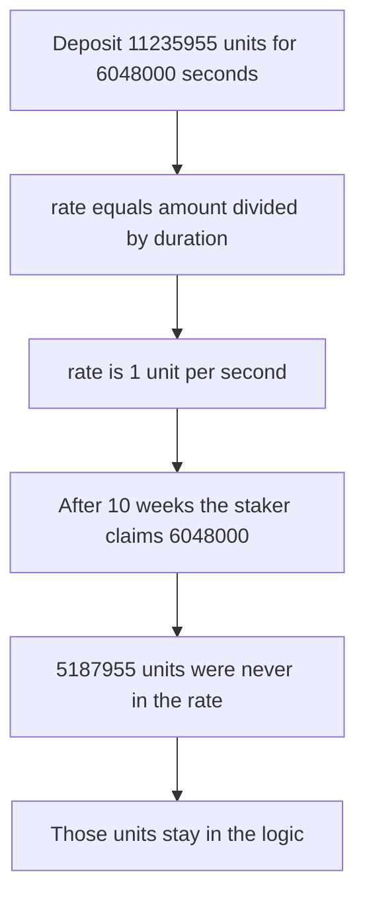

# Valkyrie — integer reward rates leave incentive tokens stuck

> **Vulnerability classes:** vuln/arithmetic/precision-loss · vuln/logic/reward-calculation · vuln/dos/frozen-funds

> **Reproduction:** a self-contained Foundry PoC that compiles and runs offline
> with only `forge-std` — no fork and no RPC. Trace: [output.txt](output.txt).
> PoC: [test/61563-precision-loss-can-result-in-funds-becoming-stuck-in-incenti_exp.sol](test/61563-precision-loss-can-result-in-funds-becoming-stuck-in-incenti_exp.sol).

<!-- non-defihacklabs -->
<!-- source-auditvault: https://github.com/Auditware/AuditVault/blob/main/findings/61563-precision-loss-can-result-in-funds-becoming-stuck-in-incenti.md -->
<!-- date: 2025-03 -->

---

## Key info

| | |
|---|---|
| **Impact** | **HIGH** — after the only staker claims, **5,187,955** WBTC base units of the **11,235,955** deposited stay in the logic |
| **Protocol** | Paladin Valkyrie incentive logic |
| **Vulnerable code** | `uint256 rate = amount / duration` |
| **Bug class** | Floor division strands `amount % duration` |
| **Finding** | Cyfrin (Draiakoo) — Paladin Valkyrie, 12 March 2025 · id 61563 |
| **Report** | [2025-03-12-cyfrin-paladin-valkyrie-v2.0.md](https://github.com/solodit/solodit_content/blob/main/reports/Cyfrin/2025-03-12-cyfrin-paladin-valkyrie-v2.0.md) |
| **Source** | [AuditVault finding](https://github.com/Auditware/AuditVault/blob/main/findings/61563-precision-loss-can-result-in-funds-becoming-stuck-in-incenti.md) |
| **Status** | Mitigated in Valkyrie commit `74060d7` (dust capped, not eliminated). Reproduced here as a local synthetic. |
| **Compiler** | solc 0.8.27, cancun, via IR |

---

## TL;DR

Every incentive logic sets the stream with `rate = amount / duration`. The product `rate * duration` is what claimants can receive. The remainder `amount % duration` is pulled into the contract and never accounted for.

The finding's WBTC example is **11,235,955** base units, which is $10,000 of 8-decimal BTC at $89,000, streamed for **10 weeks** (6,048,000 seconds). The rate is **1**. The sole staker, after the whole window, is paid **6,048,000**. **5,187,955** base units stay in the logic. At the finding's price that remainder is about **$4,618**.

`nowTs` replaces `block.timestamp`. `advance(10 weeks)` is the report's `skip(10 weeks)`.

## The vulnerable code

```solidity
function depositRewards(uint256 amount, uint256 duration) external {
    require(duration > 0 && amount > 0, "amount");
    uint256 rate = amount / duration;
    // @> VULN: amount / duration drops the remainder, and nothing ever pays it
    ratePerSec = rate;
    endTimestamp = nowTs + duration;
    lastUpdateTime = nowTs;
    reward.transferFrom(msg.sender, address(this), amount);
}
```

The fixed final claim, once `nowTs` has reached the end, pays `reward.balanceOf(this)` instead of `rate * duration`, so the remainder goes to the staker.

## Root cause

The rate is an integer number of token units per second. Any deposit that is not a multiple of the duration is rounded down at this division, and no later function adds the dropped units back. Low-decimal tokens such as WBTC make each dropped unit expensive.

## Preconditions

- A staker has liquidity, here the whole pool.
- The deposited amount is **11,235,955** and the duration is **6,048,000** seconds.
- The staker claims only after the window has elapsed, so the claim is the maximum the rate can pay.

## Attack walkthrough

1. Stake. Mint **11,235,955** WBTC base units to the depositor.
2. `depositRewards` stores `rate = 11235955 / 6048000 = 1` and pulls every unit into the logic.
3. Advance 10 weeks.
4. `claim` pays `1 * 6048000 = 6048000`.
5. The logic balance is `11235955 - 6048000 = 5187955`. There is no second staker who can be paid that remainder, and another claim returns 0 because the rate was cleared.

Control: the same deposit and the same 10-week wait. The final claim adds the token balance that the rate did not cover and transfers **11,235,955**. The logic balance is 0.

## Diagrams



## Impact

The sole staker receives **6,048,000** of the **11,235,955** funded. **5,187,955** base units remain in the incentive logic with no claim path. That is the finding's locked value of about $4,618 of WBTC.

## Remediation

On the final claim, pay the token balance that `rate * duration` did not cover, or reject deposits where `amount % duration != 0`. Valkyrie instead caps accepted dust at 1 percent of the deposit in commit `74060d7`. That still leaves a remainder for high-value 8-decimal tokens. Paying the remainder out removes it.

## Sources

- [AuditVault finding 61563](https://github.com/Auditware/AuditVault/blob/main/findings/61563-precision-loss-can-result-in-funds-becoming-stuck-in-incenti.md)
- [Cyfrin Paladin Valkyrie report, 12 March 2025](https://github.com/solodit/solodit_content/blob/main/reports/Cyfrin/2025-03-12-cyfrin-paladin-valkyrie-v2.0.md)
- Mitigation: [Valkyrie@74060d7](https://github.com/PaladinFinance/Valkyrie/pull/5/commits/74060d7a58161588c9f9a6791d70ef2745a155b3)

### Taxonomy

- `severity/high`
- `vuln/arithmetic/precision-loss` · `vuln/logic/reward-calculation` · `vuln/loss-of-funds/locked-funds`
