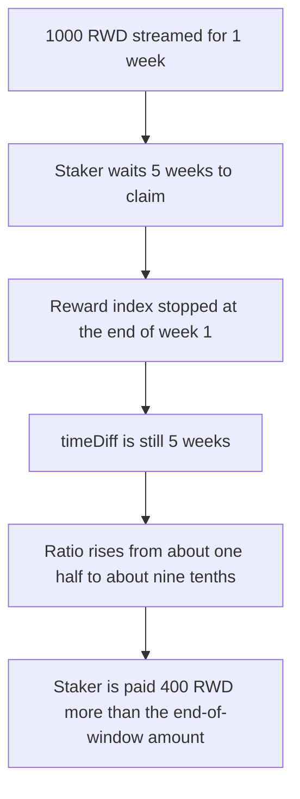

# Valkyrie — time-weighted rewards keep growing after the stream ends

> **Vulnerability classes:** vuln/logic/reward-calculation · vuln/logic/incorrect-state-transition · vuln/logic/fee-calculation

> **Reproduction:** a self-contained Foundry PoC that compiles and runs offline
> with only `forge-std` — no fork and no RPC. Trace: [output.txt](output.txt).
> PoC: [test/61564-rewards-distributed-with-timeweightedincentivelogic-can-cont_exp.sol](test/61564-rewards-distributed-with-timeweightedincentivelogic-can-cont_exp.sol).

<!-- non-defihacklabs -->
<!-- source-auditvault: https://github.com/Auditware/AuditVault/blob/main/findings/61564-rewards-distributed-with-timeweightedincentivelogic-can-cont.md -->
<!-- date: 2025-03 -->

---

## Key info

| | |
|---|---|
| **Impact** | **HIGH** — a claim five weeks after a one-week stream pays **400.000661375661269760 RWD** more than the amount due when the stream ended |
| **Protocol** | Paladin Valkyrie `TimeWeightedIncentiveLogic` |
| **Vulnerable code** | `timeDiff = now - checkpoint` inside `_earnedTimeWeighted` |
| **Bug class** | The ramp ratio is not capped at `endTimestamp` |
| **Finding** | Cyfrin (Draiakoo) — Paladin Valkyrie, 12 March 2025 · id 61564 |
| **Report** | [2025-03-12-cyfrin-paladin-valkyrie-v2.0.md](https://github.com/solodit/solodit_content/blob/main/reports/Cyfrin/2025-03-12-cyfrin-paladin-valkyrie-v2.0.md) |
| **Source** | [AuditVault finding](https://github.com/Auditware/AuditVault/blob/main/findings/61564-rewards-distributed-with-timeweightedincentivelogic-can-cont.md) |
| **Status** | The report's diff caps `timeDiff` at `endTimestamp`. Reproduced here as a local synthetic. |
| **Compiler** | solc 0.8.27, cancun, via IR |

---

## TL;DR

The reward index stops at `endTimestamp`. The time-weighted ratio does not. `_earnedTimeWeighted` sets

```text
timeDiff = now - checkpointTimestamp
```

and, once the position would have finished ramping, weights the post-ramp part of that `timeDiff` at a full unit. A longer wait makes `timeDiff` larger, so the ratio moves toward 1 even though no new rewards are streaming.

For the finding's **1000 RWD** over **1 week**, with a checkpoint duration of 0:

- Claiming as the week ends pays **499.999173280423147200 RWD** (the report's 499).
- Claiming **5 weeks** after the start pays **899.999834656084416960 RWD** (the report's 899).
- The extra is **400.000661375661269760 RWD**.

`nowTs` replaces `block.timestamp`. `advance(5 weeks)` is the report's `skip(5 weeks)`.

## The vulnerable code

```solidity
uint256 lastUpdateTs = checkpointTimestamp[account];
// @> VULN: timeDiff is not capped at endTimestamp, so waiting past the end raises the payout
uint256 timeDiff = nowTs - lastUpdateTs;
uint256 newDuration = duration + timeDiff;
if (newDuration >= maxDuration) newDuration = maxDuration;
uint256 remainingIncreaseDuration = maxDuration - duration;
uint256 left = ((((maxDuration - duration - 1) * UNIT) / 2) / maxDuration);
uint256 ratio = ((left * remainingIncreaseDuration) + (UNIT * (timeDiff - remainingIncreaseDuration))) / timeDiff;
earnedAmount = (maxEarned * ratio) / UNIT;
```

The fixed function sets `timeDiff` to `min(now, endTimestamp) - checkpoint`. A claim five weeks later then equals the end-of-window claim, and a second claim pays 0.

## Root cause

`maxEarned` is capped because `_newRewardPerToken` stops at `endTimestamp`. The ratio that scales `maxEarned` still treats every second after the checkpoint as part of the ramp, including seconds after the stream ended. Those extra seconds are weighted at `UNIT` in the numerator and only dilute the half-weight ramp in the denominator, so the ratio rises toward 1.

## Preconditions

- The staker has all **100** liquidity. The checkpoint duration is 0 and the checkpoint timestamp is the distribution start.
- **1000 RWD** is streamed for **1 week**, and the required ramp duration is that same week.
- The staker does not claim until **5 weeks** after the start. The reward index has been frozen since the end of week one.

## Attack walkthrough

1. Stake 100 liquidity. Checkpoint timestamp is `nowTs`, duration is 0.
2. Deposit **1000 RWD** for 1 week.
3. Advance 5 weeks.
4. `claim` computes `timeDiff = 5 weeks`. The payout is **899.999834656084416960 RWD**.
5. The amount due at the end of week one is **499.999173280423147200 RWD**. That part is returned to the depositor.
6. The staker keeps the extra **400.000661375661269760 RWD**.

Control: the same stake, deposit, and five-week wait, with `timeDiff` capped at `endTimestamp`. The claim equals **499.999173280423147200 RWD**, so the extra is **0**. A further claim one week later pays **0**.

## Diagrams



## Impact

The late claim pulls **400.000661375661269760 RWD** that was not owed at the end of the distribution. That comes out of the tokens the depositor funded for the one-week stream. Waiting longer moves the payout closer to the full `maxEarned`.

## Remediation

Cap `timeDiff` at `endTimestamp` before it enters the ratio, which is the diff in the finding. A claim after the end then matches a claim at the end, and a second claim pays 0.

## Sources

- [AuditVault finding 61564](https://github.com/Auditware/AuditVault/blob/main/findings/61564-rewards-distributed-with-timeweightedincentivelogic-can-cont.md)
- [Cyfrin Paladin Valkyrie report, 12 March 2025](https://github.com/solodit/solodit_content/blob/main/reports/Cyfrin/2025-03-12-cyfrin-paladin-valkyrie-v2.0.md)

### Taxonomy

- `severity/high`
- `vuln/logic/reward-calculation` · `vuln/logic/timestamp-dependence` · `vuln/loss-of-funds/reward-theft`
