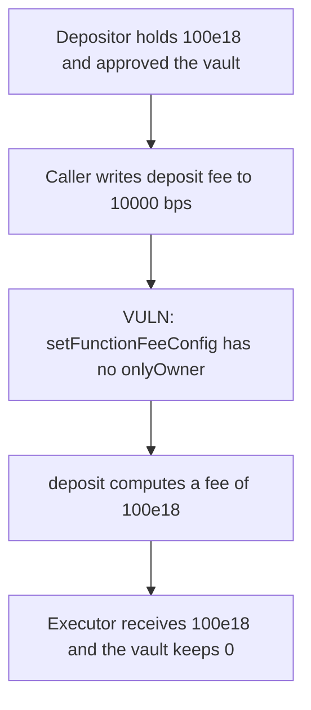

# OctoDeFi — anyone sets the deposit fee to 100% and takes the deposit

> **Vulnerability classes:** vuln/access-control/missing-modifier

<!-- non-defihacklabs -->
<!-- source-auditvault: https://github.com/Auditware/AuditVault/blob/main/findings/61597-missing-access-control-on-critical-feecontroller-setters-cyf.md -->
<!-- date: 2025-07 -->

## Key info

| | |
|---|---|
| **Protocol** | OctoDeFi |
| **Finding** | Cyfrin, AuditVault 61597 |
| **Vulnerable code** | `FeeController.setFunctionFeeConfig` |
| **Harm** | The executor sets the fee to 100% and takes 100e18 of the next deposit. |
| **Chain** | local synthetic |

## TL;DR

`setFunctionFeeConfig` is external and has no `onlyOwner`. The percentage cap is 10000 bps, so 100% is a legal value. The caller writes that fee for the deposit selector, then deposits the user's 100e18. The vault pays the whole amount to the executor. The control reverts the setter for a non-owner, and the same deposit leaves 100e18 in the vault.

## The vulnerable code

```solidity
function setFunctionFeeConfig(bytes4 _selector, FeeType _feeType, uint256 _feePercentage) external {
    if (_feePercentage > maxFeeLimits[_feeType]) {
        revert FeePercentageExceedLimit();
    }
    // @> VULN: no onlyOwner. The caller sets the deposit fee to 100%.
    functionFeeConfigs[_selector] = FeeConfig(_feeType, _feePercentage);
}
```

The fix is `onlyOwner` on the setter.

## Root cause

The admin setter checks the percentage against `maxFeeLimits` and does not check the caller. 10000 is inside the cap.

## Preconditions

`maxFeeLimits[Percent]` is 10000. The depositor holds 100e18 and has approved the vault. The caller is not the owner. One block.

## Attack walkthrough

1. The depositor is minted 100e18 and approves the vault.
2. The caller writes `deposit.selector` to fee type Percent and 10000 bps.
3. The stored fee reads back as 10000.
4. `deposit` pulls 100e18 and computes `fee = amount * 10000 / 10000`.
5. The vault transfers 100e18 to the executor. The vault and the depositor both end at 0.

## Diagrams



## Impact

The executor takes 100e18 of the deposit. The depositor is left with 0. With `onlyOwner`, the setter reverts and the deposit stays in the vault.

## Remediation

Add `onlyOwner` to `setFunctionFeeConfig`, `setTokenGetter`, and `setGlobalTokenGetter`.

## How to reproduce

```bash
cd 61597-missing-access-control-on-critical-feecontroller-setters-cyf_exp
forge test -vv
```

## Sources

- AuditVault finding: https://github.com/Auditware/AuditVault/blob/main/findings/61597-missing-access-control-on-critical-feecontroller-setters-cyf.md
- Cyfrin report: https://github.com/solodit/solodit_content/blob/main/reports/Cyfrin/2025-07-17-cyfrin-octodefi-v2.0.md
- Fix: https://github.com/octodefi/strategy-builder-plugin/pull/12
- Vulnerable function: `FeeController.setFunctionFeeConfig`, as quoted in the finding.
