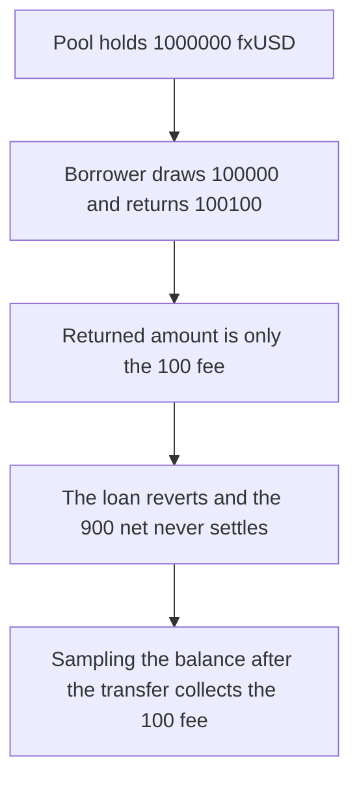

# f(x) v2 flash loans revert on an honest repayment

> **Vulnerability classes:** vuln/logic/wrong-condition · vuln/dos/griefing

<!-- non-defihacklabs -->
<!-- source-auditvault: https://github.com/Auditware/AuditVault/blob/main/findings/61789-flashloan-functionality-is-blocked-openzeppelin-none-fx-v2-a.md -->
<!-- date: 2025-03 -->

## Key info

| Field | Value |
|---|---|
| **Loss** | 900 fxUSD of arbitrage is not realized. The treasury collects 0 of the 100 fxUSD fee |
| **Vulnerable contract** | `FlashLoans.flashLoan` |
| **Attacker EOA** | `0x1111111111111111111111111111111111111111` |
| **Attack contract** | `Exploit` |
| **Attack tx** | `Exploit.run()` |
| **Chain / block / date** | Ethereum model · one block · 2025-03 |
| **Compiler** | solc 0.8.27, cancun, via IR |
| **Bug class** | Repayment is measured against the pre-loan balance |

## TL;DR

`flashLoan` stores `prevBalance` before it sends the principal. After the callback, `returnedAmount` is `balanceAfter - prevBalance`. That difference is only the fee. The check `returnedAmount < amount + fee` is therefore true for every honest repayment, and the loan reverts `ErrorInsufficientFlashLoanReturn`.

A borrower who flashes 100000 fxUSD, is paid 1000 fxUSD by an arb desk, and returns 100100 fxUSD still reverts. Their net of 900 fxUSD never settles, and the treasury fee of 100 stays uncollected. Sampling `prevBalance` after the transfer lets the same repayment succeed: the borrower keeps 1000, a 900 gain over the 100 fee, and the treasury receives 100.

## The vulnerable code

```solidity
uint256 prevBalance = token.balanceOf(address(this));
uint256 fee = flashFee(address(token), amount);
require(token.transfer(receiver, amount), "send");
// callback returns principal + fee
uint256 returnedAmount = token.balanceOf(address(this)) - prevBalance;
// @> VULN: returnedAmount is only the fee, so amount + fee never fits
if (returnedAmount < amount + fee) {
    revert("ErrorInsufficientFlashLoanReturn");
}
```

## Root cause

The surplus over the pre-loan balance is the fee, not the principal plus the fee. The comparison still demands both.

## Preconditions

- The pool holds the principal. Here, 1000000 fxUSD.
- The borrower can return principal plus fee. The fee is 0.1 percent, 100 fxUSD on a 100000 draw.

## Attack walkthrough

1. Seed the pool with 1000000 fxUSD and the arb desk with 1000. Prefund the borrower with the 100 fee.
2. `flashLoan` sends 100000. The callback is paid 1000 and returns 100100.
3. `returnedAmount` is 100. `100 < 100100`, so the call reverts and every transfer rolls back.
4. Borrower balance is still 100. Desk balance is still 1000. Treasury balance is 0. Missed net is 900.
5. Control: `prevBalance` is taken after the transfer. The same inputs leave the borrower with 1000, the desk with 0, the treasury with 100, and the pool with its 1000000.

## Diagrams



## Impact

Flash loans cannot be repaid at the quoted fee. In this run the borrower misses 900 fxUSD and the treasury misses the 100 fxUSD fee. The fixed accounting realizes both numbers.

## Remediation

Read `prevBalance` after the principal transfer, which is what the f(x) pull request did. The check can then stay `returnedAmount < amount + fee`.

## How to reproduce

```bash
cd evm-hack-registry/61789-flashloan-functionality-is-blocked-openzeppelin-none-fx-v2-a_exp
forge test -vv
```

## Sources

- [AuditVault finding 61789](https://github.com/Auditware/AuditVault/blob/main/findings/61789-flashloan-functionality-is-blocked-openzeppelin-none-fx-v2-a.md)
- [OpenZeppelin f(x) v2 audit](https://blog.openzeppelin.com/fx-v2-audit)
- [FlashLoans.sol at 56a47eab](https://github.com/AladdinDAO/fx-protocol-contracts/blob/56a47eab8d10334e479df83a2b13a8b68ce390e9/contracts/core/FlashLoans.sol)
