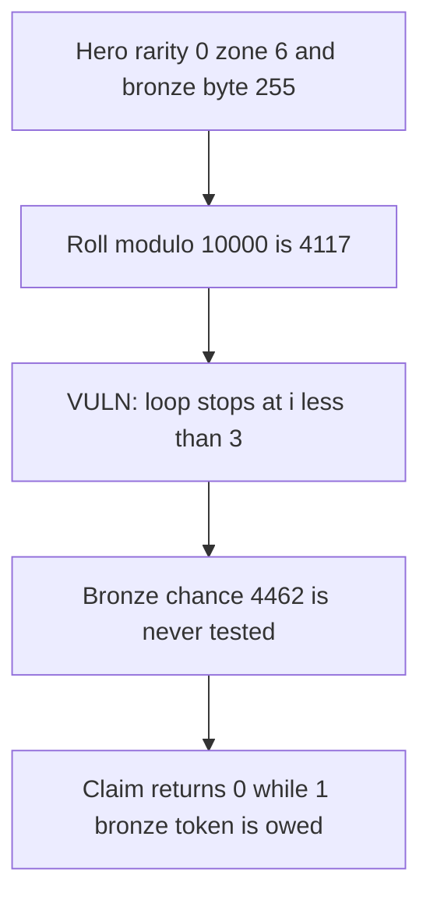

# Onchain Heroes — bronze gacha is never minted

> **Vulnerability classes:** vuln/logic/reward-calculation · vuln/logic/wrong-condition

<!-- non-defihacklabs -->
<!-- source-auditvault: https://github.com/Auditware/AuditVault/blob/main/findings/61818-h-01-hero-owner-can-never-receive-bronze-tier-gacha-tokens-s.md -->
<!-- date: 2025-07 -->

## Key info

| | |
|---|---|
| **Protocol** | Onchain Heroes |
| **Finding** | Shieldify H-01, AuditVault 61818 |
| **Vulnerable code** | `Dragma._calculateBonusRewards` |
| **Harm** | The bronze claim pays 0. The four-tier loop owes 1 bronze token. |
| **Chain** | local synthetic |

## TL;DR

`BONUS_REWARD_TABLE` packs four tiers. Bronze is bits 24-31. The loop is `i < 3`, so that byte is never read. With rarity 0, zone 6, and bronze byte 255, the chance is 4462. `keccak256(abi.encode(0, 0)) % 10000` is 4117, which would hit bronze and cannot hit the three zero bytes. The claim returns token id 0 and the hero balance stays 0. N = 1. The control uses `i < 4` and mints that 1 bronze token.

## The vulnerable code

```solidity
randomNumber_ = uint256(keccak256(abi.encode(randomNumber_, requestId)));
// @> VULN: i < 3 never reads the bronze byte in bits 24-31
for (uint256 i = 0; i < 3; i++) {
    uint256 chance = (((rewards >> (i * 8)) & 0xff) * (25 + (zone * 25))) / 10;
    if ((randomNumber_ % 10000) < chance) {
        gachaTokenId = (4 - i);
        items.mint(hero.owner, gachaTokenId, 1);
        break;
    }
}
```

The fix is `i < 4`.

## Root cause

Token id `4 - i` for `i == 3` is bronze id 1, and that iteration is outside the loop. The table byte for bronze is live. The loop never loads it.

## Preconditions

Rarity 0, zone 6, request id 0, random 0. The packed word is `255 << 24`. One block. No warp.

## Attack walkthrough

1. The hero is stored at rarity 0 and zone 6.
2. `claimBonus(1, 0, 0)` hashes the roll to a value whose modulo 10000 is 4117.
3. The loop reads three zero bytes. None of them beat the roll.
4. The returned token id is 0. The hero's bronze balance is 0.
5. The same inputs walked with `i < 4` owe token id 1, which is N = 1.

## Diagrams



## Impact

The hero is minted 0 bronze tokens. The four-tier loop owes 1. The control mints that 1 token to the hero.

## Remediation

Change the loop bound from `i < 3` to `i < 4` so bits 24-31 are read.

## How to reproduce

```bash
cd 61818-h-01-hero-owner-can-never-receive-bronze-tier-gacha-tokens-s_exp
forge test -vv
```

## Sources

- AuditVault finding: https://github.com/Auditware/AuditVault/blob/main/findings/61818-h-01-hero-owner-can-never-receive-bronze-tier-gacha-tokens-s.md
- Shieldify report: https://github.com/shieldify-security/audits-portfolio-md/blob/main/OnchainHeroes-S2(Phase2)-Security-Review.md
- Source: https://github.com/onchain-heroes/och-contracts/blob/6bc8f2a5782b8f92a32cae10cdf42a3887028e1d/src/Dragma/Dragma.sol#L569
- The loop bound `i < 3` is the line quoted in the finding. This is not the Mythical weapon-shard bug.
