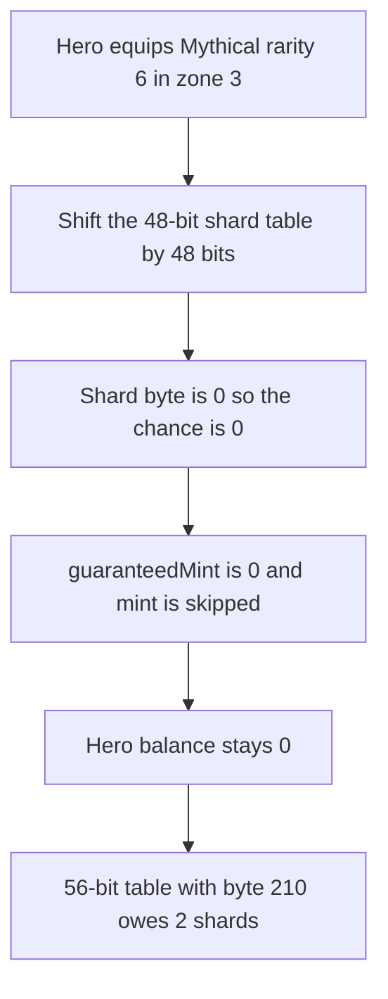

# Onchain Heroes — a Mythical weapon never mints weapon shards

> **Vulnerability classes:** vuln/logic/reward-calculation

> **Reproduction:** a self-contained Foundry PoC that compiles and runs offline
> with only `forge-std` — no fork and no RPC. Trace: [output.txt](output.txt).
> PoC: [test/61819-h-02-hero-owner-with-mythical-weapon-can-never-receive-weapo_exp.sol](test/61819-h-02-hero-owner-with-mythical-weapon-can-never-receive-weapo_exp.sol).

<!-- non-defihacklabs -->
<!-- source-auditvault: https://github.com/Auditware/AuditVault/blob/main/findings/61819-h-02-hero-owner-with-mythical-weapon-can-never-receive-weapo.md -->
<!-- date: 2025-07 -->

---

## Key info

| | |
|---|---|
| **Impact** | **HIGH** — a hero with a Mythical weapon is minted **0** shards while **2** are owed |
| **Protocol** | Onchain Heroes, Season 2 Phase 2 `Dragma` |
| **Vulnerable code** | `_calculateBonusRewards` reads `WEAPON_SHARD_TABLE >> (rarity * 8)` |
| **Bug class** | Packed rarity table has no byte for Mythical (rarity 6) |
| **Finding** | Shieldify — Onchain Heroes S2 Phase 2, July 2025 · id 61819 |
| **Report** | [OnchainHeroes-S2(Phase2)-Security-Review.md](https://github.com/shieldify-security/audits-portfolio-md/blob/main/OnchainHeroes-S2(Phase2)-Security-Review.md) |
| **Source** | [AuditVault finding](https://github.com/Auditware/AuditVault/blob/main/findings/61819-h-02-hero-owner-with-mythical-weapon-can-never-receive-weapo.md) |
| **Status** | Acknowledged and fixed by extending the table. Reproduced here as a local synthetic. |
| **Compiler** | solc 0.8.27, cancun, via IR |

---

## TL;DR

`WEAPON_SHARD_TABLE` is `0xD282321E140A`, 48 bits, six rarity bytes. Mythical weapons are rarity 6. The reward function shifts the table by `6 * 8` bits, the masked byte is 0, and the hero is minted nothing.

The published Mythic coefficient is 210 (`0xD2`). Written into a 56-bit table it is `0xD2D282321E140A`. At zone 3 that chance is 2,100, so **2** shards are guaranteed. With request id 0 and random 0 the leftover roll is 117 and does not add a third shard. **N = 2.** The Mythical claim returns **0**. A Legendary hero, rarity 5, reads byte 210 from the same short table and is paid **2**.

## The vulnerable code

```solidity
uint256 weaponShardChance = (((WEAPON_SHARD_TABLE >> (rarity * 8)) & 0xff) * (25 + (zone * 25))) / 10;

uint256 guaranteedMint = weaponShardChance / 1000;

if (weaponShardChance != 0) {
    uint256 chance = weaponShardChance - (guaranteedMint * 1000);
    randomNumber_ = uint256(keccak256(abi.encode(randomNumber_, requestId)));
    if ((randomNumber_ % 1000) < chance) {
        guaranteedMint += 1;
    }
}
if (guaranteedMint > 0) {
    items.mint(hero.owner, 1, guaranteedMint);
}
```

`WEAPON_SHARD_TABLE` is `0xD282321E140A`. The shift for rarity 6 is the line above it marked `@> VULN`. The fix is a 56-bit constant, `0xD2D282321E140A`, so rarity 6 reads `0xD2`.

## Root cause

The packed word was sized for rarities 0 through 5. Rarity 6 shifts past every defined byte. `weaponShardChance` is 0, `guaranteedMint` is 0, and the random branch is skipped, so `items.mint` never runs.

## Preconditions

- The hero's weapon rarity is 6.
- Zone is 3, where byte 210 becomes exactly 2 guaranteed shards.
- The claim uses request id 0 and random 0, so the 100-unit remainder does not add a bonus shard.

## Attack walkthrough

1. Equip hero 1 with a Mythical weapon in zone 3.
2. Claim bonus rewards. The table shift produces byte 0. The mint amount is 0. The hero's balance stays 0.
3. The 56-bit table, same zone and same random, owes 2 shards.
4. Equip hero 2 with a Legendary weapon, rarity 5, in the same zone. That claim mints 2 shards. The short table still works for rarities 0-5.

Control: the same claim against `0xD2D282321E140A` mints **2** shards to the Mythical hero.

## Diagrams



## Impact

The Mythical hero is paid **0** weapon shards on a claim that owes **2**. Players who hold the rarest weapon receive nothing from this path. A Legendary hero in the same zone is paid the **2** shards the Mythical hero was denied.

## Remediation

Extend `WEAPON_SHARD_TABLE` from 48 bits to 56 and store the Mythic coefficient in the new byte. With `0xD2` in that byte, zone 3 pays 2 shards before the remainder roll.

## Sources

- [AuditVault finding 61819](https://github.com/Auditware/AuditVault/blob/main/findings/61819-h-02-hero-owner-with-mythical-weapon-can-never-receive-weapo.md)
- [Shieldify Onchain Heroes S2 Phase 2 review](https://github.com/shieldify-security/audits-portfolio-md/blob/main/OnchainHeroes-S2(Phase2)-Security-Review.md)
- Vulnerable function: [Dragma.sol at 6bc8f2a](https://github.com/onchain-heroes/och-contracts/blob/6bc8f2a5782b8f92a32cae10cdf42a3887028e1d/src/Dragma/Dragma.sol#L608)

### Taxonomy

- `severity/high`
- `vuln/logic/reward-calculation`
