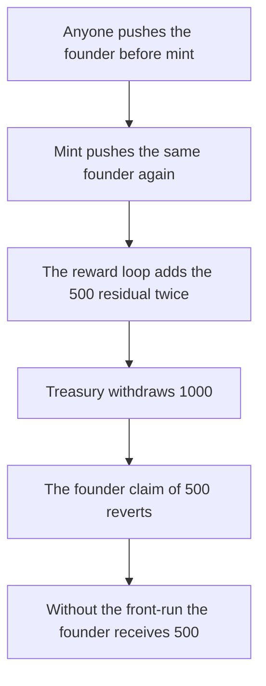

# AgentNftV2.addValidator duplicates a founder and strands their reward

> **Vulnerability classes:** vuln/access-control/missing-auth · vuln/logic/reward-calculation

<!-- non-defihacklabs -->
<!-- source-auditvault: https://github.com/Auditware/AuditVault/blob/main/findings/61822-h-01-lack-of-access-control-in-agentnftv2addvalidator-enable.md -->
<!-- date: 2025-04 -->

## Key info

| Field | Value |
|---|---|
| **Loss** | Founder is owed 500 reward tokens and receives 0. Treasury is paid 1000 instead of 500 |
| **Vulnerable contract** | `AgentNftV2._addValidator` |
| **Attacker EOA** | `0x1111111111111111111111111111111111111111` |
| **Attack contract** | `Exploit` |
| **Attack tx** | `Exploit.run()` |
| **Chain / block / date** | Ethereum model · one block · 2025-04 |
| **Compiler** | solc 0.8.27, cancun, via IR |
| **Bug class** | Public validator insert, then mint inserts the same address again |

## TL;DR

`addValidator` has no role. Anyone who can see `nextVirtualId` can push the upcoming founder into `_validators` before `mint`. `mint` calls `_addValidator` again and does not notice the address is already present, so the list contains the founder twice.

Reward distribution overwrites that founder's owed balance, so they are still owed one share, but it adds the residual on every list entry. A 1000 token distribution with a half participation rate accounts a 1000 pool instead of 500. The normal pool withdrawal sends all 1000 to the treasury. The founder's claim of 500 then reverts. Without the front-run the same distribution pays 500 to the treasury and 500 to the founder.

## The vulnerable code

```solidity
function addValidator(uint256 virtualId, address validator) public {
    if (isValidator[virtualId][validator]) return;
    _addValidator(virtualId, validator);
    _initValidatorScore(virtualId, validator);
}

function _addValidator(uint256 virtualId, address validator) internal {
    isValidator[virtualId][validator] = true;
    // @> VULN: mint pushes again; addValidator has no role to stop the first insert
    _validators[virtualId].push(validator);
}
```

`validatorPoolRewards += validatorRewards - participationReward` then runs once per list entry.

## Root cause

The public insert and the minter insert both push. The reward loop trusts the list length.

## Preconditions

- The founder address is known before `mint`. It is the application proposer.
- A later reward distribution uses `score / totalProposals = 1/2`, so each entry leaves a 500 residual on a 1000 distribution.

## Attack walkthrough

1. Read `nextVirtualId`. A contract with no minter role calls `addValidator` for the founder.
2. The minter calls `mint`. The list length is 2.
3. `distribute` of 1000 pulls the tokens and sets `validatorPoolRewards` to 1000. The founder is owed 500.
4. `withdrawValidatorPoolRewards` sends 1000 to the treasury.
5. `claim` for the founder reverts. Founder balance is 0. Shortfall is 500.
6. Control: no front-run. List length is 1. Treasury receives 500. Founder receives 500.

## Diagrams



## Impact

The founder loses 500 of the 1000 reward tokens. The treasury is overpaid by the same 500. The control split is 500 and 500.

## Remediation

Restrict `addValidator` to the role that is supposed to call it, and do not push an address that is already a validator.

## How to reproduce

```bash
cd evm-hack-registry/61822-h-01-lack-of-access-control-in-agentnftv2addvalidator-enable_exp
forge test -vv
```

## Sources

- [AuditVault finding 61822](https://github.com/Auditware/AuditVault/blob/main/findings/61822-h-01-lack-of-access-control-in-agentnftv2addvalidator-enable.md)
- [Code4rena Virtuals Protocol, April 2025](https://code4rena.com/reports/2025-04-virtuals-protocol)
