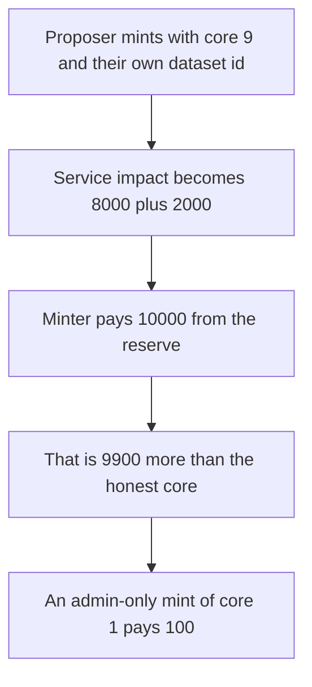

# ContributionNft.mint lets the proposer pick the impact that gets paid

> **Vulnerability classes:** vuln/access-control/missing-auth · vuln/logic/reward-calculation

<!-- non-defihacklabs -->
<!-- source-auditvault: https://github.com/Auditware/AuditVault/blob/main/findings/61825-h-04-public-contributionnftmint-leads-to-cascading-issues-lo.md -->
<!-- date: 2025-04 -->

## Key info

| Field | Value |
|---|---|
| **Loss** | Proposer is paid 10000 reward tokens. The honest core pays 100. Excess is 9900 |
| **Vulnerable contract** | `ContributionNft.mint` |
| **Attacker EOA** | `0x1111111111111111111111111111111111111111` |
| **Attack contract** | `Exploit` |
| **Attack tx** | `Exploit.run()` |
| **Chain / block / date** | Ethereum model · one block · 2025-04 |
| **Compiler** | solc 0.8.27, cancun, via IR |
| **Bug class** | Proposer-only mint stores an arbitrary core and dataset id |

## TL;DR

`ContributionNft.mint` checks that the caller is the proposal proposer and then stores `coreId`, `isModel`, and `datasetId` with no further check. `ServiceNft.updateImpact` reads that core's maturity and, when `datasetId` is nonzero, writes `datasetImpactWeight` of the raw impact onto that id.

Core 1 maturity is 100 tokens. Core 9 maturity is 10000 tokens. The proposer mints on core 9 and points `datasetId` at a side NFT they also own. Weight is 8000, so the dataset impact is 8000 and the proposal impact is 2000. `Minter.mint` pays both. The proposer receives 10000. The reserve keeps 10000 of its 20000. An admin-gated mint of the honest core pays 100 and the attacker's call reverts.

## The vulnerable code

```solidity
require(msg.sender == dao.proposalProposer(proposalId), "Only proposal proposer can mint Contribution NFT");
require(parentId != proposalId, "Cannot be parent of itself");
coreOf[proposalId] = coreId;
// @> VULN: proposer stores an arbitrary core and datasetId
isModel[proposalId] = isModel_;
datasetId[proposalId] = datasetId_;
```

## Root cause

The proposer gate does not constrain the core or the dataset the impact accounting will trust.

## Preconditions

- The caller can create a proposal, so they are its proposer.
- A matured core exists. Here core 9 is 10000 and core 1 is 100.
- Dataset weight is 8000 of 10000. The minter pays both the proposal impact and the dataset impact from a 20000 reserve.

## Attack walkthrough

1. Propose and mint a side NFT the attacker owns.
2. Propose again and mint with core 9, `isModel` true, and `datasetId` equal to the side NFT.
3. `mintService` sets dataset impact to 8000 and proposal impact to 2000.
4. `Minter.mint` transfers 10000 to the attacker. Excess over the honest 100 is 9900.
5. Control: `mint` requires the admin. The attacker's mint reverts. The admin mints core 1 and is paid 100.

## Diagrams



## Impact

The reward reserve overpays the proposer by 9900 tokens. 10000 leaves the reserve instead of 100.

## Remediation

Only the admin, or the contract that already checked the proposal, may mint. Do not take core and dataset id from the proposer.

## How to reproduce

```bash
cd evm-hack-registry/61825-h-04-public-contributionnftmint-leads-to-cascading-issues-lo_exp
forge test -vv
```

## Sources

- [AuditVault finding 61825](https://github.com/Auditware/AuditVault/blob/main/findings/61825-h-04-public-contributionnftmint-leads-to-cascading-issues-lo.md)
- [Code4rena Virtuals Protocol, April 2025](https://code4rena.com/reports/2025-04-virtuals-protocol)
