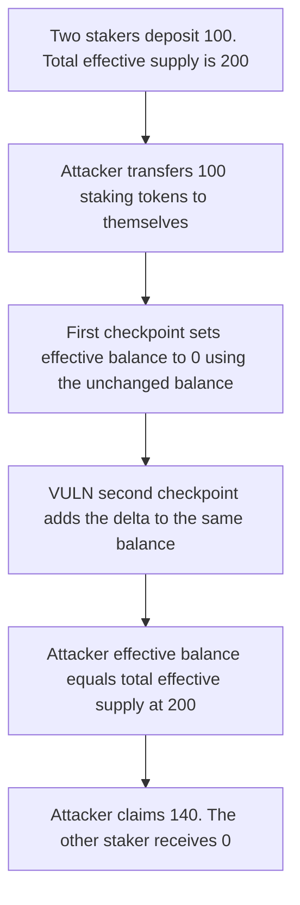

# Resolv: a self-transfer takes the whole staking reward pot

> **Vulnerability classes:** `vuln/logic/reward-calculation` · `vuln/logic/incorrect-order-of-operations`

<!-- non-defihacklabs -->
<!-- source-auditvault: https://github.com/Auditware/AuditVault/blob/main/findings/61872-c-01-rewards-can-be-stolen-by-transferring-tokens-to-oneself.md -->
<!-- date: 2025-07 -->

## Key info

| Field | Value |
|---|---|
| **Loss** | The attacker claims 140 of 140 reward tokens. The other equal staker receives 0 |
| **Vulnerable contract** | `Staking._update` / `checkpoint` |
| **Attacker EOA** | `0x1111111111111111111111111111111111111111` |
| **Attack contract** | `Exploit` |
| **Attack tx** | `Exploit.run()` |
| **Chain / block / date** | Ethereum model · block 0 · 2025-07 |
| **Compiler** | solc 0.8.27, cancun |
| **Bug class** | Second checkpoint reads `balanceOf` before the transfer updates it |

## TL;DR

`_update` checkpoints the sender with a negative delta and the receiver with a positive delta before `balanceOf` changes. On a transfer to oneself the balance stays 100. The second checkpoint adds 100 to that stale balance, effective balance becomes 200, and `totalEffectiveSupply` collapses to 200. Of a 140 reward pot the attacker is owed 140 and the other staker is owed 70. The attacker claims first and takes every token. The other staker is paid 0.

## The vulnerable code

```solidity
checkpoint(_from, -int256(_value));
checkpoint(_to, int256(_value)); // @> VULN: second checkpoint runs before balanceOf(_to) changes
// ...
totalEffectiveSupply = updateEffectiveBalance(_user, balanceOf[_user], _delta); // @> VULN: userStakedBalance is balanceOf, which the transfer has not updated
```

```diff
- checkpoint(_from, -int256(_value));
- checkpoint(_to, int256(_value));
+ if (_from != _to) {
+     checkpoint(_from, -int256(_value));
+     checkpoint(_to, int256(_value));
+ }
```

## Root cause

Both checkpoints use the pre-transfer balance. The first writes effective balance 0. The second sees a zero effective balance, so it treats the old weight as the raw balance (100) instead of 0, then stores a new effective balance of `balance + delta` = 200. Total supply becomes 200, equal to the attacker alone, while the other staker's weight of 100 is still recorded.

## Preconditions

- Two stakers have deposited 100 each. Total effective supply is 200.
- 140 reward tokens are deposited for the next accrual.
- The attacker can transfer their own staking balance to themselves.

## Attack walkthrough

1. The attacker deposits 100. Effective supply is 100.
2. The other staker deposits 100. Effective supply is 200.
3. The attacker transfers 100 to themselves.
4. The first checkpoint reads `balanceOf` = 100 and stores effective balance 0.
5. The second checkpoint adds 100 to that same balance. Effective balance is 200 and the total is 200.
6. The attacker claims 140. The other staker's claim pays 0.

## Diagrams



## Impact

A staker who should earn 70 of 140 reward tokens receives 0. The self-transferrer takes the entire pot. Fair shares before the transfer were 70 and 70.

## How to reproduce

```bash
cd 61872-c-01-rewards-can-be-stolen-by-transferring-tokens-to-oneself_exp
forge test -vv
```

## Sources

- AuditVault finding: https://github.com/Auditware/AuditVault/blob/main/findings/61872-c-01-rewards-can-be-stolen-by-transferring-tokens-to-oneself.md
- Pashov Resolv review: https://github.com/pashov/audits/blob/master/team/md/Resolv-security-review_2025-07-25.md
- Audited staking sources: https://github.com/resolv-im/resolv-contracts/blob/f7d7fee7ca456a564fb24b2db5b3f740ef7fa525/contracts/staking/ResolvStakingV2.sol
- Fix commit cited by MixBytes: `2f71574f8d57d9ecac9cbf30dc38064394796f60`
