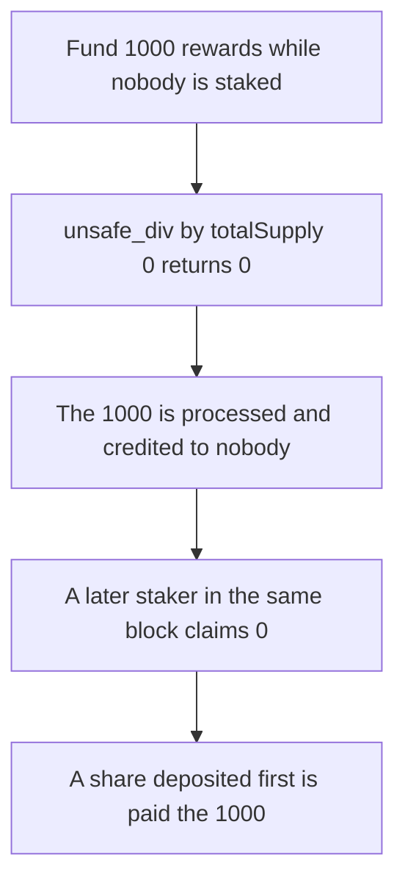

# LiquidityGauge drops a reward interval when totalSupply is 0

> **Vulnerability classes:** vuln/logic/reward-calculation · vuln/dos/frozen-funds

<!-- non-defihacklabs -->
<!-- source-auditvault: https://github.com/Auditware/AuditVault/blob/main/findings/61923-loss-of-rewards-when-liquiditygaugetotalsupply0-mixbytes-non.md -->
<!-- date: 2025-08 -->

## Key info

| Field | Value |
|---|---|
| **Loss** | 1000 reward tokens stay in the gauge. The later staker claims 0 |
| **Vulnerable contract** | `LiquidityGauge._checkpoint` |
| **Attacker EOA** | `0x1111111111111111111111111111111111111111` |
| **Attack contract** | `Exploit` |
| **Attack tx** | `Exploit.run()` |
| **Chain / block / date** | Ethereum model · one block · 2025-08 |
| **Compiler** | solc 0.8.27, cancun, via IR |
| **Bug class** | `unsafe_div` by a zero supply returns 0 and the interval is still consumed |

## TL;DR

`_checkpoint` adds `unsafe_div(1e36 * dt, totalSupply)` to the inverse-supply integral and then sets the integral time to `block.timestamp`. Vyper `unsafe_div` returns 0 when `totalSupply` is 0. The vested `d_reward` is multiplied by that zero growth, so it is marked processed and credited to nobody.

Here the reward window is one second, built by storing `integral.t = block.timestamp - 1` in the same transaction. No `warp` runs inside `run`. A 1000 token reward is funded, the gauge is checkpointed with no stakers, and a staker who deposits afterwards claims 0. The 1000 remains on the gauge. If one share is deposited before the same checkpoint, that staker is paid the 1000.

## The vulnerable code

```solidity
uint256 elapsed = block.timestamp - integralInv.t;
uint256 supply = totalSupply;
// @> VULN: unsafe_div by totalSupply 0 returns 0 and this interval is discarded
uint256 invDelta = _unsafeDiv(1e36 * elapsed, supply);
integralInv.v += invDelta;
integralInv.t = block.timestamp;
```

## Root cause

A zero supply is treated as a completed interval instead of an interval that should stay open until someone is staked.

## Preconditions

- Reward tokens are vested across a timestamp that is later than the last integral time. The one-second gap is stored up front.
- `totalSupply` is 0 at that checkpoint.

## Attack walkthrough

1. Mint and approve 1000 reward tokens. `fund` sets the window to the previous second and pulls the tokens.
2. `poke` vests 1000 and checkpoints. The integral does not grow. Time advances.
3. A staker deposits 1 share in the same block and claims. The claim pays 0.
4. The gauge still holds 1000.
5. Control: the share is deposited first. The same fund and claim pay 1000 and leave 0 stuck.

## Diagrams



## Impact

1000 reward tokens are frozen in the gauge. The staker who arrives after the empty checkpoint cannot claim them. The control pays that staker the full 1000.

## Remediation

Do not advance the integral time, and do not vest, while `totalSupply` is 0. The next depositor then still receives the interval.

## How to reproduce

```bash
cd evm-hack-registry/61923-loss-of-rewards-when-liquiditygaugetotalsupply0-mixbytes-non_exp
forge test -vv
```

## Sources

- [AuditVault finding 61923](https://github.com/Auditware/AuditVault/blob/main/findings/61923-loss-of-rewards-when-liquiditygaugetotalsupply0-mixbytes-non.md)
- [MixBytes Yield Basis DAO audit](https://github.com/mixbytes/audits_public/blob/master/Yield%20Basis/DAO/README.md)
- [LiquidityGauge.vy at 3352c612](https://github.com/yield-basis/yb-core/blob/3352c612fc33e48f1a106da41f63810f31bc38be/contracts/dao/LiquidityGauge.vy)
