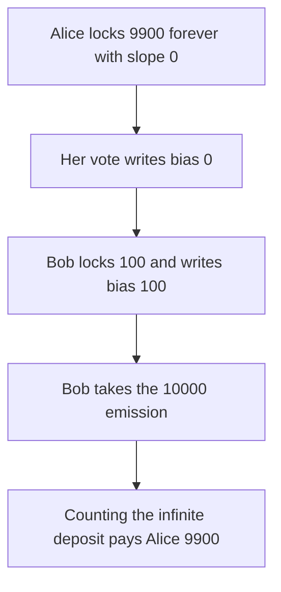

# GaugeController drops infinite VotingEscrow locks

> **Vulnerability classes:** vuln/governance/proposal-manipulation · vuln/logic/wrong-condition

<!-- non-defihacklabs -->
<!-- source-auditvault: https://github.com/Auditware/AuditVault/blob/main/findings/61924-infinitely-locked-votingescrow-positions-are-not-accounted-d.md -->
<!-- date: 2025-08 -->

## Key info

| Field | Value |
|---|---|
| **Loss** | A 100-token finite lock takes all 10000 emission tokens. The 9900 infinite lock is weighted 0 |
| **Vulnerable contract** | `GaugeController.vote` |
| **Attacker EOA** | `0x1111111111111111111111111111111111111111` |
| **Attack contract** | `Exploit` |
| **Attack tx** | `Exploit.run()` |
| **Chain / block / date** | Ethereum model · one block · 2025-08 |
| **Compiler** | solc 0.8.27, cancun, via IR |
| **Bug class** | Vote bias is recomputed as slope times time, and an infinite lock has slope 0 |

## TL;DR

An infinite lock stores slope 0 and a constant bias equal to the deposit. `vote_for_gauge_weights` ignores that bias and sets `new_bias = slope * userWeight / 10000 * (lock_end - block.timestamp)`. The product is 0, so the vote does not move the gauge.

Alice locks 9900 forever and votes 100 percent for gauge A. Bob locks 100 for 100 seconds, which makes his slope times that duration equal 100, and votes 100 percent for gauge B. Gauge A bias stays 0. Gauge B bias is 100. A 10000 emission pot split by those biases pays Bob 10000 and Alice 0. Counting the locked amount when the slope is 0 pays Alice 9900 and Bob 100.

The 10-day vote cooldown is not part of this bug and is not in the reduction, so both votes land in one block. `run` does not warp.

## The vulnerable code

```solidity
uint256 newSlope = slope * userWeight / 10_000;
uint256 newDt = lockEnd - block.timestamp;
// @> VULN: infinite lock slope is 0, so this bias is 0
uint256 newBias = newSlope * newDt;
biasOf[gauge] = biasOf[gauge] + newBias - oldBias;
```

## Root cause

The controller rebuilds bias from the slope. An infinite lock has no slope, so the rebuild throws away the deposit.

## Preconditions

- Alice's escrow point has slope 0, amount 9900, and an end after the current timestamp.
- Bob's finite lock has slope `amount / duration`, so `slope * dt` equals 100.
- Emissions are split by the stored gauge biases. The pot is 10000.

## Attack walkthrough

1. Alice locks 9900 with slope 0. Bob locks 100 for 100 seconds.
2. Alice votes for gauge A. The new bias is 0.
3. Bob votes for gauge B. The new bias is 100.
4. The 10000 pot is split by the biases. Alice is allocated 0. Bob is allocated 10000, and the exploit holds the pot.
5. Control: infinite bias is the locked amount. Alice is paid 9900. Bob is paid 100.

## Diagrams



## Impact

Bob's gauge receives 10000 emission tokens that should have been split 9900 to Alice and 100 to Bob. Alice's voting power is zero for the epoch.

## Remediation

When the escrow slope is 0, set the vote bias from the locked amount times the weight, not from `slope * dt`.

## How to reproduce

```bash
cd evm-hack-registry/61924-infinitely-locked-votingescrow-positions-are-not-accounted-d_exp
forge test -vv
```

## Sources

- [AuditVault finding 61924](https://github.com/Auditware/AuditVault/blob/main/findings/61924-infinitely-locked-votingescrow-positions-are-not-accounted-d.md)
- [MixBytes Yield Basis DAO audit](https://github.com/mixbytes/audits_public/blob/master/Yield%20Basis/DAO/README.md)
- [GaugeController.vy at 3352c612](https://github.com/yield-basis/yb-core/blob/3352c612fc33e48f1a106da41f63810f31bc38be/contracts/dao/GaugeController.vy)
