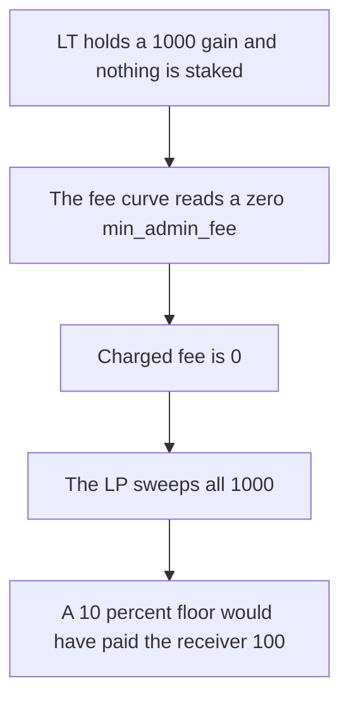

# LT never charges the minimum admin fee

> **Vulnerability classes:** vuln/logic/fee-calculation · vuln/defi/fee-manipulation

<!-- non-defihacklabs -->
<!-- source-auditvault: https://github.com/Auditware/AuditVault/blob/main/findings/62011-no-fee-enforcement-in-lt-contract-quantstamp-yield-basis-mar.md -->
<!-- date: 2025-07 -->

## Key info

| Field | Value |
|---|---|
| **Loss** | Fee receiver gets 0. The LP keeps 1000. The 10 percent floor would have taken 100 |
| **Vulnerable contract** | `LT._adminFee` |
| **Attacker EOA** | `0x1111111111111111111111111111111111111111` |
| **Attack contract** | `Exploit` |
| **Attack tx** | `Exploit.run()` |
| **Chain / block / date** | Ethereum model · one block · 2025-07 |
| **Compiler** | solc 0.8.27, cancun, via IR |
| **Bug class** | `min_admin_fee` is never stored, so the fee curve has a zero floor |

## TL;DR

The LT admin fee is `1e18 - (1e18 - min_admin_fee) * sqrt(1e36 - staked * 1e36 / supply) / 1e18`. Nothing in the deployment writes `min_admin_fee`, so it stays 0. At a stake ratio of 0 the square root term is 1 and the fee is 0. With the intended 10 percent floor the same point charges 10 percent.

A 1000 token gain is charged while nothing is staked. `feePaid` is 0. The fee receiver balance is 0. The LP sweeps all 1000. The control sets `min_admin_fee` to 0.1e18, pays the receiver 100, and leaves the LP 900.

## The vulnerable code

```solidity
uint256 inside = 1e36 - (staked * 1e36) / supply;
uint256 root = _sqrt(inside);
// @> VULN: minAdminFee is never assigned on the real LT, so this floor is 0
return 1e18 - (1e18 - minAdminFee) * root / 1e18;
```

## Root cause

The curve's lower bound is a storage variable that the constructor never sets.

## Preconditions

- `min_admin_fee` is 0.
- The gain is valued while `staked` is 0 and `supply` is nonzero, which is the point where the floor is the whole fee.

## Attack walkthrough

1. Mint a 1000 gain onto LT.
2. `charge` with staked 0 and supply 1. The fee is 0, so nothing is transferred.
3. `sweep` sends 1000 to the LP. The receiver still has 0.
4. Control: the floor is 0.1e18. The receiver gets 100. The LP gets 900.

## Diagrams



## Impact

The fee receiver, who is paid for ve holders, loses 100 tokens on this gain. The LP keeps the 1000 instead of 900.

## Remediation

Set `min_admin_fee` in the LT constructor, and allow governance to update it. 0.1e18 is the 10 percent floor used by the control.

## How to reproduce

```bash
cd evm-hack-registry/62011-no-fee-enforcement-in-lt-contract-quantstamp-yield-basis-mar_exp
forge test -vv
```

## Sources

- [AuditVault finding 62011](https://github.com/Auditware/AuditVault/blob/main/findings/62011-no-fee-enforcement-in-lt-contract-quantstamp-yield-basis-mar.md)
- [Quantstamp Yield Basis audit](https://certificate.quantstamp.com/full/yield-basis/e07ecad3-524c-4609-b4f6-71ed7fdc3281/index.html)
