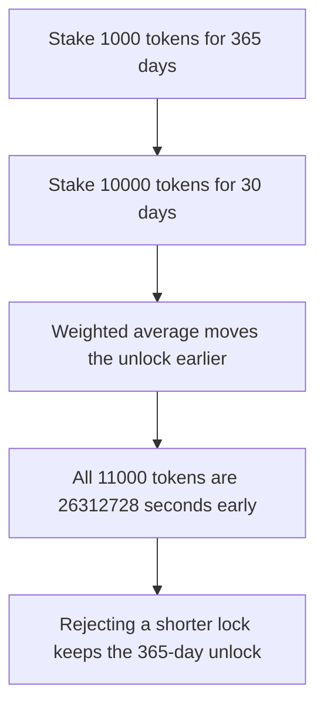

# A shorter SapienVault top-up pulls the whole lock forward

> **Vulnerability classes:** vuln/governance/timelock-bypass

<!-- non-defihacklabs -->
<!-- source-auditvault: https://github.com/Auditware/AuditVault/blob/main/findings/62026-lockup-period-for-unstaking-can-be-decreased-by-staking-agai.md -->
<!-- date: 2025-11 -->

## Key info

| Field | Value |
|---|---|
| **Loss** | 11000 tokens unlock 26312728 seconds earlier than the 365-day stake |
| **Vulnerable contract** | `SapienVault.stake` |
| **Attacker EOA** | `0x1111111111111111111111111111111111111111` |
| **Attack contract** | `Exploit` |
| **Attack tx** | `Exploit.run()` |
| **Chain / block / date** | Ethereum model · one block · 2025-11 |
| **Compiler** | solc 0.8.27, cancun, via IR |
| **Bug class** | Weighted-average unlock lets a larger short lock replace a longer one |

## TL;DR

`stake` on an existing position sets the unlock to the amount-weighted average of the old unlock and the new one. A user stakes 1000 tokens for 365 days, then stakes 10000 tokens for 30 days. The stored unlock moves earlier by 26312728 seconds, and all 11000 tokens are bound by that new time.

The number does not depend on `block.timestamp`, so the whole sequence fits in one block. `run` does not warp. The control rejects a new unlock that is earlier than the current one. The second stake reverts, the unlock stays on the original 365-day timestamp, and only the first 1000 tokens are locked.

## The vulnerable code

```solidity
uint256 newUnlock = block.timestamp + lockup;
// @> VULN: weighted average can move an existing unlock earlier
p.unlock = (p.amount * p.unlock + amount * newUnlock) / (p.amount + amount);
p.amount += amount;
```

## Root cause

The average treats a shorter lock as a reason to reduce time already committed, instead of as a deposit that must last at least as long.

## Preconditions

- The user already has a position. Here it is 1000 tokens at `block.timestamp + 365 days`.
- The second stake is larger and shorter: 10000 tokens at 30 days.
- Both amounts are `n * 1e18`. Integer division of the weighted timestamps yields 26312728 seconds.

## Attack walkthrough

1. Approve and stake 1000 for 365 days. Record the unlock.
2. Stake 10000 for 30 days.
3. The new unlock is earlier. `earlyBy` is 26312728. `locked` is 11000 tokens.
4. Control: the 30-day stake reverts. The unlock is unchanged. Locked amount stays 1000.

## Diagrams



## Impact

11000 tokens become free 26312728 seconds before the original 365-day commitment. That is the full position, not just the 10000 token top-up. The control keeps the original 1000 tokens locked until the first unlock.

## Remediation

Reject a stake whose new unlock is earlier than the position's current unlock. Extra stake must use a lockup at least as long as the one already stored.

## How to reproduce

```bash
cd evm-hack-registry/62026-lockup-period-for-unstaking-can-be-decreased-by-staking-agai_exp
forge test -vv
```

## Sources

- [AuditVault finding 62026](https://github.com/Auditware/AuditVault/blob/main/findings/62026-lockup-period-for-unstaking-can-be-decreased-by-staking-agai.md)
- [Quantstamp Sapien audit](https://certificate.quantstamp.com/full/sapien-2/9f938662-5bf7-4dc3-8774-3e7a12204cc3/index.html)
