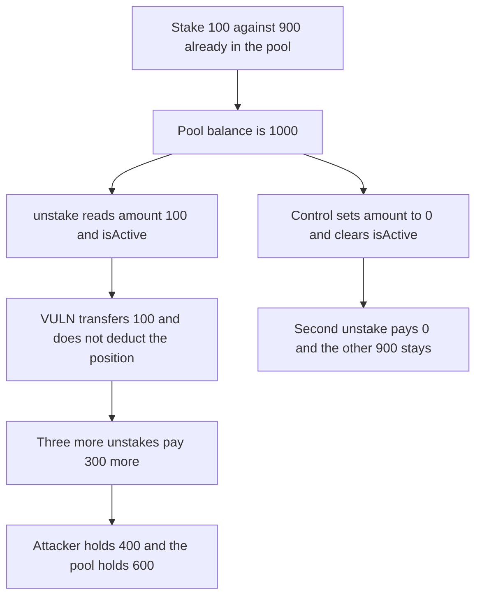

# Sapien staking: unstake pays the recorded balance without deducting it

> **Vulnerability classes:** vuln/logic/missing-check · vuln/logic/state-update

<!-- non-defihacklabs -->
<!-- source-auditvault: https://github.com/Auditware/AuditVault/blob/main/findings/62035-missing-balance-deduction-in-unstaking-functions-allows-cont.md -->
<!-- date: 2025-06 -->

## Key info

| Field | Value |
|---|---|
| **Loss** | A 100 SAPIEN stake is withdrawn four times. The attacker holds 400. The pool falls from 1,000 to 600 |
| **Vulnerable contract** | `SapienStaking.unstake` |
| **Attacker EOA** | `0x1111111111111111111111111111111111111111` |
| **Attack contract** | `Exploit` |
| **Attack tx** | `Exploit.run()` |
| **Chain / block / date** | Ethereum model · block 0 · 2025-06 |
| **Compiler** | solc 0.8.27, cancun, via IR |
| **Bug class** | Staking position is paid out and left active |

## TL;DR

unstake reads StakingInfo.amount, transfers that amount, and does not set the amount to zero or clear isActive. The same orderId can be withdrawn for as long as the contract holds tokens. One 100 SAPIEN stake, against 900 SAPIEN already deposited by other users, is withdrawn four times. The attacker finishes with 400. The other depositors are left with 600. The control zeroes the position, so the second unstake pays nothing and the 900 stays put.

## Background

Quantstamp's June 2025 Sapien review. initiateUnstake and unstake never deduct the staked amount, and the lock duration is not checked on the way out. The client later deducted the balance and cleared the active flag. This reduction keeps the missing deduction. There is no cooldown in the model, matching the report's note that the lock is not enforced. The other 900 SAPIEN is already in the contract when the attack starts.

## The vulnerable code

```solidity
require(info.isActive, "inactive");
uint256 amount = info.amount;
require(amount > 0, "zero");
// @> VULN: staked balance is not deducted and isActive stays true
token.transfer(msg.sender, amount);
```

## Root cause

The transfer uses the stored amount as the payout and then leaves that storage alone. The next call sees the same active position and pays it again.

## Preconditions

- The staking contract already holds 900 SAPIEN from other depositors.
- The attacker can open one 100 SAPIEN position.
- unstake does not reduce StakingInfo.amount and does not clear isActive.

## Attack walkthrough

1. The attacker stakes 100. The pool holds 1,000.
2. unstake pays 100 and leaves the position at 100 active.
3. The same order is unstaked three more times. The attacker holds 400.
4. The pool holds 600. The recorded stake is still 100 and still active.
5. On the control, the first unstake zeroes the position. The second call reverts. The other 900 is untouched.

## Diagrams



## Impact

The attacker deposited 100 SAPIEN and withdrew 400 SAPIEN. The 300 SAPIEN difference is taken from the 900 SAPIEN other depositors had in the contract. Those tokens are no longer fully backed. The staking record still says the attacker has an active 100 SAPIEN position, so another unstake would pay again. The control pays the 100 once and leaves the 900 in the contract.

## Remediation

Set the stored amount to zero and isActive to false before the transfer. After that change the second unstake does not pay.

## How to reproduce

```bash
cd 62035-missing-balance-deduction-in-unstaking-functions-allows-cont_exp
forge test -vv
```

test_exploit_unstake_repeats asserts a 400 balance, a live 100 position, and 600 left in the pool. test_control_unstakes_once asserts a single 100 payout and a revert on the second call. Captured output is `output.txt`.

## Sources

- AuditVault finding: https://github.com/Auditware/AuditVault/blob/main/findings/62035-missing-balance-deduction-in-unstaking-functions-allows-cont.md
- Quantstamp Sapien report, June 2025: https://certificate.quantstamp.com/full/sapien/ffb7e698-6178-46f0-8df8-52e537af70c0/index.html
