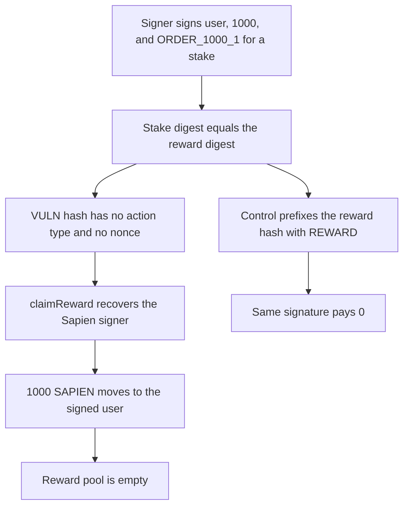

# Sapien: a stake signature is replayed into claimReward

> **Vulnerability classes:** vuln/auth/signature-replay · vuln/auth/signature-validation

<!-- non-defihacklabs -->
<!-- source-auditvault: https://github.com/Auditware/AuditVault/blob/main/findings/62036-signature-replay-attack-possible-between-stake-unstake-and-r.md -->
<!-- date: 2025-06 -->

## Key info

| Field | Value |
|---|---|
| **Loss** | One precomputed stake signature moves 1,000 SAPIEN out of the reward pool to the signed user |
| **Vulnerable contract** | `OrderHash.hashOrder` |
| **Attacker EOA** | `0x1111111111111111111111111111111111111111` |
| **Attack contract** | `Exploit` |
| **Attack tx** | `Exploit.run()` |
| **Chain / block / date** | Ethereum model · block 0 · 2025-06 |
| **Compiler** | solc 0.8.27, cancun, via IR |
| **Bug class** | Stake and reward orders share one packed hash with no nonce |

## TL;DR

verifyOrder hashes keccak256(abi.encodePacked(userWallet, amount, orderId)) for both staking and rewards. There is no action type and no used-order nonce. The signer key is held here. One signature over user 0x1111…1111, amount 1,000, and order ORDER_1000_1 is submitted to claimReward. The reward pool pays that user 1,000 SAPIEN. The control separates the hashes with a REWARD type tag, and the same signature pays 0.

## Background

Quantstamp's June 2025 Sapien review. SapienStaking and SapienRewards both recover keccak256(abi.encodePacked(userWallet, rewardAmount, orderId)). A signature requested for a stake is a valid reward claim, and nothing records the order as used. The client later switched both contracts to EIP-712 typed data. The signature in this run was produced offline with the held signer key 0x7099…79C8 and checked with ecrecover. No cheatcode signs it at runtime.

## The vulnerable code

```solidity
// @> VULN: stake and reward orders share this preimage. No type and no nonce.
return keccak256(abi.encodePacked(userWallet, amount, orderId));
```

## Root cause

The packed preimage does not name the action. A digest built for stakeDigest equals the digest claimReward recovers. The order is not marked used, so the signature is still valid on the second action.

## Preconditions

- The signer has signed user, amount 1,000, and order ORDER_1000_1 for a stake.
- The reward contract holds 1,000 SAPIEN.
- claimReward uses the same hash and does not store a nonce.

## Attack walkthrough

1. The stake digest and the reward digest are computed. They are equal.
2. The signed user holds 0. The reward pool holds 1,000.
3. claimReward is called with the precomputed signature. ecrecover returns the signer.
4. 1,000 SAPIEN moves to the signed user. The pool is empty.
5. On the control, the reward hash is prefixed with REWARD. The stake signature fails and the pool keeps 1,000.

## Diagrams



## Impact

The signed user receives 1,000 SAPIEN from the reward pool. The signature was produced for a stake, not a reward claim. No stake tokens were deposited. The control rejects that signature and moves 0.

## Remediation

Hash a type tag, or an EIP-712 typehash, into the order, and store the digest once it has been used. A stake signature then fails inside claimReward.

## How to reproduce

```bash
cd 62036-signature-replay-attack-possible-between-stake-unstake-and-r_exp
forge test -vv
```

test_exploit_stake_signature_claims_rewards asserts the signed user holds 1,000 and the pool holds 0. test_control_typed_hash_rejects_stake_signature asserts the typed hashes differ and the stake signature pays 0. Captured output is `output.txt`.

## Sources

- AuditVault finding: https://github.com/Auditware/AuditVault/blob/main/findings/62036-signature-replay-attack-possible-between-stake-unstake-and-r.md
- Quantstamp Sapien report, June 2025: https://certificate.quantstamp.com/full/sapien/ffb7e698-6178-46f0-8df8-52e537af70c0/index.html
