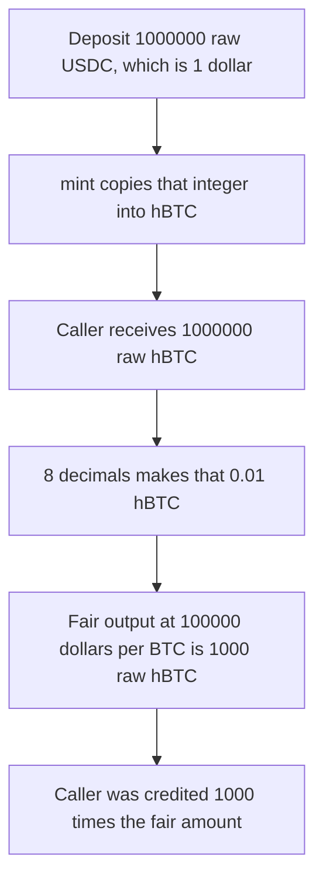

# Syntetika — mint ignores decimals and the BTC price

> **Vulnerability classes:** vuln/arithmetic/decimal-mismatch

> **Reproduction:** a self-contained Foundry PoC that compiles and runs offline
> with only `forge-std` — no fork and no RPC. Trace: [output.txt](output.txt).
> PoC: [test/62198-minter-doesnt-account-for-depegs-exchange-rates-and-decimal_exp.sol](test/62198-minter-doesnt-account-for-depegs-exchange-rates-and-decimal_exp.sol).

<!-- non-defihacklabs -->
<!-- source-auditvault: https://github.com/Auditware/AuditVault/blob/main/findings/62198-minter-doesnt-account-for-depegs-exchange-rates-and-decimal.md -->
<!-- date: 2025-08 -->

---

## Key info

| | |
|---|---|
| **Impact** | **HIGH** — 1 USDC mints **1,000,000** raw hBTC instead of the fair **1,000** |
| **Protocol** | Syntetika `Minter` |
| **Vulnerable code** | `mint` calls `hilBTCToken.mint(to, amount)` with the raw base deposit |
| **Bug class** | Decimal and exchange-rate scale dropped on mint |
| **Finding** | Cyfrin (Dacian) — Syntetika, 1 August 2025 · id 62198 |
| **Report** | [2025-08-01-cyfrin-syntetika-v2.0.md](https://github.com/solodit/solodit_content/blob/main/reports/Cyfrin/2025-08-01-cyfrin-syntetika-v2.0.md) |
| **Source** | [AuditVault finding](https://github.com/Auditware/AuditVault/blob/main/findings/62198-minter-doesnt-account-for-depegs-exchange-rates-and-decimal.md) |
| **Status** | Team matched decimals in the constructor and added a pause. Reproduced here as a local synthetic. |
| **Compiler** | solc 0.8.27, cancun, via IR |

---

## TL;DR

`baseAsset` can be USDC (6 decimals). `hilBTCToken` is hBTC (8 decimals) and is redeemable as BTC. `mint` pulls `amount` of the base asset and mints `amount` hBTC.

At **$100,000 per BTC**, 1 USDC is **1,000** raw hBTC:

`1_000_000 * 1e8 / (100_000 * 1e6) = 1_000`

The call mints **1,000,000** raw hBTC instead. That is **0.01 hBTC**, a thousand times the fair **0.00001 hBTC**. The same 1:1 copy is what the report describes for a depegged 8-decimal wrapper: the minter never reads a price.

## The vulnerable code

```solidity
function mint(address to, uint256 amount) external onlyWhitelisted(msg.sender) onlyWhitelisted(to) nonReentrant {
    baseAsset.safeTransferFrom(msg.sender, address(this), amount);
    hilBTCToken.mint(to, amount); // @> VULN: raw base amount, no decimals and no price
    totalDeposits += amount;
    emit Minted(to, amount);
}
```

The fixed mint replaces that amount with `amount * 1e8 / (100_000 * 1e6)`.

## Root cause

The mint output is the input integer. Nothing rescales 6-decimal base units into 8-decimal hBTC, and nothing divides by the BTC price. A depegged base asset is accepted the same way.

## Preconditions

- The caller and the recipient are whitelisted. That is the normal mint path, not the bug.
- The base asset is 6-decimal USDC and hBTC is 8 decimals.
- BTC is priced at $100,000, so 1 USDC is 1,000 raw hBTC.

## Attack walkthrough

1. Mint 1,000,000 raw USDC to the caller and approve the minter.
2. Whitelist the caller.
3. `mint(caller, 1_000_000)` pulls the USDC and mints 1,000,000 raw hBTC.
4. The fair amount is 1,000. The caller holds 1,000 times that.

Control: the same deposit mints **1,000** raw hBTC. The minter still holds the **1,000,000** raw USDC.

## Diagrams



## Impact

For a **1 USDC** deposit the caller is credited **1,000,000** raw hBTC instead of **1,000**. The extra **999,000** raw hBTC is unbacked by the deposit. The report's depeg case is the same missing scale: a cheap base token is still minted 1:1 into hBTC.

## Remediation

Scale the minted amount by the decimal gap and the base-asset price before calling `hilBTCToken.mint`. Reject, or pause, when the base asset has depegged from the value hBTC redeems for.

## Sources

- [AuditVault finding 62198](https://github.com/Auditware/AuditVault/blob/main/findings/62198-minter-doesnt-account-for-depegs-exchange-rates-and-decimal.md)
- [Cyfrin Syntetika report, 1 August 2025](https://github.com/solodit/solodit_content/blob/main/reports/Cyfrin/2025-08-01-cyfrin-syntetika-v2.0.md)
- Decimal-matching fix: [monorepo@a70110c](https://github.com/SyntetikaLabs/monorepo/commit/a70110c1399c49667c2ef5b12e7b1d2354c02509)

### Taxonomy

- `severity/high`
- `vuln/arithmetic/decimal-mismatch`
