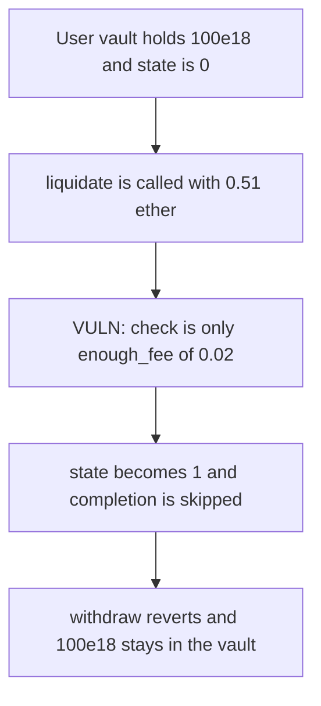

# EVAA — a short liquidation fee locks the user vault

> **Vulnerability classes:** vuln/dos/frozen-funds · vuln/logic/liquidation-logic

<!-- non-defihacklabs -->
<!-- source-auditvault: https://github.com/Auditware/AuditVault/blob/main/findings/62252-insufficient-fee-validation-leading-to-user-contract-state-l.md -->
<!-- date: 2025-08 -->

## Key info

| | |
|---|---|
| **Protocol** | EVAA Finance |
| **Finding** | Trail of Bits, AuditVault 62252 |
| **Vulnerable code** | master liquidate fee check |
| **Harm** | 0.51 ether sets state to 1. Withdraw reverts. 100e18 stays in the user vault. |
| **Chain** | local synthetic |

## TL;DR

The FunC check accepts `msg_value` when it covers `enough_fee` and does not add `TON_reserve_amount`. Those numbers in the report are 0.02 TON and 0.50 TON, so the call needs 0.52. A liquidate with 0.51 passes, the user contract increments `state`, and the completion message is never applied. The later withdraw sees `state != 0` and reverts. 100e18 stays in the vault. The control rejects 0.51, leaves state at 0, and the withdraw pays 100e18.

## The vulnerable code

```solidity
if (msg.value < ENOUGH_FEE) {
    payable(msg.sender).transfer(msg.value);
    return;
}
// @> VULN: 0.51 ether cleared enough_fee and never reserved 0.50 on top
user.lockForLiquidation();
if (msg.value < ENOUGH_FEE + TON_RESERVE) {
    return;
}
```

The fix requires `msg.value >= enough_fee + TON_reserve` before the state increment.

## Root cause

The user contract treats `state != 0` as a lock. The master increments state before it knows the message can pay the reserve and finish. A value in the window locks the account with no completion.

## Preconditions

`enough_fee` is 0.02 ether. `TON_reserve` is 0.50 ether. The call sends 0.51 ether. The user vault holds 100e18. One block. No warp.

## Attack walkthrough

1. 100e18 is minted into the user vault.
2. `liquidate` is called with 0.51 ether.
3. 0.51 is not below 0.02, so the refund branch is skipped.
4. `state` becomes 1. 0.51 is below 0.52, so completion is skipped.
5. `withdraw(100e18)` reverts. The vault still holds 100e18. The owner receives 0.

## Diagrams



## Impact

The depositor cannot withdraw. 100e18 remains in the user vault. The control reverts the 0.51 ether liquidate, state stays 0, and withdraw pays 100e18 to the owner.

## Remediation

Require `msg.value >= enough_fee + TON_reserve_amount` before incrementing the user state.

## How to reproduce

```bash
cd 62252-insufficient-fee-validation-leading-to-user-contract-state-l_exp
forge test -vv
```

## Sources

- AuditVault finding: https://github.com/Auditware/AuditVault/blob/main/findings/62252-insufficient-fee-validation-leading-to-user-contract-state-l.md
- Trail of Bits report: https://github.com/trailofbits/publications/blob/master/reviews/2025-08-evaafinance-securityreview.pdf
- Quoted FunC: `master-liquidate.fc` fee check and `user-liquidate.fc` `state + 1`, plus the withdraw guard in `user-supply-withdrawal.fc`. This synthetic is the same check in Solidity. The audited contracts are FunC.
