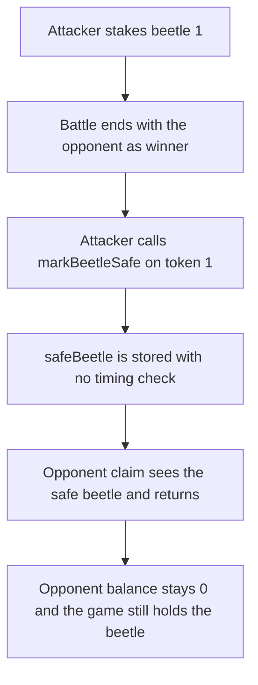

# Beetle — marking a beetle safe after a loss blocks the opponent's NFT

> **Vulnerability classes:** vuln/logic/missing-check · vuln/dos/frozen-funds

> **Reproduction:** a self-contained Foundry PoC that compiles and runs offline
> with only `forge-std` — no fork and no RPC. Trace: [output.txt](output.txt).
> PoC: [test/62314-c-01-user-can-deny-opponent-nft-rewards-by-marking-safe-post_exp.sol](test/62314-c-01-user-can-deny-opponent-nft-rewards-by-marking-safe-post_exp.sol).

<!-- non-defihacklabs -->
<!-- source-auditvault: https://github.com/Auditware/AuditVault/blob/main/findings/62314-c-01-user-can-deny-opponent-nft-rewards-by-marking-safe-post.md -->
<!-- date: 2025-08 -->

---

## Key info

| | |
|---|---|
| **Impact** | **CRITICAL** — the opponent receives **0** beetles and **1** beetle stays locked on the loser's stake |
| **Protocol** | Beetle `BeetleBattleGame` |
| **Vulnerable code** | `markBeetleSafe` writes `safeBeetle[msg.sender] = _tokenId` with no battle check |
| **Bug class** | Post-battle shield blocks `claimBeetleFromVictory` |
| **Finding** | Shieldify — Beetle, August 2025 · id 62314, report C-01 |
| **Report** | [Beetle-Security-Review.md](https://github.com/shieldify-security/audits-portfolio-md/blob/main/Beetle-Security-Review.md) |
| **Source** | [AuditVault finding](https://github.com/Auditware/AuditVault/blob/main/findings/62314-c-01-user-can-deny-opponent-nft-rewards-by-marking-safe-post.md) |
| **Status** | Team fixed the timing. Reproduced here as a local synthetic. |
| **Compiler** | solc 0.8.27, cancun, via IR |

---

## TL;DR

`markBeetleSafe` checks that the caller staked the token and then stores it as that player's safe beetle. It does not look at whether a battle for that token has already been lost. `claimBeetleFromVictory` will not transfer a safe beetle.

The loser waits until battle 1 names the opponent as the winner, calls `markBeetleSafe(1)`, and the opponent's claim returns without a transfer. The opponent's balance stays **0**. The game still holds **1** beetle, staked to the loser.

## The vulnerable code

```solidity
function markBeetleSafe(uint256 _tokenId) public {
    if (isStaked[_tokenId] != msg.sender) revert InvalidTokenOwner();
    safeBeetle[msg.sender] = _tokenId; // @> VULN: allowed after the battle is already lost
    emit SafeBeetleUpdated(msg.sender, _tokenId);
}
```

The claim then hits `if (safeBeetle[loser] == tokenId)` and returns. The transfer to the winner does not run.

The fix reverts `markBeetleSafe` when `battleOf[tokenId]` is already set.

## Root cause

Safety is only an ownership check. The battle result is not an input, so the loser can change `safeBeetle` after the winner is known and before the claim.

## Preconditions

- The attacker has staked beetle 1.
- A battle already records the opponent as the winner and beetle 1 as the stake.
- `claimBeetleFromVictory` refuses to move a beetle that is the loser's `safeBeetle`.

## Attack walkthrough

1. Mint beetle 1 to the attacker and stake it. The game holds the NFT.
2. Finish the battle. The opponent is the winner.
3. The attacker calls `markBeetleSafe(1)`. The assignment stores token 1.
4. The opponent calls `claimBeetleFromVictory(1)`. The safe-beetle check returns early.
5. The opponent's balance is **0**. The game's balance is **1**. The stake still names the attacker.

Control: `markBeetleSafe` reverts with `TooLate` once the battle exists. The claim then transfers beetle 1 to the opponent. The opponent's balance is **1** and the game's balance is **0**.

## Diagrams



## Impact

The winner cannot take the **1** beetle the battle awarded. It stays locked in the game under the loser's stake. The opponent's balance remains **0**.

## Remediation

Allow `markBeetleSafe` only while staking, or reject it when a battle for that token is already recorded. The fixed function reverts with `TooLate` in that case, and the claim transfers the beetle to the winner.

## Sources

- [AuditVault finding 62314](https://github.com/Auditware/AuditVault/blob/main/findings/62314-c-01-user-can-deny-opponent-nft-rewards-by-marking-safe-post.md)
- [Shieldify Beetle review](https://github.com/shieldify-security/audits-portfolio-md/blob/main/Beetle-Security-Review.md)
- Vulnerable function: [BeetleBattleGame.sol at 4ab13a82](https://github.com/rshtirmer/BeetleGame-Contracts/blob/4ab13a82a1f9b7228d5c0ad3a085518a60459036/contracts/BeetleBattleGame.sol#L231)

### Taxonomy

- `severity/high`
