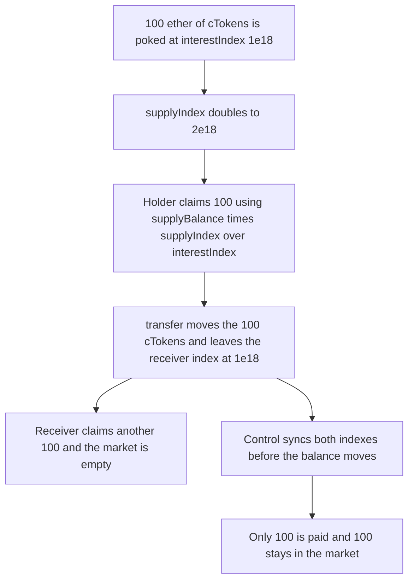

# Fungify cToken transfer does not refresh the interest index, so one balance is claimed twice

> **Vulnerability classes:** vuln/logic/reward-calculation · vuln/defi/reward-inflation

<!-- non-defihacklabs -->
<!-- source-auditvault: https://github.com/Auditware/AuditVault/blob/main/findings/62379-fng-11-all-interest-tokens-can-be-stolen-from-the-interest-m.md -->
<!-- date: 2023-11 -->

## Key info

| Field | Value |
|---|---|
| **Loss** | 200 reward tokens leave a market that was funded with 200. One 100 ether cToken balance was entitled to 100. The second 100 is the same rewards claimed again |
| **Vulnerable contract** | `CErc721.supplyInterestStoredInternal` |
| **Attacker EOA** | `0x1111111111111111111111111111111111111111` |
| **Attack contract** | `Exploit` at `0x15452ec016c4dc8c549e7fe6ff4b26324ea8b7a4` |
| **Attack tx** | `Exploit.run()` |
| **Chain / block / date** | Ethereum model · block 0 · 2023-11 |
| **Compiler** | solc 0.8.27, cancun, via IR |
| **Bug class** | `transfer` moves cTokens and does not set the receiver's `interestIndex` |



## TL;DR

`supplyInterestStoredInternal` is the quoted view. Accrued interest is

`supplyBalance * supplyIndex / interestIndex - supplyBalance`

with `supplyBalance` taken from the account's current cToken balance. `transfer` adds that balance to the receiver and does not write `interestIndex`.

Both accounts were poked at `1e18`. `supplyIndex` then becomes `2e18`. The holder claims 100 ether. The 100 cTokens are transferred. The receiver's index is still `1e18`, so the same formula pays another 100 ether. The market was seeded with 200 and pays all of it. `drained` is 200 ether.

The fixed `transfer` checkpoints both accounts, including a zero balance, before the tokens move. The receiver's index becomes `2e18`. The second claim pays 0. The holder receives 100 and the market keeps 100.

## The vulnerable code

```solidity
SupplyInterestSnapshot memory supplyInterestSnapshot = supplyInterest[account];
uint256 newInterestAccrued = (supplyBalance * supplyIndex / supplyInterestSnapshot.interestIndex) - supplyBalance; // @> VULN: stale interestIndex pays the same rewards on a transferred balance
return supplyInterestSnapshot.interestAccrued + newInterestAccrued;
```

## Impact

Every fresh account that receives the cTokens can claim the full accrued interest for a period it did not hold them. With a 2x index and a 200 ether reward balance, the attacker takes the entire balance instead of the 100 ether the position earned.
