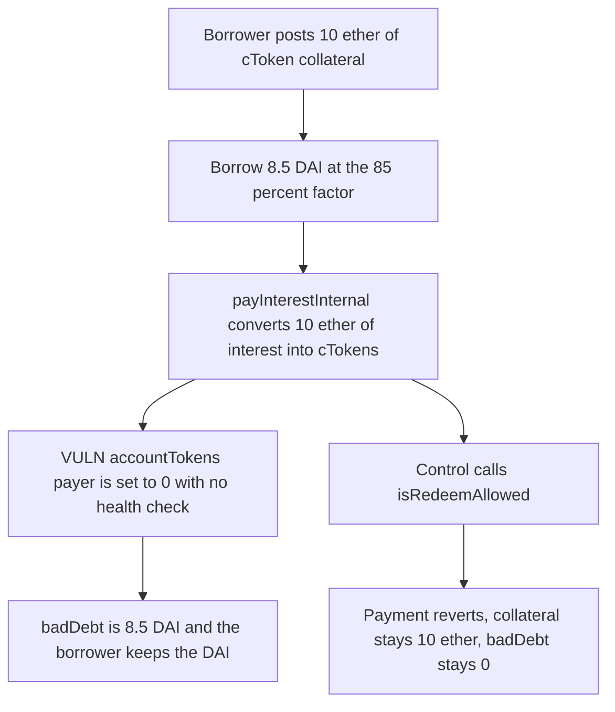

# Fungify interest payment spends cToken collateral and leaves 8.5 DAI of bad debt

> **Vulnerability classes:** vuln/logic/missing-check · vuln/defi/bad-debt

<!-- non-defihacklabs -->
<!-- source-auditvault: https://github.com/Auditware/AuditVault/blob/main/findings/62380-fng-17-cerc20interestmarket-collateral-can-be-directly-used.md -->
<!-- date: 2023-11 -->

## Key info

| Field | Value |
|---|---|
| **Loss** | 8.5 DAI of bad debt. The borrower keeps 8.5 DAI after `payInterestInternal` removes the 10 ether of cToken collateral that backed it |
| **Vulnerable contract** | `CErc20InterestMarket.payInterestInternal` |
| **Attacker EOA** | `0x1111111111111111111111111111111111111111` |
| **Attack contract** | `Exploit` at `0x15452ec016c4dc8c549e7fe6ff4b26324ea8b7a4` |
| **Attack tx** | `Exploit.run()` |
| **Chain / block / date** | Ethereum model · block 0 · 2023-11 |
| **Compiler** | solc 0.8.27, cancun, via IR |
| **Bug class** | Collateral is reduced without `Comptroller.isRedeemAllowed` |



## TL;DR

`payInterestInternal` is the quoted function. It checks `payInterestAllowed`, converts the interest at the stored exchange rate, and subtracts the cTokens from the payer if the raw balance is large enough. It does not ask whether the payer's remaining collateral still covers their borrow.

The payer has 10 ether of cTokens and has borrowed 8.5 DAI, the maximum the 85 percent factor allows. Paying 10 ether of interest at a 1e18 exchange rate zeros the collateral. `badDebt` becomes 8.5 ether. The DAI has already been sent to the attacker.

The fixed market calls `isRedeemAllowed` first. That returns a non-zero code because zero remaining collateral cannot cover 8.5 DAI, the call reverts, and `badDebt` stays 0.

## The vulnerable code

```solidity
uint256 balancePayer = accountTokens[payer];
require(balancePayer >= interestTokens, "insufficient payer reserve");
accountTokens[payer] = balancePayer - interestTokens; // @> VULN: collateral is reduced with no isRedeemAllowed health check
```

## Impact

The protocol is owed 8.5 DAI and holds none of the payer's collateral against it. The attacker keeps the 8.5 DAI. A redeem of the same 10 ether of cTokens would have been rejected.
