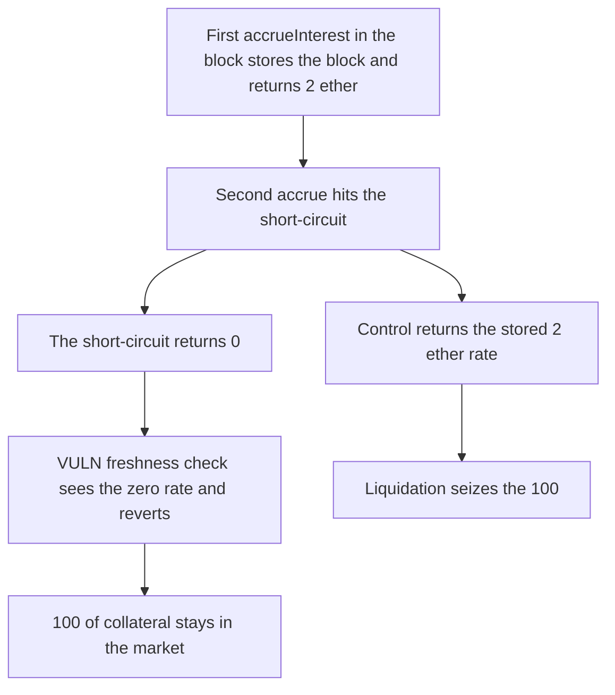

# Fungify liquidation reverts after interest was already accrued in the block

> **Vulnerability classes:** vuln/logic/liquidation-freshness · vuln/dos/blocked-liquidation

<!-- non-defihacklabs -->
<!-- source-auditvault: https://github.com/Auditware/AuditVault/blob/main/findings/62381-fng-15-cerc721-liquidation-will-always-revert-if-interest-st.md -->
<!-- date: 2023-11 -->

## Key info

| Field | Value |
|---|---|
| **Loss** | 100 of collateral is not seized. Liquidation reverts because a same-block accrue returns 0 |
| **Vulnerable contract** | `CToken.liquidate` |
| **Attacker EOA** | `0x1111111111111111111111111111111111111111` |
| **Attack contract** | `Exploit` at `0x15452ec016c4dc8c549e7fe6ff4b26324ea8b7a4` |
| **Attack tx** | `Exploit.run()` |
| **Chain / block / date** | Ethereum model · block 0 · 2023-11 |
| **Compiler** | solc 0.8.27, cancun, via IR |
| **Bug class** | accrueInterest returns 0 on the same-block short-circuit and the freshness check treats that as stale |



## TL;DR

`liquidate` uses the return value of `accrueInterest` as the exchange rate. If this block already accrued, `accrueInterest` returns 0. The freshness check reverts when that rate is 0.

The market holds 100 of collateral and an exchange rate of 2 ether. The first accrue in the transaction returns 2 ether and records the block. The liquidation's accrue then returns 0, and `LiquidateFreshnessCheck` reverts. `collateral` is still 100 and nothing is seized.

The fixed accrue returns the stored exchange rate on that short-circuit. Liquidation seizes the 100.

## The vulnerable code

```solidity
if (accrualBlockNumber == currentBlockNumber) {
    return NO_ERROR;
}
if (accrualBlockNumber != block.number || assetsExchangeRate == 0) {
    lastSeized = assetsExchangeRate; // @> VULN: the same-block accrue returned 0, so the 100 is not seized
    return 0;
}
```

`NO_ERROR` is 0. The quoted `_liquidateBorrow` reverts with `LiquidateFreshnessCheck` on that 0. This model takes the same branch and returns without seizing.

## Impact

A liquidation that should seize 100 of collateral reverts. The collateral stays in the market. Calling `accrueInterest` earlier in the same block is enough to cause it.
