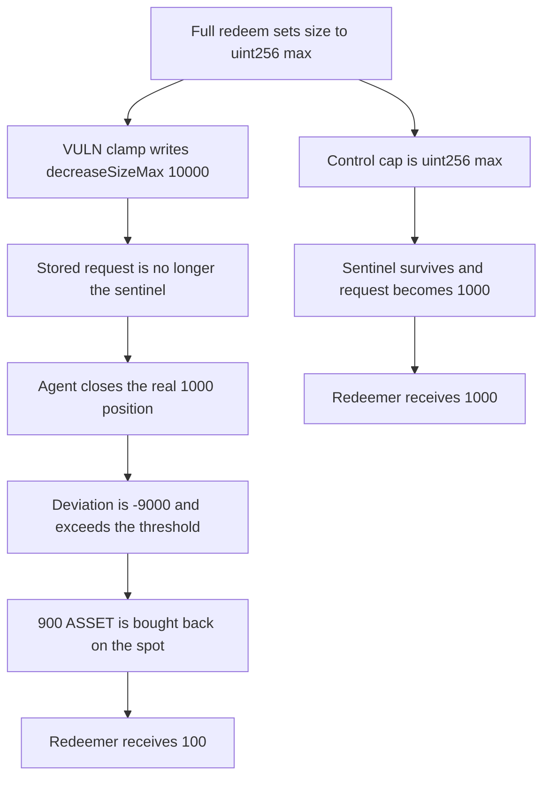

# BasisOS: clamping the close-all sentinel buys back 900 of a 1,000 redemption

> **Vulnerability classes:** vuln/logic/sentinel-clamp · vuln/defi/redemption-buyback

<!-- non-defihacklabs -->
<!-- source-auditvault: https://github.com/Auditware/AuditVault/blob/main/findings/62397-loglab-10-unable-to-redeem-all-user-shares-or-sell-all-produ.md -->
<!-- date: 2024-11 -->

## Key info

| Field | Value |
|---|---|
| **Loss** | Redeemer receives 100 of 1,000 ASSET. 900 is bought back onto the spot |
| **Vulnerable contract** | `BasisStrategy._adjustPosition` |
| **Attacker EOA** | `0x1111111111111111111111111111111111111111` |
| **Attack contract** | `Exploit` |
| **Attack tx** | `Exploit.run()` |
| **Chain / block / date** | Ethereum model · block 0 · 2024-11 |
| **Compiler** | solc 0.8.27, cancun, via IR |
| **Bug class** | `type(uint256).max` close-all size is clamped, so the fill looks short |

## TL;DR

A full redemption sets the hedge decrease to `type(uint256).max`. `_adjustPosition` clamps every non-zero size to `decreaseSizeMax`. With that cap at 10,000, the stored request is 10,000 instead of the sentinel. The agent closes the real 1,000 position. The deviation is -9,000, so `1,000 * 9,000 / 10,000 = 900` ASSET is transferred back to the spot and bought. The redeemer receives 100. If `decreaseSizeMax` is `type(uint256).max`, the sentinel survives and the redeemer receives 1,000.

## Background

Hexens, November 2024, BasisOS / Logarithm basis strategy, LOGLAB-10. `spotSellCallback` uses `type(uint256).max` as the close-all signal for both size and collateral. `_afterDecreasePosition` copies the agent's actual fill over that sentinel before the deviation check. The clamp in `_adjustPosition` destroys the signal whenever `decreaseSizeMax` is any smaller value. The fix is to skip the clamp when the size is `type(uint256).max`.

## The vulnerable code

```solidity
recordedMax = max;
// @> VULN: the close-all sentinel is clamped to decreaseSizeMax, so it is no longer type(uint256).max
clampedSize = _clamp(min, sizeDeltaInTokens, max);
```

The buyback then uses the clamped request:

```solidity
revertedAmt = pending * sizeDeviationAbs / requestSize;
```

## Root cause

`type(uint256).max` means "close whatever the position actually is". Treating it as a numeric size and capping it makes a full fill look like an under-fill against a much larger request.

## Preconditions

- Users are redeeming everything, so vault supply is 0 and the close-all branch runs.
- `decreaseSizeMax` is 10,000. The hedge position and the sale proceeds are 1,000.
- The response deviation threshold is 100 bps. A 90 percent gap exceeds it.
- The agent reports the real decrease of 1,000, which is the whole position.

## Attack walkthrough

1. `decreaseSizeMax` is stored as 10,000. The strategy holds 1,000 ASSET of sale proceeds.
2. `spotSellCallback` sets the size sentinel to `type(uint256).max`.
3. The clamp stores 10,000. The sentinel branch in `_afterDecreasePosition` does not run.
4. Deviation is 1,000 - 10,000. The negative branch buys 900 back on the spot.
5. The redeemer is transferred 100.
6. The control uses `decreaseSizeMax = type(uint256).max`. The clamp returns the sentinel, the request is replaced by the 1,000 fill, and the redeemer receives 1,000.

## Diagrams



## Impact

The redeemer is paid 100 ASSET of a 1,000 ASSET redemption. 900 ASSET is back on the spot, so the hedge is closed and the spot is open again. The same close with `decreaseSizeMax` equal to `type(uint256).max` pays the full 1,000 and buys nothing back.

## Remediation

Do not clamp `sizeDeltaInTokens` when it equals `type(uint256).max`. The close-all branch in `_afterDecreasePosition` can then replace the sentinel with the agent's actual fill before the deviation check.

## How to reproduce

```bash
cd 62397-loglab-10-unable-to-redeem-all-user-shares-or-sell-all-produ_exp
forge test -vv
```

`test_exploit_close_all_buys_back_900` asserts a 900 spot balance, a 100 redeemer balance, and a 900 LOCKED marker. `test_control_max_decrease_pays_the_full_1000` asserts a 1,000 redeemer balance and an empty spot.

## Sources

- AuditVault finding: https://github.com/Auditware/AuditVault/blob/main/findings/62397-loglab-10-unable-to-redeem-all-user-shares-or-sell-all-produ.md
- Report: https://github.com/solodit/solodit_content/blob/main/reports/Hexens/2024-11-25-BasisOS.md
