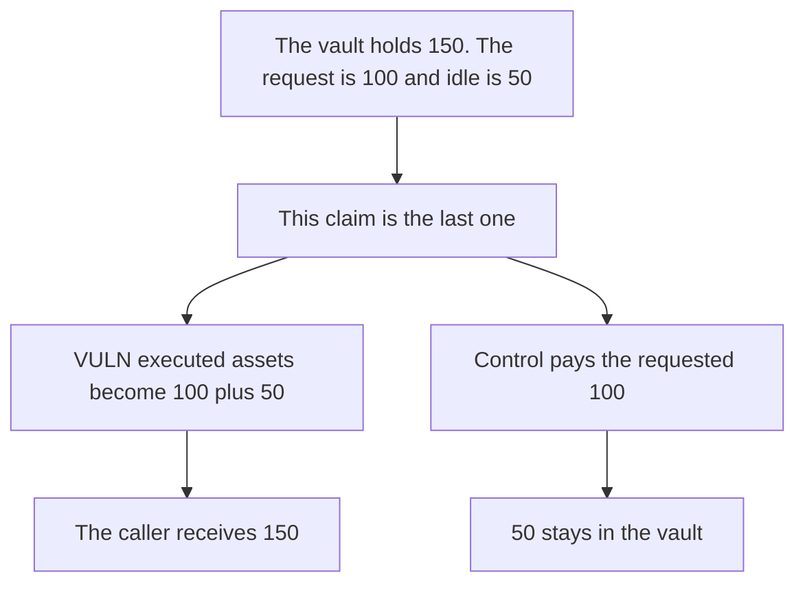

# The last vault claim pays the request plus the idle balance

> **Vulnerability classes:** vuln/logic/last-withdraw · vuln/defi/overpayment

<!-- non-defihacklabs -->
<!-- source-auditvault: https://github.com/Auditware/AuditVault/blob/main/findings/62399-loglab-15-last-withdrawer-could-give-next-depositor-0-shares.md -->
<!-- date: 2024-11 -->

## Key info

| Field | Value |
|---|---|
| **Loss** | A request of 100 is paid 150. The extra 50 is the vault's idle balance |
| **Vulnerable contract** | `Vault.claim` |
| **Attacker EOA** | `0x1111111111111111111111111111111111111111` |
| **Attack contract** | `Exploit` at `0x15452ec016c4dc8c549e7fe6ff4b26324ea8b7a4` |
| **Attack tx** | `Exploit.run()` |
| **Chain / block / date** | Ethereum model · block 0 · 2024-11 |
| **Compiler** | solc 0.8.27, cancun, via IR |
| **Bug class** | The last claim sets `executedAssets` to `requestedAssets + idleAssets` |



## TL;DR

`claim` treats the last withdrawal differently. When there is no shortfall it adds `idleAssets()` to the requested amount and transfers that sum. Idle assets are the balance that should stay for the next deposit.

The vault holds 150. The request is 100 and idle is 50. The last claim pays 150. The control pays 100 and leaves 50 in the vault.

## The vulnerable code

```solidity
uint256 idleAssets = idle;
assetsToClaim += idleAssets;
executedAssets = requested + idleAssets; // @> VULN: the last claim pays the request plus every idle asset
```

## Impact

The last withdrawer takes the idle balance on top of their request. Here that is 50 extra, and the vault is emptied.

## How to reproduce

```bash
cd 62399-loglab-15-last-withdrawer-could-give-next-depositor-0-shares_exp
forge test -vv
```

`test_exploit_last_claim_pays_idle` asserts the caller receives 150. `test_control_pays_the_request_only` asserts a payment of 100 and 50 left in the vault.

## Sources

- AuditVault finding: https://github.com/Auditware/AuditVault/blob/main/findings/62399-loglab-15-last-withdrawer-could-give-next-depositor-0-shares.md
- Hexens report: BasisOS, 2024-11-25
