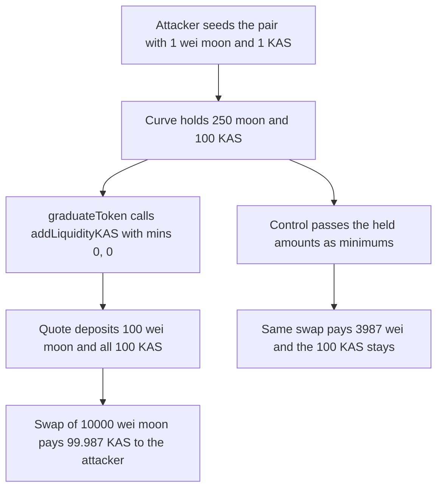

# Moonbound graduation adds liquidity with both minimums at 0, so a seeded pair takes the 100 KAS

> **Vulnerability classes:** vuln/defi/liquidity-drain · vuln/logic/price-calculation

<!-- non-defihacklabs -->
<!-- source-auditvault: https://github.com/Auditware/AuditVault/blob/main/findings/62420-mnbd1-5-early-pair-creation-breaks-fair-launch-of-new-moon-t.md -->
<!-- date: 2025-05 -->

## Key info

| Field | Value |
|---|---|
| **Loss** | 99.987091649290040710 KAS pulled from the pair. The curve deposited 100 KAS and 100 wei of moon. The same 10000 wei moon swap on an empty pair pays 3987 wei |
| **Vulnerable contract** | `BondingCurvePool.graduateToken` |
| **Attacker EOA** | `0x1111111111111111111111111111111111111111` |
| **Attack contract** | `Exploit` at `0x15452ec016c4dc8c549e7fe6ff4b26324ea8b7a4` |
| **Attack tx** | `Exploit.run()` |
| **Chain / block / date** | Ethereum model · block 0 · 2025-05 |
| **Compiler** | solc 0.8.27, cancun, via IR |
| **Bug class** | `addLiquidityKAS` is called with `amountTokenMin` and `amountKasMin` of 0 |



## TL;DR

`graduateToken` approves the router and calls `addLiquidityKAS` with both slippage minimums at 0. The pair already exists. Its reserves are 1 wei of moon and 1 KAS, so the Uniswap quote

`amountB = amountA * reserveB / reserveA`

does not take the curve's 250 moon. It takes 100 wei of moon and the curve's entire 100 KAS. Swapping 10000 wei of moon against that pool pays the attacker 99987091649290040710 wei of KAS.

The fixed call passes the moon and KAS the curve actually holds as the minimums. On an empty pair the full amounts are added, and the same 10000 wei moon swap pays 3987 wei. The pair still holds 100 KAS minus that dust.

## The vulnerable code

```solidity
uint256 tokenForLiquidity = moon.balanceOf(address(this));
uint256 kasCollected = kas.balanceOf(address(this));
moon.approve(address(router), tokenForLiquidity);
kas.approve(address(router), kasCollected);
router.addLiquidityKAS(address(moon), tokenForLiquidity, 0, 0, address(this), block.timestamp + 15 minutes); // @> VULN: mins are 0, so the skewed quote deposits 100 wei of moon and all 100 KAS
```

KAS is modeled as an 18-decimal token so the run does not need a pre-funded native balance. The quoted arguments are the token, the desired moon amount, two zero minimums, the curve, and a deadline.

## Impact

The curve's 100 KAS is moved into a pool the attacker priced. The attacker receives 99.987091649290040710 KAS. Depositors of the new moon token do not get the fair KAS pool the graduation was supposed to create.
