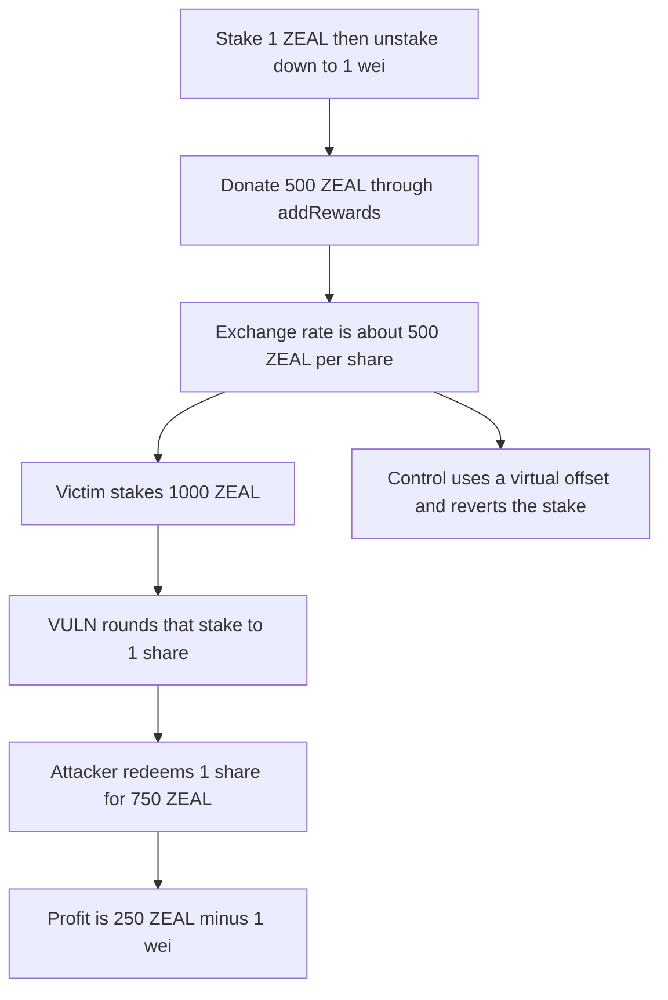

# Zealous: the first depositor rounds the next stake down to 1 share

> **Vulnerability classes:** vuln/logic/price-calculation · vuln/arithmetic/rounding

<!-- non-defihacklabs -->
<!-- source-auditvault: https://github.com/Auditware/AuditVault/blob/main/findings/62427-zls1-2-first-depositor-can-front-run-and-steal-the-next-user.md -->
<!-- date: 2025-05 -->

## Key info

| Field | Value |
|---|---|
| **Loss** | A 1,000 ZEAL stake mints 1 share. The attacker redeems 750 and profits 250 ZEAL minus 1 wei |
| **Vulnerable contract** | `ZealPool.stake` |
| **Attacker EOA** | `0x1111111111111111111111111111111111111111` |
| **Attack contract** | `Exploit` |
| **Attack tx** | `Exploit.run()` |
| **Chain / block / date** | Ethereum model · block 0 · 2025-05 |
| **Compiler** | solc 0.8.27, cancun, via IR |
| **Bug class** | Share mint rounds down after the exchange rate is inflated with rewards |

## TL;DR

stake mints xMint = amount * 1e18 / exchangeRate, rounding down. The attacker stakes 1 ZEAL, unstakes all but 1 wei, and donates X/2 = 500 ZEAL through addRewards. The rate becomes (1 + X/2) * 1e18. The next user stakes X = 1,000 ZEAL and receives 1 share. The attacker redeems their 1 share for 750 ZEAL. Profit against the 501 ZEAL they started with is 250 ZEAL minus 1 wei, which is X/4 - 1. The offset control rejects the victim stake.

## Background

Hexens' May 2025 Zealous review, ZLS1-2. ZEALInfinityPool.stake prices shares as amount * PRECISION / currentRate, and currentRate is (totalStaked + totalRewards) * PRECISION / xSupply. addRewards increases totalRewards without minting shares. The report's scenario, with zealPerBlock = 0 and a victim stake of X, leaves the attacker with profit X/4 - 0.5. The dead-share offset used by ZealousSwapPair stops the rate from being a single wei of supply. This run uses X = 1,000 ZEAL.

## The vulnerable code

```solidity
uint256 currentRate = (totalStaked + totalRewards) * PRECISION / xSupply;
// @> VULN: xMint rounds down, so an inflated rate mints 1 share for a full deposit
xMint = amount * PRECISION / currentRate;
```

## Root cause

Rounding down turns X / (1 + X/2) into 1 share once the attacker has left a single share against a donated X/2. The victim's whole deposit joins a pool that the attacker's one share owns half of.

## Preconditions

- The pool can be the first stake, so the attacker receives shares 1:1.
- addRewards increases totalRewards and does not mint shares.
- The next stake does not require the minted shares to be worth the deposit.

## Attack walkthrough

1. Stake 1 ZEAL. Unstake 1 ZEAL minus 1 wei. Supply is 1 share and totalStaked is 1 wei.
2. Donate 500 ZEAL. The rate is (1 + 500 ZEAL) * 1e18.
3. The victim stakes 1,000 ZEAL. xMint = 1000e18 / (500e18 + 1) = 1.
4. Supply is 2 shares against 1,500 ZEAL plus 1 wei. Redeeming 1 share pays 750 ZEAL.
5. End balance is 751 ZEAL minus 1 wei. Started at 501 ZEAL. Profit is 250 ZEAL minus 1 wei.
6. The offset control prices shares with a 1,000 unit virtual offset and reverts the victim stake.

## Diagrams



## Impact

The next staker deposits 1,000 ZEAL and receives 1 share of a pool the attacker also has 1 share of. The attacker, who put in 1 ZEAL plus a 500 ZEAL donation, withdraws 750 ZEAL. Net profit is 250 ZEAL minus 1 wei. The victim's remaining share is backed by about 750 ZEAL, so about 250 ZEAL of their deposit was taken. The control reverts the victim's stake and the victim keeps 1,000 ZEAL.

## Remediation

Mint a block of dead shares on the first deposit, or revert when the shares being minted are worth less than the deposit. The offset control does the second.

## How to reproduce

```bash
cd 62427-zls1-2-first-depositor-can-front-run-and-steal-the-next-user_exp
forge test -vv
```

test_exploit_rounds_next_stake_to_one_share asserts profit of 250e18 - 1 and a victim share balance of 1. test_control_offset_rejects_inflated_stake asserts the victim keeps 1,000. Captured output is `output.txt`.

## Sources

- AuditVault finding: https://github.com/Auditware/AuditVault/blob/main/findings/62427-zls1-2-first-depositor-can-front-run-and-steal-the-next-user.md
- Hexens Zealous report, 26 May 2025: https://github.com/solodit/solodit_content/blob/main/reports/Hexens/2025-05-26-Zealous.md
