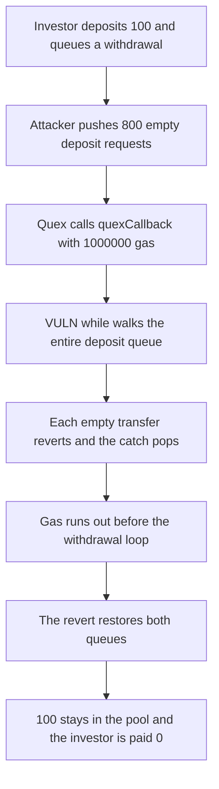

# UFarm: empty deposit requests make quexCallback run out of gas and freeze a withdrawal

> **Vulnerability classes:** vuln/dos/unbounded-loop · vuln/dos/gas-limit · vuln/dos/frozen-funds

<!-- non-defihacklabs -->
<!-- source-auditvault: https://github.com/Auditware/AuditVault/blob/main/findings/62437-ufarm1-2-quex-callback-can-be-permanently-dosed-by-congestin.md -->
<!-- date: 2025-06 -->

## Key info

| Field | Value |
|---|---|
| **Loss** | An investor's 100 stays in the pool. The withdrawal pays 0 |
| **Vulnerable contract** | `UFarmPool.quexCallback` |
| **Attacker EOA** | `0x1111111111111111111111111111111111111111` |
| **Attack contract** | `Exploit` |
| **Attack tx** | `Exploit.run()` |
| **Chain / block / date** | Ethereum model · block 0 · 2025-06 |
| **Compiler** | solc 0.8.27, cancun, via IR |
| **Bug class** | The 1,000,000 gas callback loops the whole deposit queue |

## TL;DR

`quexCallback` is the only function that pops `depositQueue` and `withdrawQueue`. It loops every deposit before it pays withdrawals, and Quex calls it with a fixed 1,000,000 gas. Deposit requests do not pull tokens until that callback, so anyone can push hundreds of empty requests. The callback runs out of gas, the revert restores the queue, and a queued withdrawal of 100 is never paid. The same 800 requests on a callback that handles at most 4 deposits still pay the 100. One empty request on the vulnerable callback also pays the 100.

## Background

Hexens' June 2025 UFarm review, UFARM1-2. A deposit or withdrawal appends a `QueueItem` and asks the Quex oracle for the pool's total value. Quex calls `quexCallback` with a 1,000,000 gas limit. The queues shrink only inside that callback. If the callback cannot finish, the pool cannot settle.

## The vulnerable code

```solidity
uint256 requestsLength = depositQueue.length;
// @> VULN: unbounded loop over the whole deposit queue inside the 1_000_000 gas callback
while (requestsLength > 0) {
    depositItem = depositQueue[requestsLength - 1];
    try this.safeTransferToPool(investor, amountToInvest, depositItem.bearerToken) {
        sharesToMint = _mintSharesByQuote(investor, amountToInvest, _totalCost);
    } catch {
        depositQueue.pop();
        requestsLength = depositQueue.length;
        continue;
    }
}
```

Withdrawals run only after that loop. An empty request fails `safeTransferToPool` and is popped, but each pop still costs gas. Past the 1,000,000 gas stipend the whole callback reverts, so the pops do not stick.

## Root cause

The callback has no cap on how many queue items it processes, and failed deposits are not rejected before they are queued. The gas limit is outside the contract. Once the queue is larger than that limit, every later callback reverts at the same place.

## Preconditions

- Quex calls `quexCallback` with 1,000,000 gas.
- An investor already holds 100 shares backed by 100 tokens in the pool and has a withdrawal queued.
- The attacker can push deposit requests without holding the token.

## Attack walkthrough

1. The investor is minted 100 and deposits it. The pool holds 100 and records 100 shares.
2. The investor queues a withdrawal of those shares. `withdrawQueue` length becomes 1.
3. The attacker pushes 800 deposit requests for 1 token each, with no approval.
4. `quexCallback` enters `while (requestsLength > 0)` and loads each request.
5. `safeTransferToPool` reverts. The catch pops the request and continues.
6. Gas runs out before `_settleWithdrawals`. The call reverts.
7. The pool still holds 100, the investor's token balance is 0, both queues are unchanged, and `paidOut` is 0.
8. The control caps the deposit loop at 4 items, then pays the withdrawal. The investor receives 100 under the same 1,000,000 gas limit and the same 800 requests.

## Diagrams



## Impact

The investor cannot withdraw 100. The tokens sit in the pool, the 100 shares stay outstanding, and the withdrawal stays queued. A later callback hits the same gas limit, so the queue does not drain. The capped callback pays the same 100.

## Remediation

Handle a fixed maximum number of deposit and withdrawal requests per callback, and settle withdrawals inside that budget. The control processes at most 4 empty deposits, then pays the queued 100, and the call succeeds inside 1,000,000 gas.

## How to reproduce

```bash
cd 62437-ufarm1-2-quex-callback-can-be-permanently-dosed-by-congestin_exp
forge test -vv
```

`test_exploit_congested_callback_locks_withdrawal` asserts the pool holds 100, the investor received 0, 800 deposit requests remain, and the withdrawal is still queued. `test_control_bounded_callback_pays_same_spam` asserts one empty request on the vulnerable callback pays 100, and 800 requests on the capped callback also pay 100.

## Sources

- AuditVault finding: https://github.com/Auditware/AuditVault/blob/main/findings/62437-ufarm1-2-quex-callback-can-be-permanently-dosed-by-congestin.md
- Hexens UFarm report, 10 June 2025: https://github.com/solodit/solodit_content/blob/main/reports/Hexens/2025-06-10-Ufarm.md
