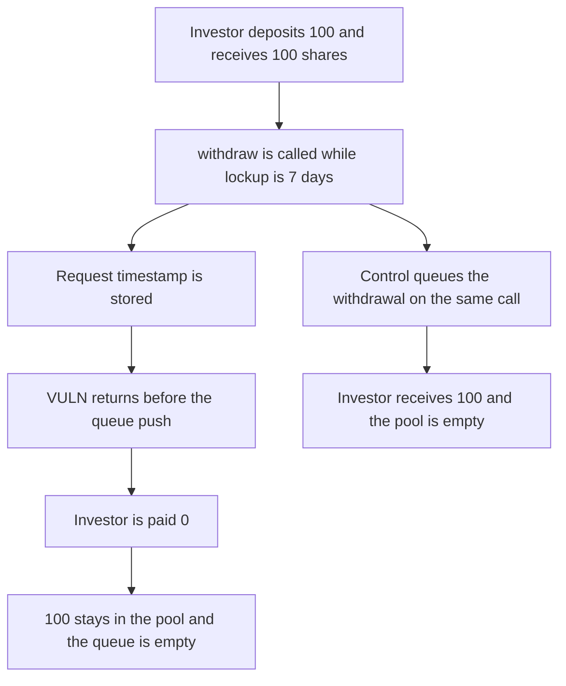

# UFarm: a nonzero withdrawal lockup returns before the withdrawal is queued

> **Vulnerability classes:** vuln/dos/frozen-funds · vuln/logic/missing-check

<!-- non-defihacklabs -->
<!-- source-auditvault: https://github.com/Auditware/AuditVault/blob/main/findings/62440-ufarm1-9-investor-withdrawals-may-not-function-with-a-nonzer.md -->
<!-- date: 2025-06 -->

## Key info

| Field | Value |
|---|---|
| **Loss** | An investor deposits 100 and withdraw receives 0. The 100 stays in the pool and the queue stays empty |
| **Vulnerable contract** | `UFarmPool.withdraw` |
| **Attacker EOA** | `0x1111111111111111111111111111111111111111` |
| **Attack contract** | `Exploit` |
| **Attack tx** | `Exploit.run()` |
| **Chain / block / date** | Ethereum model · block 0 · 2025-06 |
| **Compiler** | solc 0.8.27, cancun, via IR |
| **Bug class** | Both steps of a locked withdrawal return before withdrawQueue.push |

## TL;DR

When withdrawalLockupPeriod is above zero, UFarmPool.withdraw stores the request timestamp and returns before the shares are pushed onto the withdrawal queue. The investor's 100 shares stay recorded and the 100 underlying stays in the pool. The call pays 0. The control still has a 7 day lockup configured, but it queues and pays on the call, so the investor receives 100 and the pool ends empty.

## Background

Hexens' June 2025 UFarm review, UFARM1-9. Investor withdrawals are a two-step flow when config.withdrawalLockupPeriod is nonzero. Both steps return before withdrawQueue.push and before sendQuexRequest. ARCHITECTURE.md says the withdrawal is queued on a later call. That later call is unreachable: the second step, after the lockup, only flips the pool to Deactivating and returns. This run shows the first step, which is enough to freeze the funds in one transaction. The lockup is 7 days.

## The vulnerable code

```solidity
if (pendingWithdrawalsRequests[withdrawalRequestHash] == 0) {
    pendingWithdrawalsRequests[withdrawalRequestHash] = block.timestamp;
} else {
    uint256 unlockTime = pendingWithdrawalsRequests[withdrawalRequestHash] + withdrawalLockupPeriod;
    require(block.timestamp >= unlockTime, "lockup");
    status = DEACTIVATING;
}
// @> VULN: both lockup steps return before the withdrawal is queued
return;
```

## Root cause

The lockup branch returns unconditionally. withdrawQueue.push sits after that return, so a nonzero lockup never records the shares or transfers the underlying.

## Preconditions

- withdrawalLockupPeriod is 7 days.
- The caller is an investor, not the fund address that skips the lockup branch.
- The investor has 100 shares backed by 100 underlying.

## Attack walkthrough

1. The investor deposits 100 and receives 100 shares. The pool holds 100.
2. withdraw is called for 100 shares.
3. The request hash is new, so the timestamp is stored.
4. The function returns. queuedShares is 0. The investor's token balance is unchanged.
5. The 100 underlying is still in the pool and the 100 shares are still outstanding.
6. The control queues that call and transfers the 100 back.

## Diagrams



## Impact

The investor cannot withdraw 100 underlying. The tokens sit in the pool, the share balance is still 100, and the withdrawal queue is empty, so nothing is scheduled to pay them. The control returns the 100 on the same call.

## Remediation

After the lockup has been recorded, or once it has passed, push the withdrawal and pay it. Do not return before the queue update. The control pays the 100 while leaving the lockup parameter set.

## How to reproduce

```bash
cd 62440-ufarm1-9-investor-withdrawals-may-not-function-with-a-nonzer_exp
forge test -vv
```

test_exploit_withdraw_returns_before_queue asserts the pool holds 100, the investor received 0, and the queue is empty. test_control_queues_and_pays asserts the investor receives 100. Captured output is `output.txt`.

## Sources

- AuditVault finding: https://github.com/Auditware/AuditVault/blob/main/findings/62440-ufarm1-9-investor-withdrawals-may-not-function-with-a-nonzer.md
- Hexens UFarm report, 10 June 2025: https://github.com/solodit/solodit_content/blob/main/reports/Hexens/2025-06-10-Ufarm.md
