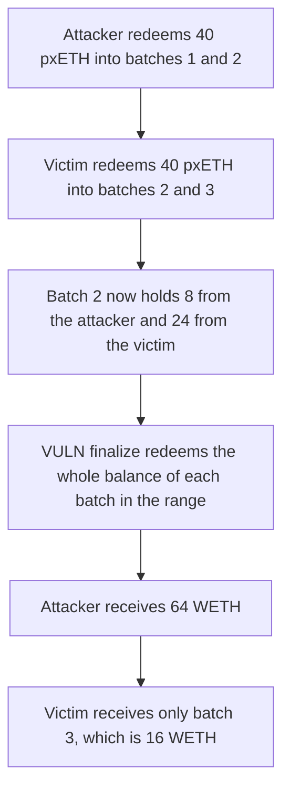

# Notional Exponent: the first Dinero finalizer takes the overlapped batch

> **Vulnerability classes:** `vuln/logic/state-update` · `vuln/logic/incorrect-state-transition`

<!-- non-defihacklabs -->
<!-- source-auditvault: https://github.com/Auditware/AuditVault/blob/main/findings/62484-h-3-dinerowithdrawrequestmanager-vulnerable-to-token-overwit.md -->
<!-- date: 2025-06 -->

## Key info

| Field | Value |
|---|---|
| **Loss** | 24 WETH taken from the next withdrawal. Attacker receives 64 on a 40 request. Victim is left with 16 of 40 |
| **Vulnerable contract** | `DineroWithdrawRequestManager._finalizeWithdrawImpl` |
| **Attacker EOA** | `0x1111111111111111111111111111111111111111` |
| **Attack contract** | `Exploit` |
| **Attack tx** | `Exploit.run()` with 80 ETH |
| **Chain / block / date** | Ethereum model · block 0 · 2025-06 |
| **Compiler** | solc 0.8.27, cancun, via IR |
| **Bug class** | Finalize redeems `upxETH.balanceOf(this, batchId)`, which is every request that landed in that batch |

## TL;DR

Pirex mints upxETH in 32 ETH batches. A 40 ETH redemption fills batch 1 with 32 and leaves 8 on the still-open batch 2. The next 40 ETH redemption adds 24 to that same batch 2 and opens batch 3 with 16. `_finalizeWithdrawImpl` walks the caller's batch range and redeems the manager's entire balance of each id. The first finalizer takes batch 2's 32, including the other user's 24. They receive 64 WETH. The victim receives 16.

## The vulnerable code

```solidity
for (uint256 i = initialBatchId; i <= finalBatchId; i++) {
    uint256 assets = upxETH.balanceOf(address(this), i); // @> VULN
    if (assets == 0) continue;
    PirexETH.redeemWithUpxEth(i, assets, address(this));
    tokensClaimed += assets;
}
```

The judging fix records, at initiate time, how much of each batch belonged to that request, and finalizes only that amount.

## Root cause

`_initiateWithdrawImpl` returns `nonce << 240 | initialBatchId << 120 | finalBatchId`. The nonce makes the id unique. The claim does not. Two requests can share a batch because `_initiateRedemption` keeps minting into `batchId` until another 32 ETH has accumulated. Finalize ignores the per-request split and burns whatever the manager holds for that id.

## Preconditions

- `DEPOSIT_SIZE` is 32 ETH. Both users redeem 40 pxETH, so each request spans two batches and the ranges overlap on batch 2.
- Validators are already dissolved, so `canFinalizeWithdrawRequest` is true. The wait is not the bug. Pirex holds 80 ETH to pay both redemptions.

## Attack walkthrough

1. The attacker initiates 40 pxETH. Batch 1 is minted 32. Batch 2 is minted the 8 remainder. The stored range is 1 to 2.
2. The victim initiates 40 pxETH. Batch 2 grows by 24, to 32. Batch 3 is minted 16. The stored range is 2 to 3.
3. The attacker finalizes first. The loop redeems batch 1 (32) and batch 2 (32). They receive 64 WETH.
4. The victim finalizes. Batch 2 is empty. Batch 3 pays 16 WETH.
5. 24 WETH, the amount above the attacker's own 40, is transferred to the sink.

## Diagrams



## Impact

The first user to finalize an overlapping batch is paid the other user's upxETH in that batch. Here that is 24 ETH. The victim asked to withdraw 40 ETH and receives 16. The attacker's fair share was 40. They keep 40 and the sink holds the stolen 24.

## How to reproduce

```bash
cd 62484-h-3-dinerowithdrawrequestmanager-vulnerable-to-token-overwit_exp
forge test -vv
```

`test_first_finalizer_takes_the_overlapped_batch` sends 80 ETH into `run`, then checks the sink holds 24 WETH, the victim holds 16, and the attacker keeps 40.

## Sources

- AuditVault finding: https://github.com/Auditware/AuditVault/blob/main/findings/62484-h-3-dinerowithdrawrequestmanager-vulnerable-to-token-overwit.md
- Sherlock judging issue 297: https://github.com/sherlock-audit/2025-06-notional-exponent-judging/issues/297
- Manager: https://github.com/sherlock-audit/2025-06-notional-exponent/blob/82c87105f6b32bb362d7523356f235b5b07509f9/notional-v4/src/withdraws/Dinero.sol#L51
- Pirex loop: https://github.com/redacted-cartel/pirex-eth-contracts/blob/master/src/PirexEthValidators.sol#L923
- Fix: https://github.com/notional-finance/notional-v4/pull/20
