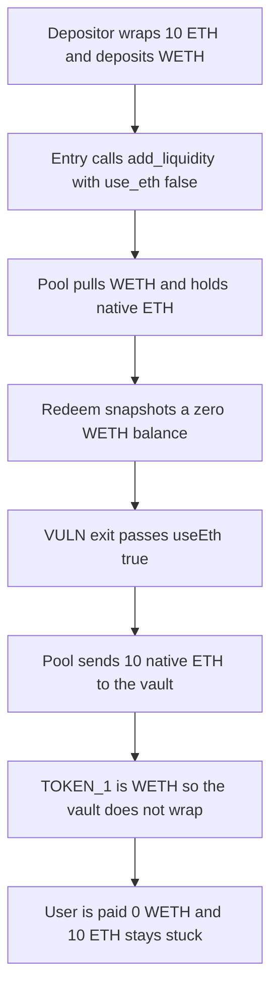

# Notional Exponent: Curve V2 exit hardcodes useEth and strands WETH as native ETH

> **Vulnerability classes:** `vuln/dos/frozen-funds` · `vuln/logic/missing-check`

<!-- non-defihacklabs -->
<!-- source-auditvault: https://github.com/Auditware/AuditVault/blob/main/findings/62490-h-9-hardcoded-useeth-true-in-remove-liquidity-one-coin-or-re.md -->
<!-- date: 2025-06 -->

## Key info

| Field | Value |
|---|---|
| **Loss** | 10 WETH deposited, 0 WETH returned, 10 native ETH stuck in the vault |
| **Vulnerable contract** | `CurveConvex2Token._exitPool` |
| **Attacker EOA** | `0x1111111111111111111111111111111111111111` |
| **Attack contract** | `Exploit` |
| **Attack tx** | `Exploit.run()` |
| **Chain / block / date** | Ethereum model · local · 2025-06 |
| **Compiler** | solc 0.8.27, cancun |
| **Bug class** | Hardcoded `useEth = true` on a WETH Curve V2 exit |

## TL;DR

A Notional yield vault whose Curve coin 0 is WETH enters the pool with `use_eth = (0 < msgValue)`, which is false. `_exitPool` still calls `remove_liquidity_one_coin` with `useEth = true`. The pool sends 10 native ETH to the vault. The vault wraps only when `TOKEN_1` or `TOKEN_2` is the zero address, so the WETH balance delta is 0 and the depositor is paid nothing.

## Background

Sherlock contest `2025-06-notional-exponent`, issue 691, reported by elolpuer and xiaoming90. Curve V2 pools such as t/ETH and cvxETH use WETH at index 0, so `ETH_INDEX` is 0 and the vault's `TOKEN_1` is WETH rather than native ETH.

## The vulnerable code

```solidity
return CURVE_POOL.add_liquidity{value: msgValue}(amounts, minPoolClaim, 0 < msgValue);
// ...
exitBalances[_PRIMARY_INDEX] = CURVE_POOL.remove_liquidity_one_coin(poolClaim, _PRIMARY_INDEX, _minAmounts[_PRIMARY_INDEX], true, address(this)); // @> VULN: useEth hardcoded true
```

The recommended change is to pass true only when the exited coin is native ETH:

```diff
- remove_liquidity_one_coin(poolClaim, _PRIMARY_INDEX, _minAmounts[_PRIMARY_INDEX], true, address(this))
+ remove_liquidity_one_coin(poolClaim, _PRIMARY_INDEX, _minAmounts[_PRIMARY_INDEX], TOKEN_1 == ETH_ADDRESS, address(this))
```

The same flag is hardcoded on the proportional `remove_liquidity` path.

## Root cause

Entry and exit do not use the same `use_eth` rule. Entry follows `msg.value`. Exit always asks the pool for native ETH. After the exit, `unstakeAndExitPool` wraps only if `TOKEN_1` or `TOKEN_2` equals `address(0)`. A WETH vault therefore keeps the ETH and `_burnShares` reports a zero WETH delta.

## Preconditions

- Curve V2 pool, coin 0 is WETH, `ETH_INDEX` is 0.
- The vault asset and `TOKEN_1` are WETH. Neither token is native ETH.
- The depositor enters single-sided with WETH and later redeems single-sided.

## Attack walkthrough

1. The depositor wraps 10 ETH and deposits the WETH into the vault.
2. `_enterPool` calls `add_liquidity` with `use_eth` false. The pool pulls WETH and unwraps it.
3. Redeem snapshots the vault's WETH balance, which is 0.
4. `_exitPool` calls `remove_liquidity_one_coin` with `true`.
5. The pool sends 10 native ETH to the vault.
6. The wrap branches are skipped. `assetsWithdrawn` is 0. The vault's ETH balance is 10.

## Diagrams



## Impact

The depositor's 10 WETH position is replaced by 10 native ETH sitting in the vault. `_burnShares` pays 0 WETH. The control path, which exits with `useEth` false, returns the full 10 WETH and leaves no ETH in the vault.

## Remediation

Set `useEth` on both exit calls from `TOKEN_1 == ETH_ADDRESS` or `TOKEN_2 == ETH_ADDRESS`, matching the mitigation in the Sherlock report.

## How to reproduce

```bash
cd 62490-h-9-hardcoded-useeth-true-in-remove-liquidity-one-coin-or-re_exp
forge test -vv
```

`test_exploit_weth_vault_receives_native_eth_and_pays_zero` asserts a 0 WETH delta and a 10 ETH vault balance. `test_control_use_eth_false_returns_weth` asserts the depositor receives 10 WETH. Captured output is `output.txt`.

## Sources

- AuditVault finding: https://github.com/Auditware/AuditVault/blob/main/findings/62490-h-9-hardcoded-useeth-true-in-remove-liquidity-one-coin-or-re.md
- Sherlock judging: https://github.com/sherlock-audit/2025-06-notional-exponent-judging/issues/691
- Blamed exit: https://github.com/sherlock-audit/2025-06-notional-exponent/blob/main/notional-v4/src/single-sided-lp/CurveConvex2Token.sol#L244
- Blamed entry: https://github.com/sherlock-audit/2025-06-notional-exponent/blob/main/notional-v4/src/single-sided-lp/CurveConvex2Token.sol#L219
