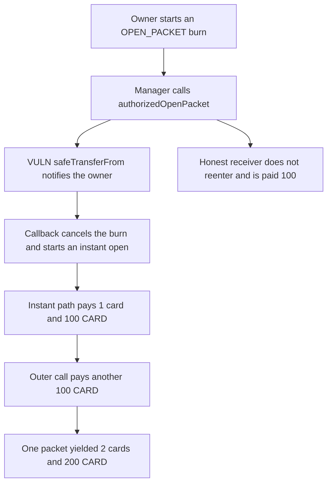

# RipIt: authorizedOpenPacket pays a second card bundle through the receive hook

> **Vulnerability classes:** vuln/reentrancy/cross-function · vuln/logic/incorrect-order-of-operations

<!-- non-defihacklabs -->
<!-- source-auditvault: https://github.com/Auditware/AuditVault/blob/main/findings/62592-c-01-reentrancy-attack-in-authorizedopenpacket-allows-duplic.md -->
<!-- date: 2025-05 -->

## Key info

| Field | Value |
|---|---|
| **Loss** | One packet pays 200 CARD and 2 cards. An honest open of the same pool pays 100 CARD and 1 card |
| **Vulnerable contract** | `Pool.authorizedOpenPacket` |
| **Attacker EOA** | `0x1111111111111111111111111111111111111111` |
| **Attack contract** | `Exploit` |
| **Attack tx** | `Exploit.run()` |
| **Chain / block / date** | Ethereum model · block 0 · 2025-05 |
| **Compiler** | solc 0.8.27, cancun, via IR |
| **Bug class** | safeTransferFrom runs before the OPEN_PACKET burn is finalized |

## TL;DR

authorizedOpenPacket transfers a card with safeTransferFrom before it calls finalizeOpen. The owner's onERC721Received cancels the burn and calls initiateBurn with INSTANT. instantOpenPacket pays a second card and a second 100 CARD, then finalizes. Control returns to the outer call, which pays the first 100 CARD as well. One packet yields 2 cards and 200 CARD. An honest receiver, which does not reenter, is paid 1 card and 100 CARD, and 100 CARD stays in the pool.

## Background

Pashov Audit Group's 10 May 2025 RipIt review, C-01. CardAllocationPool.authorizedOpenPacket delivers the opened cards with safeTransferFrom, which calls the receiver, and only then asks Packet to finalize the burn. The burn type is not cleared before the callback, so the receiver can cancelBurn and initiateBurn(INSTANT_OPEN_PACKET) on the same packet. When that packet type has a single card bundle, instantOpenPacket transfers another set and finalizes. The outer call then finalizes again. The client resolved it with a reentrancy guard and checks-effects-interactions.

## The vulnerable code

```solidity
uint256 cardId = card.mint(address(this));
// @> VULN: the card transfer notifies the receiver before finalizeOpen
card.safeTransferFrom(address(this), to, cardId);
valueToken.transfer(to, SET_VALUE);
packet.finalizeOpen(id);
```

## Root cause

The external transfer happens while the packet is still in the OPEN_PACKET burn. The callback is free to clear that burn and start the instant-open path, which pays a full second set before the outer call pays the first.

## Preconditions

- The attacker owns one packet and has started an OPEN_PACKET burn.
- The pool holds 200 CARD, two sets of 100.
- The receiver is a contract, so safeTransferFrom notifies it.

## Attack walkthrough

1. initiateBurn(OPEN_PACKET) on packet 1.
2. The manager calls authorizedOpenPacket. It mints a card and safeTransferFrom notifies the owner.
3. The callback cancelBurn, then initiateBurn(INSTANT). instantOpenPacket pays 1 card and 100 CARD and finalizes.
4. The outer call pays another 100 CARD and finalizes again.
5. The owner holds 2 cards and 200 CARD. finalized is 2.
6. The honest receiver control is paid 1 card and 100 CARD.

## Diagrams



## Impact

The packet owner receives two card bundles and 200 CARD for a single packet. The fair payout, shown by the honest receiver, is one card and 100 CARD. The extra 100 CARD is the second set. finalizeOpen runs twice, so the packet is both inventoried and cleared.

## Remediation

Clear the burn type, or take a reentrancy lock, before safeTransferFrom. The honest path, which does not reenter, pays one set.

## How to reproduce

```bash
cd 62592-c-01-reentrancy-attack-in-authorizedopenpacket-allows-duplic_exp
forge test -vv
```

test_exploit_opens_one_packet_twice asserts 2 cards, 200 CARD, and two finalizes. test_control_honest_receiver_is_paid_once asserts 1 card, 100 CARD, and 100 CARD left in the pool. Captured output is `output.txt`.

## Sources

- AuditVault finding: https://github.com/Auditware/AuditVault/blob/main/findings/62592-c-01-reentrancy-attack-in-authorizedopenpacket-allows-duplic.md
- Pashov RipIt review, 10 May 2025: https://github.com/pashov/audits/blob/master/team/md/RipIt-security-review_2025-05-10.md
