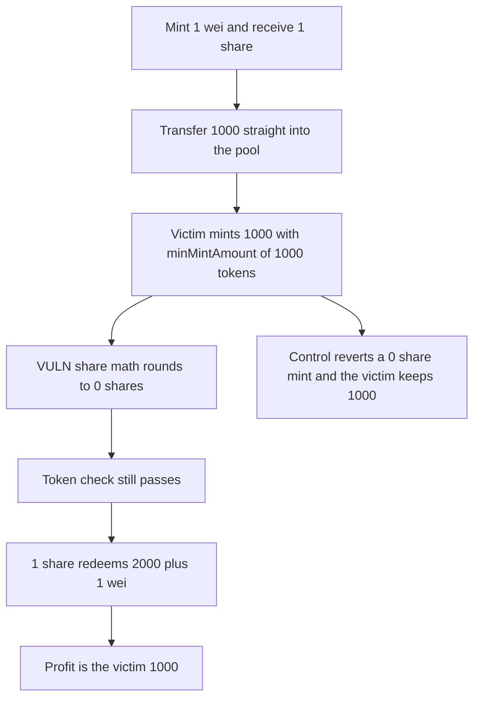

# Tapio: the first mint rounds the next depositor's shares to zero

> **Vulnerability classes:** vuln/logic/price-calculation · vuln/arithmetic/rounding

<!-- non-defihacklabs -->
<!-- source-auditvault: https://github.com/Auditware/AuditVault/blob/main/findings/62659-initial-mint-front-run-inflation-attack-mixbytes-none-nuts-f.md -->
<!-- date: 2025-01 -->

## Key info

| Field | Value |
|---|---|
| **Loss** | The victim deposits 1,000 and receives 0 shares. The attacker's 1 share redeems that 1,000 |
| **Vulnerable contract** | `SelfPeggingAsset.mint` |
| **Attacker EOA** | `0x1111111111111111111111111111111111111111` |
| **Attack contract** | `Exploit` |
| **Attack tx** | `Exploit.run()` |
| **Chain / block / date** | Ethereum model · block 0 · 2025-01 |
| **Compiler** | solc 0.8.27, cancun, via IR |
| **Bug class** | Share count rounds down while minMintAmount checks the token amount |

## TL;DR

An attacker mints 1 wei, receives 1 share, and transfers 1,000 tokens directly into the pool. The victim then mints 1,000 with minMintAmount set to 1,000 tokens. Inside the share math, amount * supply / balance is 0, but the slippage check compares minMintAmount with the token amount, so the mint succeeds. The attacker redeems the 1 share for 2,000 plus 1 wei. Profit is the victim's 1,000. The control requires the share count itself to be nonzero, the victim's mint reverts, and the attacker only gets the donation back.

## Background

MixBytes' Tapio review for NUTS Finance, opened 15 January 2025. SelfPeggingAsset.mint lets the first depositor take a 1 wei position, donate the victim's intended amounts by a plain transfer, and then let the victim's mintShares call round to 0 shares. The minMintAmount guard is applied to the token amounts passed in, not to the shares that come out. The report rates this critical because the initial liquidity deposit can be taken. The recommended fix is a dead share on the first mint, or a check that the minted shares are nonzero.

## The vulnerable code

```solidity
uint256 bal = token.balanceOf(address(this));
// @> VULN: share count rounds down. minMintAmount is checked on tokens, not shares.
shares = amount * supply / bal;
require(amount >= minMintAmount, "min");
```

## Root cause

The donation changes the balance without changing supply. The victim's tokens are pulled in before the division, so the denominator is donation plus deposit plus 1 wei. The numerator is the deposit times a supply of 1. The result is 0. The require that was meant to protect the minter looks at amount, which is exactly minMintAmount.

## Preconditions

- The pool has no shares yet, so a 1 wei mint receives 1 share.
- Tokens can be transferred into the pool without minting.
- The victim sets minMintAmount to their token amount, not to a share amount.

## Attack walkthrough

1. Mint 1 wei. Supply is 1 and the pool balance is 1 wei.
2. Transfer 1,000 into the pool. Supply stays 1.
3. The victim mints 1,000 with minMintAmount of 1,000. Shares minted are 0.
4. Redeem the 1 share. It pays 2,000 plus 1 wei.
5. The attacker started with 1,000 plus 1 wei and ends with 2,000 plus 1 wei. Profit is 1,000.
6. The control reverts the 0-share mint. The victim keeps 1,000. Redeeming the 1 share returns only the donation.

## Diagrams



## Impact

The victim deposits 1,000 tokens and receives 0 shares. The attacker redeems 1 share and receives those 1,000 tokens on top of their own donation, which they also get back. The victim's wallet is empty. The control leaves the victim holding 1,000 and returns only the donation to the attacker.

## Remediation

Require the minted share count to be greater than zero, and compare minMintAmount with that share count. A dead share on the first mint is the report's other fix. The control uses the share check.

## How to reproduce

```bash
cd 62659-initial-mint-front-run-inflation-attack-mixbytes-none-nuts-f_exp
forge test -vv
```

test_exploit_victim_mints_zero_shares asserts profit of 1,000 and a victim share balance of 0. test_control_zero_shares_reverts asserts the victim keeps 1,000. Captured output is `output.txt`.

## Sources

- AuditVault finding: https://github.com/Auditware/AuditVault/blob/main/findings/62659-initial-mint-front-run-inflation-attack-mixbytes-none-nuts-f.md
- MixBytes Tapio report: https://github.com/mixbytes/audits_public/blob/master/NUTS%20Finance/Tapio/README.md#1-initial-mint-front-run-inflation-attack
