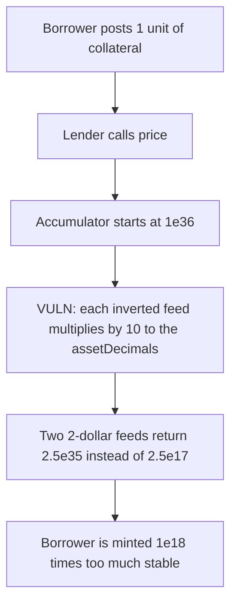

# Tapio `price()` — two inverted feeds borrow 10^18 times too much

> **Vulnerability classes:** vuln/arithmetic/decimal-mismatch

<!-- non-defihacklabs -->
<!-- source-auditvault: https://github.com/Auditware/AuditVault/blob/main/findings/62663-flawed-precision-and-scaling-logic-in-price-mixbytes-none-nu.md -->
<!-- date: 2025-09 -->

## Key info

| | |
|---|---|
| **Protocol** | NUTS Finance Tapio |
| **Finding** | MixBytes, AuditVault 62663 |
| **Vulnerable code** | `ChainlinkCompositeOracleProvider.price` |
| **Harm** | 1 unit of collateral borrows `2.5e35` stable instead of `2.5e17` (factor `1e18`) |
| **Chain** | local synthetic |

## TL;DR

`price()` starts from a 36-decimal accumulator (`PRECISION = 1e36`). For every inverted feed it multiplies that accumulator by `(10**assetDecimals) * (10**feed.decimals()) / feedPrice` and never scales back down by `PRECISION` until the return. Two inverted 8-decimal feeds quoting $2 should mean `0.5 * 0.5 = 0.25` (price `2.5e17`). The second `10**18` leaves the returned price at `2.5e35`. Borrowing `1e18` collateral mints `2.5e35` stable. The fixed fold mints `2.5e17`.

## The vulnerable code

The multiplier is the operation the report describes. The marker sits on the line that applies it.

```solidity
uint256 multiplier =
    (10 ** uint256(assetDecimals)) * (10 ** uint256(cfg.feed.decimals())) / uint256(feedPrice);
// @> VULN: both exponents are reapplied, so each inverted feed inflates the scale by 10**assetDecimals
highPrecisionPrice = highPrecisionPrice * multiplier;
```

The recommended fold keeps one scale and converts once:

```solidity
uint256 rate = scaling * (10 ** feedDecimals) / feedPrice;
highPrecisionPrice = highPrecisionPrice * rate / scaling;
return highPrecisionPrice * 10 ** 18 / scaling;
```

## Root cause

`assetDecimals` is applied inside every inverted iteration, so the accumulator's exponent grows by 18 on each extra inverted feed. With feed price `2e8` and feed decimals `8`, the per-feed multiplier is `5e17`. Starting from `1e36`:

- after one feed: `5e53`, and `/ 1e36` would still be the fair `5e17`
- after two feeds: `2.5e71`, and `/ 1e36` is `2.5e35`

The fair composition is `2.5e17`. The ratio is `10**18`.

## Preconditions

Two inverted Chainlink feeds, each 8 decimals, each answering `2e8`. The borrower posts `1e18` units of collateral. No privileged role is required.

## Attack walkthrough

1. The fair fold of the same two feeds returns `2.5e17`.
2. `Lender.borrow` calls `price()`.
3. The inverted branch multiplies the `1e36` accumulator by `5e17` twice.
4. The returned price is `2.5e35`.
5. The lender mints `1e18 * 2.5e35 / 1e18 = 2.5e35` stable to the borrower.

The fixed lender, given the same feeds, mints `2.5e17`.

## Diagrams



## Impact

A one-unit borrow draws `250000000000000000000000000000000000` stable instead of `250000000000000000`. That is unbacked issuance of `10**18` times the collateral's fair value. The control path pays the fair `2.5e17`.

## Remediation

Build one `rate` per feed on the shared `1e36` scale, divide the accumulator by that scale on every iteration, and convert to the oracle's output decimals a single time on the way out.

## How to reproduce

```bash
cd 62663-flawed-precision-and-scaling-logic-in-price-mixbytes-none-nu_exp
forge test -vv
```

`test_exploit_borrow_is_1e18_times_too_big` asserts the borrower holds `2.5e35` stable. `test_control_fixed_scale_borrows_fair_amount` asserts the fixed oracle returns `2.5e17` and the fixed lender mints that amount.

## Sources

- AuditVault finding: https://github.com/Auditware/AuditVault/blob/main/findings/62663-flawed-precision-and-scaling-logic-in-price-mixbytes-none-nu.md
- MixBytes report: https://github.com/mixbytes/audits_public/blob/master/NUTS%20Finance/Tapio/README.md#4-flawed-precision-and-scaling-logic-in-price
- The audited `ChainlinkCompositeOracleProvider` was later removed from the Tapio scope. The synthetic keeps the inverted-feed arithmetic the report states, and the fixed fold is the report's recommended formula.
