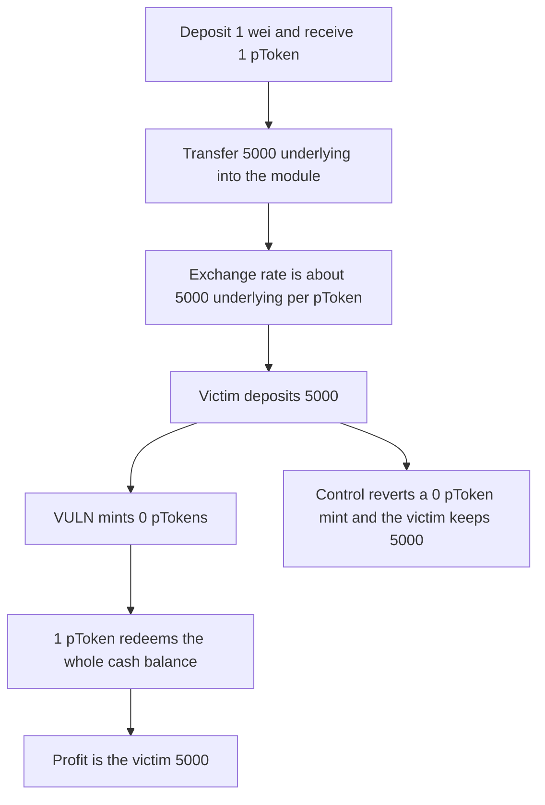

# Pike: a donated balance makes the next deposit mint zero pTokens

> **Vulnerability classes:** vuln/logic/price-calculation · vuln/arithmetic/rounding

<!-- non-defihacklabs -->
<!-- source-auditvault: https://github.com/Auditware/AuditVault/blob/main/findings/62693-inflation-attack-in-ptokenmoduledeposit-draining-initial-dep.md -->
<!-- date: 2025-01 -->

## Key info

| Field | Value |
|---|---|
| **Loss** | The victim deposits 5,000 and receives 0 pTokens. The attacker's 1 pToken redeems that 5,000 |
| **Vulnerable contract** | `PTokenModule.deposit` |
| **Attacker EOA** | `0x1111111111111111111111111111111111111111` |
| **Attack contract** | `Exploit` |
| **Attack tx** | `Exploit.run()` |
| **Chain / block / date** | Ethereum model · block 0 · 2025-01 |
| **Compiler** | solc 0.8.27, cancun, via IR |
| **Bug class** | exchangeRate uses donated cash, and the mint rounds down to 0 pTokens |

## TL;DR

deposit prices pTokens as amount * 1e18 / exchangeRate, and exchangeRate is getCash() * 1e18 / totalSupply. The attacker deposits 1 wei, receives 1 pToken, and transfers 5,000 underlying directly into the module. The rate becomes (1 + 5,000) * 1e18. The victim deposits 5,000 and the division rounds to 0 pTokens. The tokens still move in. Redeeming the 1 pToken returns all cash, including the victim's 5,000. Profit is 5,000. The control reverts a zero pToken mint, so the victim keeps 5,000.

## Background

MixBytes' Pike review for NUTS Finance, opened 24 January 2025. PTokenModule.deposit computes the exchange rate from getCash before it accounts for a direct token transfer. A 1 wei first deposit plus a donation inflates getCash while totalSupply stays 1. The next depositor can be rounded to 0 pTokens and the attacker then redeems the single pToken for the whole cash balance. The report calls this critical. The recommended fix is a dead-share mint plus a check that the minted amount is greater than 0.

## The vulnerable code

```solidity
uint256 rate = exchangeRate();
token.transferFrom(msg.sender, address(this), amount);
// @> VULN: integer division at the inflated exchange rate mints 0 pTokens
minted = amount * 1e18 / rate;
```

## Root cause

getCash counts every token held by the module, including a plain transfer. totalSupply does not. Dividing a later deposit by that rate rounds away the entire deposit when the donation is at least as large as the deposit.

## Preconditions

- The module can be opened with a 1 wei deposit that mints 1 pToken.
- Underlying can be transferred in without calling deposit.
- deposit does not require the minted pToken amount to be greater than 0.

## Attack walkthrough

1. Deposit 1 wei. Receive 1 pToken. Cash is 1 wei.
2. Transfer 5,000 into the module. The exchange rate is (5,000 + 1 wei) * 1e18.
3. The victim deposits 5,000. Minted pTokens are 5,000e18 / (5,000e18 + 1) = 0.
4. Supply is still 1. Redeeming it pays 10,000 plus 1 wei.
5. The attacker started with 5,000 plus 1 wei and ends with 10,000 plus 1 wei. Profit is 5,000.
6. The control reverts the victim deposit. Redeeming the 1 pToken returns only the 5,000 donation.

## Diagrams



## Impact

The victim deposits 5,000 underlying and receives 0 pTokens. The attacker redeems 1 pToken and takes that 5,000, on top of receiving their donation back. The module's cash ends at 0. The control keeps the victim's 5,000 in the victim's wallet.

## Remediation

Require the minted pToken amount to be greater than 0, and mint dead shares on the first deposit so a 1 wei position cannot set the rate. The control uses the nonzero check.

## How to reproduce

```bash
cd 62693-inflation-attack-in-ptokenmoduledeposit-draining-initial-dep_exp
forge test -vv
```

test_exploit_deposit_mints_zero_ptokens asserts profit of 5,000 and a victim pToken balance of 0. test_control_requires_positive_ptokens asserts the victim keeps 5,000. Captured output is `output.txt`.

## Sources

- AuditVault finding: https://github.com/Auditware/AuditVault/blob/main/findings/62693-inflation-attack-in-ptokenmoduledeposit-draining-initial-dep.md
- MixBytes Pike report: https://github.com/mixbytes/audits_public/blob/master/NUTS%20Finance/Pike/README.md#1-inflation-attack-in-ptokenmoduledeposit-draining-initial-deposits
