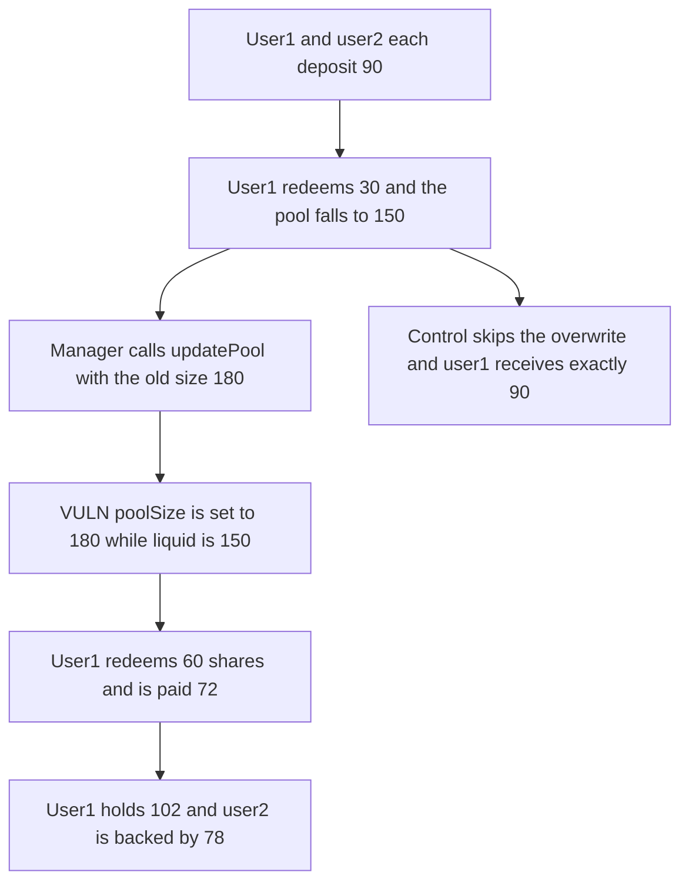

# YuzuUSD: updatePool writes a stale poolSize and user1 extracts 12 from user2

> **Vulnerability classes:** `vuln/defi/sandwich-attack` · `vuln/logic/state-update`

<!-- non-defihacklabs -->
<!-- source-auditvault: https://github.com/Auditware/AuditVault/blob/main/findings/62757-h-02-non-atomic-updatepool-enables-sandwich-attacks-and-extr.md -->
<!-- date: 2025-08 -->

## Key info

| Field | Value |
|---|---|
| **Loss** | User1 deposits 90 and leaves with 102; user2's 90 shares are backed by 78 |
| **Vulnerable contract** | `YuzuILP.updatePool` |
| **Attacker EOA** | `0x1111111111111111111111111111111111111111` (user1) |
| **Attack contract** | `Exploit` |
| **Attack tx** | `Exploit.run()` |
| **Chain / block / date** | Ethereum model · block 0 · 2025-08 |
| **Compiler** | solc 0.8.27, cancun, via IR |
| **Bug class** | `poolSize` is replaced from an external argument with no check against liquid assets |

## TL;DR

`updatePool` sets `poolSize` to whatever the manager passes. User1 and user2 each deposit 90. User1 redeems 30 shares first, so the contract holds 150. The manager's update still writes `poolSize = 180` and a 10% yield rate. User1 redeems the remaining 60 shares at `60 * 180 / 150 = 72`. User1 has received 102. The pool has 78 left against user2's 90 shares. Without the overwrite, user1's two redeems return exactly 90.

## Background

Pashov Audit Group, YuzuUSD review dated 2025-08-28, finding H-02. The report's sequence is two 100e6 deposits, a half redeem in front of `updatePool(200e6, 0.1e6)`, and a back-run redeem that pays more than the remaining fair share. The live YuzuILP now takes the caller's view of the current size and reverts when it disagrees, and it is `whenPaused`. This reduction keeps the reviewed shape: one external `newPoolSize`, no freshness check. The numbers are 90 and 90 so the division is exact.

## The vulnerable code

```solidity
function updatePool(uint256 newPoolSize, uint256 newDailyLinearYieldRatePpm) external onlyRole {
    require(newDailyLinearYieldRatePpm <= 1e6, "yield");
    poolSize = newPoolSize; // @> VULN: poolSize is replaced without checking liquid
    dailyLinearYieldRatePpm = newDailyLinearYieldRatePpm;
    lastPoolUpdateTimestamp = block.timestamp;
}
```

```diff
- poolSize = newPoolSize;
+ require(newPoolSize == liquid, "stale");
+ poolSize = newPoolSize;
```

Pausing user redeems across the update is the other fix the report suggests.

## Root cause

Share price is `poolSize / totalShares`, and redeems also decrease `poolSize`. An update that writes a size captured before those redeems puts the price back above the assets the contract holds. The back-run redeem is paid from the other depositor's tokens.

## Preconditions

- Two depositors, 90 tokens each. Shares mint 1:1, so the pool starts at 180.
- The manager is authorized. The bug is not a missing role. The manager passes the pre-redeem size, 180, and yield rate `100000` (10% in ppm).
- User1 can redeem before and after that transaction. This run does both calls in order inside `run()`.

## Attack walkthrough

1. Both users deposit 90.
2. User1 redeems 30 shares and receives 30. `poolSize` and the token balance are 150.
3. The manager calls `updatePool(180, 100000)`.
4. `poolSize` is 180 again. The contract still holds 150.
5. User1 redeems 60 shares and receives 72.
6. User1's balance is 102. The pool holds 78. User2 still has 90 shares. The excess paid above shares burned is 12.

## Diagrams



## Impact

User1 deposited 90 and holds 102, a gain of 12. Those 12 tokens are the shortfall against user2's 90 shares: the pool balance is 78. The control, which never overwrites `poolSize`, returns exactly 90 to user1 and leaves 90 backing user2.

## Remediation

Reject `updatePool` unless the passed size matches the assets still in the pool, or accept it only while deposits and redeems are paused so it cannot be sandwiched.

## How to reproduce

```bash
cd 62757-h-02-non-atomic-updatepool-enables-sandwich-attacks-and-extr_exp
forge test -vv
```

`test_exploit_user1_extracts_12_from_user2` asserts the 102 payout, the 78 remainder, and the 12 excess. `test_control_without_overwrite_user1_receives_principal` asserts a fair 90. Captured output is `output.txt`.

## Sources

- AuditVault finding: https://github.com/Auditware/AuditVault/blob/main/findings/62757-h-02-non-atomic-updatepool-enables-sandwich-attacks-and-extr.md
- Pashov report: https://github.com/pashov/audits/blob/master/team/md/YuzuUSD-security-review_2025-08-28.md
- PoC the report links: https://gist.github.com/merlinboii/b125979b081266de2491e883712713fc
- Later guarded update: https://github.com/Telos-Consilium/ouroboros-contracts/blob/main/src/YuzuILP.sol
