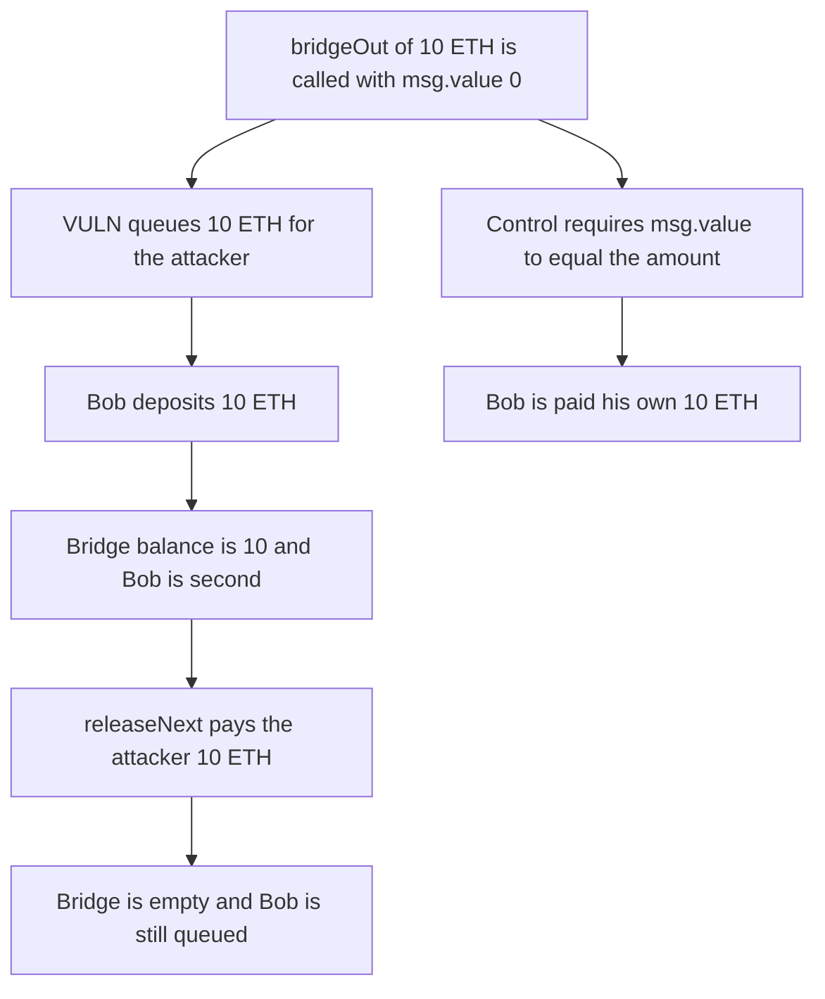

# Camp: bridgeOut records a deposit that msg.value did not pay

> **Vulnerability classes:** vuln/input-validation/missing · vuln/logic/missing-validation

<!-- non-defihacklabs -->
<!-- source-auditvault: https://github.com/Auditware/AuditVault/blob/main/findings/62775-missing-check-of-msgvalue-in-bridgeout-function-allows-dos-o.md -->
<!-- date: 2025-07 -->

## Key info

| Field | Value |
|---|---|
| **Loss** | A 0-value deposit of 10 ETH is paid from Bob's later 10 ETH deposit. Bob is left queued and unpaid |
| **Vulnerable contract** | `Bridge.bridgeOut` |
| **Attacker EOA** | `0x1111111111111111111111111111111111111111` |
| **Attack contract** | `Exploit` |
| **Attack tx** | `Exploit.run()` |
| **Chain / block / date** | Ethereum model · block 0 · 2025-07 |
| **Compiler** | solc 0.8.27, cancun, via IR |
| **Bug class** | The queued amount is the caller's argument, not msg.value |

## TL;DR

bridgeOut pushes _originalAmount onto the release queue and never compares it with msg.value. The attacker queues 10 ETH with msg.value 0. Bob then deposits 10 ETH for real, so the bridge balance is 10. releaseNext pays the queue in order and sends that 10 ETH to the attacker. Bob remains queued for 10 ETH against an empty bridge. The control requires msg.value == _originalAmount. The 0-value call is rejected, and Bob's own release returns his 10 ETH.

## Background

Quantstamp's Camp review, 31 July 2025 through 1 August 2025, file CampTimelockEscrowNativeOFT.sol. bridgeOut is the native deposit into the OFT bridge. The amount to bridge is _originalAmount, and it is not checked against msg.value. A deposit can be opened in debt. Whitelisted users can be paid immediately. Everyone else is paid when the queue reaches them, and that payment spends whatever balance is in the contract, including deposits that arrived later. A huge unpaid amount also wedges batchRelease, because the debt cannot be skipped. This run is the ordering theft: the zero-value deposit is first, and the next real deposit pays it. The client fixed the check in 95fad25.

## The vulnerable code

```solidity
function bridgeOut(uint256 originalAmount) external payable {
    // @> VULN: originalAmount is queued with no check against msg.value
    queue.push(Deposit({user: msg.sender, amount: originalAmount}));
}
```

## Root cause

The queue stores a caller-chosen amount. releaseNext pays queue[head].amount from address(this).balance. Nothing ties that amount to the value that was sent with the deposit.

## Preconditions

- bridgeOut does not check msg.value.
- Release pays the queue from the front and does not skip an entry.
- A later user deposits at least the attacker's recorded amount.

## Attack walkthrough

1. The call carries Bob's 10 ETH, but it is not deposited yet.
2. bridgeOut(10 ETH) is called with value 0. The attacker is queue index 0.
3. Bob deposits the 10 ETH. The bridge balance is 10. Bob is queue index 1.
4. releaseNext pays index 0. The attacker receives 10 ETH. The bridge balance is 0.
5. Bob is still queued for 10 ETH and holds 0.
6. The control rejects the 0-value bridgeOut. Bob deposits 10 and his release pays him 10.

## Diagrams



## Impact

Bob deposited 10 ETH and received 0. The attacker, who deposited 0, received that 10 ETH. Bob's queue entry is still open and the bridge has nothing left to pay it. The control returns Bob's 10 ETH to Bob.

## Remediation

Require msg.value == _originalAmount before enqueueing, including any bridge fee. The control uses that check.

## How to reproduce

```bash
cd 62775-missing-check-of-msgvalue-in-bridgeout-function-allows-dos-o_exp
forge test -vv
```

test_exploit_zero_value_deposit_takes_next_deposit asserts the attacker holds 10 ETH, the bridge holds 0, and Bob holds 0. test_control_requires_msg_value asserts the 0-value call is rejected and Bob is paid 10 ETH. Captured output is `output.txt`.

## Sources

- AuditVault finding: https://github.com/Auditware/AuditVault/blob/main/findings/62775-missing-check-of-msgvalue-in-bridgeout-function-allows-dos-o.md
- Quantstamp Camp report, July 2025: https://certificate.quantstamp.com/full/camp/ae830654-5f2b-4d21-aba2-1de572092da6/index.html
