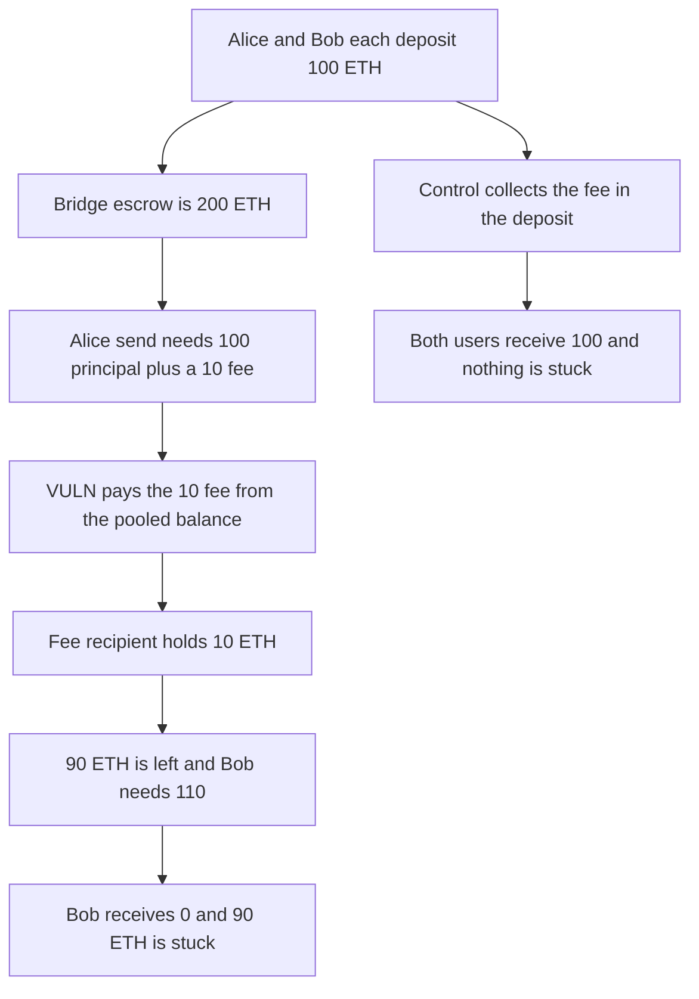

# Camp: the bridge fee is taken from the next depositor

> **Vulnerability classes:** vuln/logic/fee-calculation · vuln/dos/frozen-funds

<!-- non-defihacklabs -->
<!-- source-auditvault: https://github.com/Auditware/AuditVault/blob/main/findings/62776-user-deposit-may-not-cover-bridging-fees-quantstamp-camp-mar.md -->
<!-- date: 2025-07 -->

## Key info

| Field | Value |
|---|---|
| **Loss** | A 10 ETH fee is paid out of Bob's 100 ETH deposit. 90 ETH of that deposit is stuck and Bob receives 0 |
| **Vulnerable contract** | `CampBridge.send` |
| **Attacker EOA** | `0x1111111111111111111111111111111111111111` |
| **Attack contract** | `Exploit` |
| **Attack tx** | `Exploit.run()` |
| **Chain / block / date** | Ethereum model · block 0 · 2025-07 |
| **Compiler** | solc 0.8.27, cancun, via IR |
| **Bug class** | send pays principal plus a fee that bridgeOut never collected |

## TL;DR

bridgeOut accepts msg.value equal to _originalAmount and does not collect the fee that send later pays. send computes a 10 percent fee and pays principal plus fee from the contract balance. Alice deposits 100 ETH and Bob deposits 100 ETH. Alice's send pays her 100 and pays a 10 ETH fee. The bridge has 90 ETH left. Bob's send needs 110 ETH, so it cannot run. Bob receives 0. The 90 ETH stays in the bridge. The control requires the deposit to include the 10 percent fee. Both users pay 110, both receive 100, and the fee recipient receives 20 from those payments.

## Background

Quantstamp's Camp review, 31 July 2025 through 1 August 2025, the companion finding to the missing msg.value check. send and _bridgeNativeTokens charge fees on top of the _originalAmount recorded by bridgeOut. Nothing in the deposit checks that msg.value covers the fee. The contract can run out of balance while deposits are still queued. The client fixed the accounting in 95fad25 and 3f19c06. This run keeps the principal check, so the only shortfall is the fee, and shows that fee coming out of the next deposit.

## The vulnerable code

```solidity
uint256 fee = item.amount * FEE_BPS / 10_000;
uint256 total = item.amount + fee;
require(address(this).balance >= total, "short");
// @> VULN: the bridge fee is paid from pooled deposits, not from this msg.value
(bool paidUser,) = item.user.call{value: item.amount}("");
require(paidUser, "user");
(bool paidFee,) = address(feeSink).call{value: fee}("");
```

## Root cause

The fee is computed at send time and paid from address(this).balance. bridgeOut only escrowed the principal. The extra value is whoever deposited after this user.

## Preconditions

- The bridge fee is 10 percent of the principal.
- bridgeOut accepts exactly the principal.
- At least two deposits are queued, so the first send can pay its fee from the second deposit.

## Attack walkthrough

1. Alice deposits 100 ETH. Bob deposits 100 ETH. The bridge holds 200.
2. Alice's fee is 10 ETH. Her send needs 110.
3. She is paid 100. The fee recipient is paid 10. The bridge holds 90.
4. Bob is still queued for 100 and would also owe a 10 fee, 110 in total. 90 is not enough.
5. Bob's balance is 0. His 90 ETH remainder cannot complete a bridge.
6. The control collects 110 from each user. Both receive 100. Nothing is stuck.

## Diagrams



## Impact

Bob deposited 100 ETH and received 0. 10 ETH of his deposit was paid to the fee recipient to cover Alice's bridge, and the other 90 ETH is stuck because his own bridge needs 110. Alice was paid in full. The control pays both users 100 and takes the fees from their own deposits.

## Remediation

Require msg.value to cover _originalAmount plus the fee inside bridgeOut, and pay the fee from that deposit. The control does this.

## How to reproduce

```bash
cd 62776-user-deposit-may-not-cover-bridging-fees-quantstamp-camp-mar_exp
forge test -vv
```

test_exploit_fee_comes_out_of_the_next_deposit asserts the fee recipient holds 10 ETH, the bridge holds 90 ETH, and Bob holds 0. test_control_collects_the_fee_up_front asserts both users receive 100 and the bridge holds 0. Captured output is `output.txt`.

## Sources

- AuditVault finding: https://github.com/Auditware/AuditVault/blob/main/findings/62776-user-deposit-may-not-cover-bridging-fees-quantstamp-camp-mar.md
- Quantstamp Camp report, July 2025: https://certificate.quantstamp.com/full/camp/ae830654-5f2b-4d21-aba2-1de572092da6/index.html
