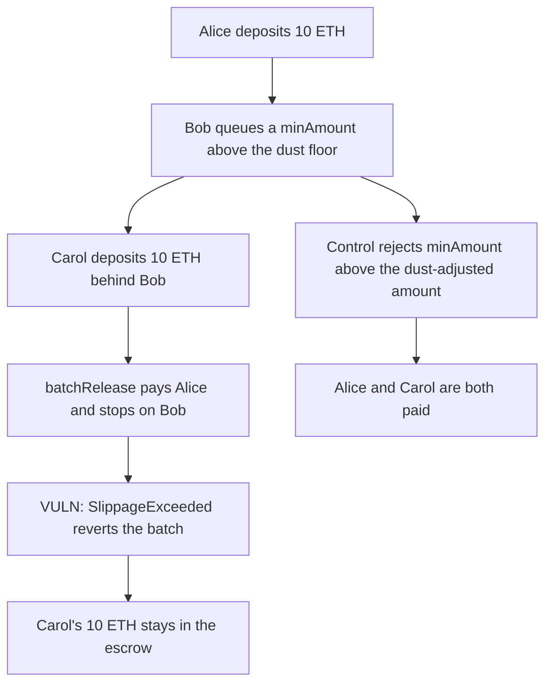

# Camp: a dust-sensitive minAmount freezes batchRelease

> **Vulnerability classes:** vuln/dos/frozen-funds · vuln/input-validation/missing · vuln/defi/slippage

<!-- non-defihacklabs -->
<!-- source-auditvault: https://github.com/Auditware/AuditVault/blob/main/findings/62778-malicious-deposit-with-dust-sensitive-minamount-can-cause-de.md -->
<!-- date: 1970-01 -->

## Key info

| Field | Value |
|---|---|
| **Loss** | Carol's 10 ETH stays in the escrow. Every later batchRelease reverts on the poison deposit |
| **Vulnerable contract** | `Bridge._debitView` |
| **Attacker EOA** | `0x1111111111111111111111111111111111111111` |
| **Attack contract** | `Exploit` |
| **Attack tx** | `Exploit.run()` |
| **Chain / block / date** | Ethereum model · block 0 · 1970-01 |
| **Compiler** | solc 0.8.27, cancun, via IR |
| **Bug class** | minAmount is not checked against the dust-rounded amount |

## TL;DR

`batchRelease` bridges each queued deposit by rounding the amount down with `_removeDust`, then reverts if that rounded amount is below the depositor's `minAmount`. `bridgeOut` stores `minAmount` without that check. Bob queues 1.0000123 ETH with `minAmount` 1.0000120 ETH. The 1e13 dust unit floors the amount to 1.0000100 ETH, the slippage check reverts, and the cursor stays on Bob. Carol deposited 10 ETH behind him. She cannot be paid. A second `batchRelease` reverts the same way.

## Background

Quantstamp's Camp review of `CampTimelockEscrowNativeOFT`. `batchRelease` walks the deposit queue and calls the LayerZero debit path. `_removeDust` drops decimal dust so the amount can be represented on the other chain. `OFTCore` then reverts `SlippageExceeded` when the rounded amount is under `_minAmount`. There is no try/catch around one deposit, so one bad `minAmount` stops every deposit behind it. The client fixed this by rejecting a `minAmount` above the dust-adjusted amount inside `bridgeOut`.

## The vulnerable code

```solidity
uint256 amountSentLD = _removeDust(amountLD);
uint256 amountReceivedLD = amountSentLD;
if (amountReceivedLD < minAmountLD) {
    revert SlippageExceeded(amountReceivedLD, minAmountLD); // @> VULN: one deposit reverts the whole batchRelease
}
```

## Root cause

Dust removal and the slippage check run at release time. The queue accepts any `minAmount` at `bridgeOut`. Bob picks a minimum that is below his raw amount and above the rounded amount, so the check can only fail, and it fails inside the loop that every later release must enter.

## Preconditions

- The dust unit does not divide the queued amount. Here the unit is 1e13 wei.
- `minAmount` is greater than the floored amount and was not rejected at queue time.
- A later depositor is already behind that entry. Carol's 10 ETH is.

## Attack walkthrough

1. Alice deposits 10 ETH with `minAmount` 0. She is index 0.
2. Bob deposits 1.0000123 ETH with `minAmount` 1.0000120 ETH.
3. Carol deposits 10 ETH behind Bob.
4. `batchRelease(1)` pays Alice. The cursor moves to Bob.
5. `batchRelease` on the remainder hits `_removeDust(1.0000123 ETH) = 1.0000100 ETH`, which is below Bob's minimum, and reverts. The cursor stays at 1.
6. The call is repeated and reverts again. Carol's balance is 0. The bridge still holds Bob's deposit plus Carol's 10 ETH.
7. The control rejects Bob's `bridgeOut`. Alice and Carol are both released and the escrow ends at 0.

## Diagrams



## Impact

Carol deposited 10 ETH and received 0. The escrow still holds that 10 ETH, plus Bob's 1.0000123 ETH, and no later `batchRelease` can move the cursor. Alice, who was ahead of the poison entry, was paid. The control pays Carol her 10 ETH.

## Remediation

In `bridgeOut`, require `_minAmount <= _removeDust(_originalAmount)` before enqueueing. The control uses that require. Bob's deposit never enters the queue, so `batchRelease` pays Alice and Carol.

## How to reproduce

```bash
cd 62778-malicious-deposit-with-dust-sensitive-minamount-can-cause-de_exp
forge test -vv
```

`test_exploit_dust_min_amount_locks_later_deposit` asserts Alice holds 10 ETH, Carol holds 0, the bridge balance is Bob's deposit plus 10 ETH, `head == 1`, and the locked marker is 10 ETH. `test_control_rejects_min_above_dust` asserts the poison `bridgeOut` is rejected and both 10 ETH deposits are paid.
